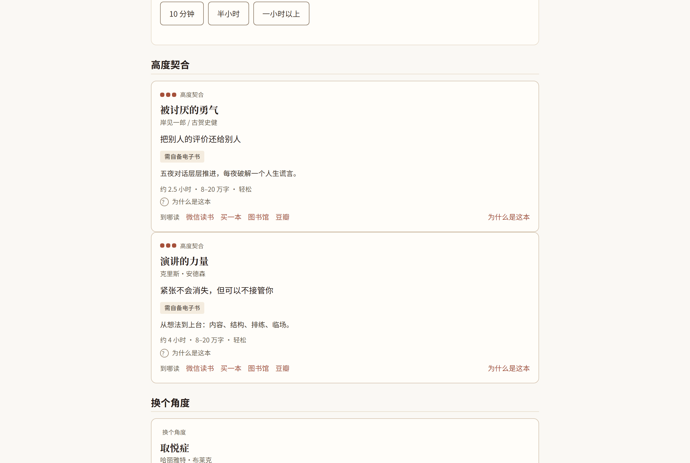
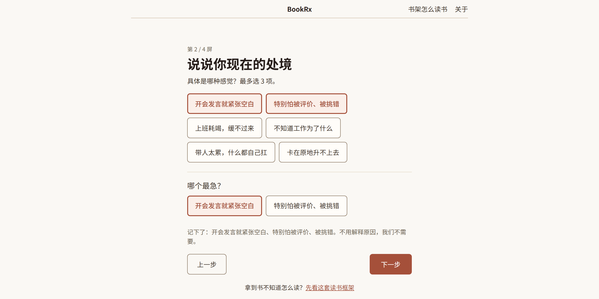
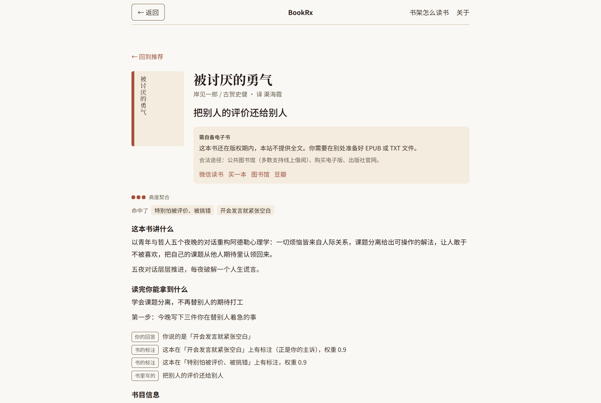
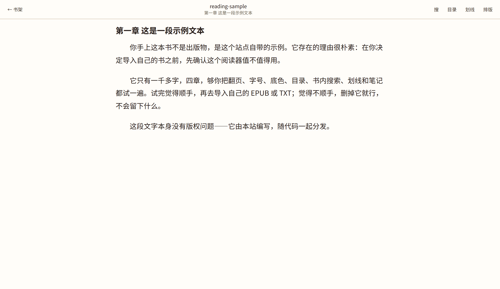

# BookRx（书方）

说清你此刻的困境，它给 5 本确实对味的书，每本说清为什么是它——**能读的直接在这里读。**



纯前端、无账号、无上报、无第三方请求。所有事都在你的浏览器里完成。

```
说困境  →  拿 5 本书  →  当场开读  →  划线做笔记
```

68 本人工逐字段标注的核心库，6551 本候选池；七因子确定性打分，同一份输入永远得到同一份结果。

```bash
npm install
npm run dev
```

想看它长什么样、怎么打分、为什么这么设计 → [`docs/方案总览.md`](docs/方案总览.md)

**在线试用**：<https://qichi666.github.io/bookrx/>

---

<details>
<summary><b>界面</b></summary>

**① 问卷**：第 2 屏选完标签后追问「哪个最急」，主诉由用户显式指定，不按选择顺序猜。



**② 详情页**：可用性区块紧跟书名；每句推荐理由都带来源徽章（你的回答 / 书的标注 / 书里写的）。



**③ 阅读器**：按段落分页，字号 / 行距 / 底色 / 目录 / 书内搜索 / 划线 / 笔记，换字号后位置不丢。



</details>


---

<details>
<summary><b>它解决什么</b></summary>

所有榜单都在回答「哪些书好」，没有人回答「**以我现在的状态，我能读完哪一本，读完会变好吗**」。

BookRx 把**可完成性**当成一等公民：难度、篇幅、文体门槛、可读性都是**打分因子**，不是标签。库内没有合适的书时，它会明说「这些都不对」并给出库外书名，而不是拿三本不对症的书把列表填满。

| 替代方案 | 它回答的问题 | 为什么不够 |
|---|---|---|
| 电商 / 畅销榜 | 最近什么好卖 | 买回来发现不对味，书架越堆越高，形成「买了等于读过」的代偿 |
| 小红书 / 公众号书单 | 一次给 20 本 | 没有一本是为他选的，收藏完一本都不开始 |
| 豆瓣 | 大众平均分 | 无公开 API；8.9 分的书对他可能是 0 分，因为他读不下去 |
| 微信读书 | 有书、有社交 | 推荐按人群偏好；不解决「我该读哪本」 |
| `yzfly/LightRead`（最接近的开源竞品） | 「阅读器 + 顺手几张书单」 | 推荐藏在设置里且**默认关闭**。我们是「诊断器 + 自带阅读器」，主路径就是诊断 |

**目标用户**：22–35 岁、有阅读意愿、但连续 12 个月没完整读完一本书的中文用户。60% 卡在「买了很多、读不完」，30% 是「读了很多、记不住」，10% 想参与共建。

</details>

<details>
<summary><b>推荐是怎么算出来的</b></summary>

```
问卷 / 自由文本 → 诊断 → 硬过滤 → 七因子打分 → 六级排序 → 三档分组 → 5 张卡
```

**1｜诊断**：你在问卷里点选的困境标签按 `0.6 / 0.25 / 0.15` 取权重，主诉由你显式指定（不按选择顺序猜）。你写的那句话如果命中词典里的标签，会按 `max(现有, 0.6)` 并入；命中新标签则按 0.15 追加，且**只进分子不进分母**——否则「说得更具体 = 推荐更没把握」。

**2｜硬过滤**（打分之前，7 条规则码）：用户排除 / 仅元数据 / 无困境标签 / 难度超限 / 认知负荷超限 / 创伤内容 / 临终丧亲。创伤类（自杀、性暴力）**永不可豁免**；临终丧亲可被「我能接受沉重内容」开关豁免——**开关承诺的范围必须等于放行的范围**。

**3｜七因子打分**，权重之和恒为 10000：

| 因子 | 权重 | 怎么算 |
|---|---|---|
| `problem` | 3800 | 困境匹配：覆盖率口径 `Σ min(你的权重, 书的权重) / Σ 你的权重` |
| `difficulty` | 1800 | `10000 − bp(\|书的难度 − 你的目标\| / 4)` |
| `depth` | 1200 | 认知深浅：同档 10000 / 相邻 6000 / 跨档 1500 |
| `form` | 1000 | 文体形态：叙事 / 方法 / 框架 |
| `length` | 1000 | 篇幅档差 0/1/2/3 → 10000/6000/2500/0；「不限」→ 7000 |
| `readability` | 700 | 文字可读性，同 difficulty 的距离算法 |
| `availability` | 500 | 站内可读 10000 / 自备 5500 / 外链 2500 |

- **跳答 ≠ 填中位数**：没答的那组对应的因子整条移除，权重按比例重分配。填中位数会让未观测维度稳定输出 5000 分。
- **可得性不许当主角**：`availability` 归一化后也不许超过 800 基点，超出部分还给其他因子。真正承担「优先推能读的」的是排序第 4 级。
- **不给缺失字段填默认值**：字段没标过的书，对应因子整条不参与打分，并如实报出覆盖率——那是**不知道**，不是**不好**。

**4｜六级全序排序**：分数降序 → problem 契合降序 → difficulty 契合降序 → 可得性升序 → 预计时长升序 → 书 id 升序。最后一级保证全序，链上**不含任何时间字段**（否则结果会随时间漂移）。

**5｜三档**：≥8000 较为契合 / ≥6000 值得一读 / 其余可以试试。阈值是**绝对值不是分位数**——分位数保证每次都有「较为契合」，那档位就没信息了。

两条封顶比阈值更重要：

- **主诉全不命中 ⇒ 封顶「可以试试」**。其余六因子合计 6200，一本完全不沾题的书只要难度、篇幅、体例全中就能混进「值得一读」——而「较为契合」对一本没回答你问题的书是谎话。
- **标注覆盖率不足 ⇒ 封顶「值得一读」**。候选层只有困境标签一类信息（4300/10000），可能非常沾题，但我们不知道它难度、体例、篇幅合不合适。用 43% 的信息讲「高度契合」是编造。

界面上**只给档位，不给百分数**。理由有两条：版权风险；避免「分数崇拜」——推荐的主依据是困境匹配，不是书的好坏。

</details>

<details>
<summary><b>三层书库</b></summary>

三层是**包含关系**，不是并列：

| 层 | 规模 | 有什么 | 怎么用 |
|---|---|---|---|
| 核心库 | **68 本** | 34 个字段齐全，含 5 段预写文案 | 进主推荐池，能出完整理由 |
| 候选池 | **6551 本** | 元数据 + 豆瓣标签 | 宽池「和你这个困境相关的还有 N 本」 |
| 派生标注层 | 6551 本全覆盖 | 由 33 标签词表派生的困境标签 | 让没人工标注的书也能进池，并如实报覆盖率 |

其中 **1872 本**带强证据的困境标签（证据来自书名或人工标注），可以进「同题书」；其余 4679 本只能被搜索框找到，不打分。

**每条证据都记来源，不记书级**：`annotation`（人工/模型标注，0.95）、`title`（书名，0.85–0.9）、`category`（豆瓣大类兜底，0.4）。运行时只放行前两类——大类兜底是 1 对多的抽签（实测 27/33 个标签的兜底占比 ≥80%），拿它推书等于乱推。

评分也爬好了（5646/6551 有分），用**贝叶斯收缩**（`(rating × votes + 50 × m) / (votes + m)`，`votes < 10` 给 null）。但**评分不进契合度**：评分回答「书好不好」，契合度回答「对你合不合适」。评分负责「别推垃圾」——质量档轮转、劣质淘汰、同分排序。

</details>

<details>
<summary><b>四条能力</b></summary>

- **推荐**：硬过滤 + 七因子打分 + 三档分档。同一输入永远得到同一结果，不接大模型、不接推荐服务。
- **导入**：拖进 EPUB 或 TXT，浏览器里解压、切章、落库（IndexedDB）。零依赖，不用上传。
- **阅读**：真翻页（按段落分页）、字号 / 行距 / 底色、目录、书内搜索、划线、笔记。换字号后位置不丢。
- **离线**：装一次 Service Worker，第二次打开不需要联网（除第一次加载）。

</details>

<details>
<summary><b>三条底线</b></summary>

1. **危机优先**：诊断命中危机信号时，只给心理援助热线、不给推荐。结果页与关于页各留一个援助入口，全项目配额恒为 2，多了少一个构建直接失败。
2. **不凑数**：库内没有合适的书就明说，引导重述困境，同时给出库外书名（标「未入库」）。
3. **理由可追溯**：每句推荐理由要么来自预写文案，要么来自打分字段，**不允许模型现编**。界面上每句理由都带来源徽章（书里写的 / 你的回答 / 书的标注），点开能看到它是怎么来的。

</details>

<details>
<summary><b>门禁就是规格</b></summary>

这个项目把「说过的话」尽量变成「跑得起来的检查」。`npm run check` 里的每一条都对应一份文档条款，并且**每条都自己带测试**（既证能红、也证不误红）：

| 命令 | 拦什么 |
|---|---|
| `typecheck` | 契约与实现不一致 |
| `test` | 打分、金标、导入、分页、定位降级、文案一致性 |
| `check:enums` | SPEC / ARCH 与 `src/contracts` 的枚举分叉 |
| `audit:style` | emoji、硬编码色值、单文件超长（src ≤300 行 / tools ≤400 行） |
| `audit:token` | `var(--x)` 引用了不存在的令牌（CSS 不会报错，只会静默丢失） |
| `audit:copy` | 禁词、营销话术、危机页埋点泄漏 |
| `audit:doc` | 文档里的表格列数错位、emoji、失效锚点 |
| `audit:input` | 输入净化缺口 |
| `audit:crisis` | 危机资源的可核实性（必须有来源与核对日期，超期红灯） |
| `data:verify` / `data:map-core` | 书目数据、派生标注与规则逐位一致 |

**三态纪律**：每条检查只能报「通过 / 失败 / **未验证**」。扫描对象为空时必须报「未验证」并非零退出——**「扫到了 0 个文件」不是通过**。用 `|| true`、`console.warn` 代替断言，都是明令禁止的。

**当前状态**：`npm run check` 通过（**54 个测试文件 / 412 条测试**）；浏览器冒烟 45 条断言全过；金标 10 条画像认出率 10/10、首屏率 9/10。

想确认真实浏览器里点得通（单测跑在 happy-dom 里，看不见 CSS、路由、CSP）：

```bash
npm run build
python tools/smoke-browser.py   # 需要 Playwright 的 Python 包 + chromium；端口没人监听会自己起 preview
```

脚本走完「问卷 → 结果 → 危机页 → 关于页 → 导入 → 阅读 → 划线」，断言原词回显逐字来自用户、每句理由都有来源徽章、反馈不落自由文本，并检查控制台零报错。

> 仅支持 HTTPS（或 localhost）：Web Crypto 需要 secure context，不支持 `file://` 直接打开。

</details>

<details>
<summary><b>项目结构</b></summary>

```
src/
  views/        页面装配
  components/   可复用组件
  engine/       业务编排（推荐 / 诊断 / 导入 / 分页 / 定位）
  domain/       纯函数：无 I/O、无 DOM、无 Vue、无随机源、无时钟
  data/         静态数据与词表
  storage/      IndexedDB 读写
  lib/          通用小工具
  contracts/    类型声明，编译后零字节
tools/          构建期脚本（抓取 / 标注 / 派生 / 审计 / 冒烟）
tests/          54 个测试文件，412 条测试
catalog/        书目数据（不在 MIT 范围内）
docs/           24 篇文档，约 1 万行
```

规模：源码 116 个文件 / 约 1.3 万行，测试 54 个文件 / 约 5.8 千行，门禁脚本 28 个。

`domain/` 里出现 `Math.random` 或 `Date.now` 会被测试拦下——**可复现是推荐结果的前提**。

</details>

## 数据从哪来

| 数据 | 来源 | 授权 |
|---|---|---|
| 核心库 68 本的书目与文案 | 本站编写 + 公开书目信息人工核对 | 随代码 MIT |
| 候选池 6551 本的元数据（书名 / 作者 / 出版社 / 年份 / 豆瓣评分与标签） | 抓取自豆瓣公开书籍页面 | **不在 MIT 授权范围内** |
| 困境标签词表（33 个）与派生规则 | 本站编写 | 随代码 MIT |
| 危机援助资源 | 公开渠道，逐条标注来源与核对月份 | 随代码 MIT |
| 你导入的书、划线、笔记 | 只在你自己的浏览器里 | 不经过任何服务器 |

**关于候选池数据**：它派生自第三方站点，本站无权以 CC 协议再授权——用一个自己并不拥有的权利去授权，比不授权更糟。所以 `catalog/` 下的书目数据只作**演示数据集**随仓库分发，**不在 MIT 授权范围内，请勿单独抽取再分发**。抓取脚本在 `tools/fetch-douban.mjs`，带限速与礼貌抓取；`catalog/raw/` 是原始抓取件（只含事实性元数据，**不含任何正文或简介**），`tools/fetch-intros.mjs` 抓到的简介只进本地缓存（`.cache/`，已 gitignore，不入库）。

**关于千本级标注通道**（`docs/标注通道.md`）：`tools/fetch-intros.mjs` 取证 → `tools/annotate-books.mjs` 用模型标注 → **证据闸**逐条校验：每个标签必须附 ≤40 字原文逐字引文，`normalize(evidence) ⊆ normalize(原文)`，不通过就丢弃并记账。放量前先在 29 本「真有人标过标签」的书上校准，**精确率 ≥70%、召回 ≥50%** 才许放量。

> 这条通道**只在构建期跑**，运行时零模型调用、零外部请求。要跑它需要自己准备 `DEEPSEEK_API_KEY`（见 `.env.example`）；没有 key 项目照常可用。

## 导入与版权

- 本站**不提供任何版权书的正文**，也不绕过 DRM。导入的是你自己合法持有的文件。
- 明确拒绝：受 DRM 保护的书（`E_DRM_PROTECTED`）、超过 50 MB 的文件、没有文字层的扫描件。
- 导入书**不进入推荐池**（`content_ready='readable'` 会被硬过滤挡掉）——我们不对自己没读过的书做推荐。
- 内置示例书由本站编写，随代码分发，不涉及第三方版权。
- 站内可直读的公版书，`copyright_basis` 与 `translation_copyright` 由 `tools/copyright-audit.mjs` 逐本校验：中译本的译者有独立著作权，原作进入公有领域**不代表译文可以自由分发**。

## 路线图

- [x] 诊断 → 推荐 → 当场能读 → 记住 的完整主链路
- [x] EPUB / TXT 导入、阅读器、划线、笔记、离线
- [x] 千本级模型标注通道（取证 → 标注 → 证据闸 → 接入）
- [ ] 补齐薄标签池（`big-choice` / `emptiness` 各只有 2 本）
- [ ] 100 本小测 + 间隔复习（FSRS）
- [ ] 社区反馈替代外部金标

## 文档

- [`docs/方案总览.md`](docs/方案总览.md) — **一份可直接转交其他 AI 的完整上下文**，读完即可接手
- [`docs/SPEC.md`](docs/SPEC.md) — 唯一契约；其余文档与它冲突时以它为准
- [`docs/ARCH.md`](docs/ARCH.md) — 架构、错误码表、黄金算例
- [`docs/PLAN.md`](docs/PLAN.md) — 里程碑与执行状态
- [`docs/HANDOVER.md`](docs/HANDOVER.md) — 交接：进度、已知陷阱、下一步
- [`docs/标注通道.md`](docs/标注通道.md) — 千本级标注通道的设计与实测
- [`docs/decisions/`](docs/decisions) — 架构决策记录（ADR，含被牺牲的选项）

## 参与

见 [`CONTRIBUTING.md`](CONTRIBUTING.md)。最需要的两种反馈：

1. **书单不对味**：把你实际遇到的困境和它给出的 5 本贴出来（`Issues → 书单反馈`）。
2. **导入失败**：附上文件格式（EPUB / TXT）、大小、错误码，**不要附全文**。

## 许可

代码以 [MIT](LICENSE) 授权。`catalog/` 下的书目数据是演示用数据集，**不在 MIT 授权范围内**，请勿单独抽取再分发。
