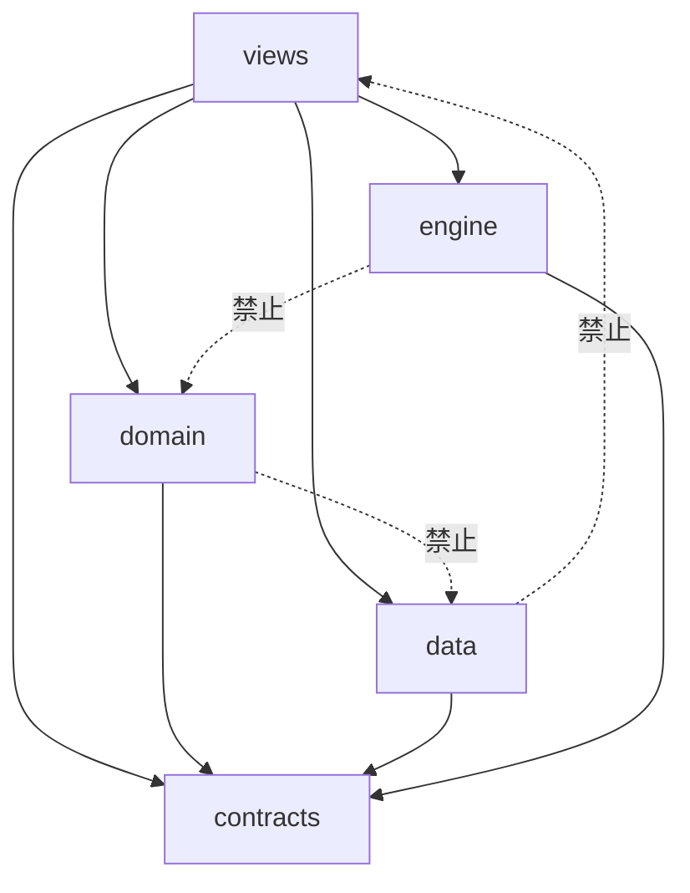

# BookRx 架构文档（产品名待定）

- 版本：v1.0（MVP 技术基线）
- 日期：2026-10-18
- 作者：高见远（首席架构师）
- 状态：待评审 → 通过后作为 Phase 2 前后端并行开发的唯一依据
- 配套产物：`docs/types-draft.ts`（类型契约）、`docs/decisions/ADR-001..008.md`（决策留痕）

---

## §0 一页摘要

| 项 | 结论 |
|---|---|
| 产品本质 | 一个诊断器，自带一个阅读器。不是书城，不是书单 |
| 技术形态 | 纯静态 SPA，无后端，无账号，数据全在浏览器 IndexedDB |
| 分层 | 视图层 → 领域层 → 数据层，另有独立的引擎层，四层依赖只向下；`contracts/` 为类型唯一来源（零运行时） |
| 技术栈 | Vue 3.5.43 + TypeScript 5.9 + Vite 8.1 + Dexie 4.4；阅读引擎 foliate-js（git submodule 锁 commit）；图标 Lucide 单套 |
| 推荐算法 | 6 步顺序固定：**① hardFilter → ② score（7 因子，权重和 10000）→ ③ rank（6 级全序链）→ ④ slotAssembly（5 本：1 破冰 + 3 深化 + 1 换角度）→ ⑤ relax（L0–L4）→ ⑥ tier**；全序比较器保证同输入同输出 |
| 符合度呈现 | 三档固定为 `strong` / `worth` / `explore`（显示名：高度契合 / 较为契合 / 换个角度），判定**直接比 `score_bp` 绝对值**：≥8000 / 6000–7999 / <6000，不做归一化、不给百分数；**外加一条硬封顶：主诉未被覆盖（`primary_hit = 0`）时档位封顶 `explore`，与总分无关**；每档配 2–4 个命中依据（用户原词）+ 一句边界声明；第一编码是可数方块 3/2/1 |
| 理由生成 | PRD 三段式（回引处境 / 书讲什么 / 读完得到什么），`{{slot}}` 变量替换，模板与文案存 JSON；S1 强制回引用户原词，S3 可整段不生成（宁可少一段不可编一段）；零模板引擎 |
| 书库 | 首发 300 本 → v1.0 前 800 本 → 架构上限 3000 本（静态 JSON，列式编码，构建期生成检索索引）；库外靠"导入即入库 + 元数据降级"兜底 |
| 首屏预算 | catalog 120 KB gzip（22+85+10+3）+ 应用 JS 117 KB gzip（105 JS + 12 图标）+ 字体子集 4 KB ≈ **241 KB gzip**；阅读器 chunk 145 KB gzip 懒加载。中文**不自托管 webfont**（Noto Serif SC 单包 8–10 MB），CI 门禁：产物内不得出现 >200 KB 的 .woff2 |
| 最大工程风险 | 标注锚点在"用户自行导入的不同版式同一本书"之间不可迁移（CFI 只对同一份文件稳定）→ 必须引入引文锚点做二级定位 |
| 最大数据风险 | 6 个标注字段（difficulty / prose_accessibility / est_reading_hours / entry_level / depth / form）× 首发 300 本 = **1800 个标注点**，加上 300 本 × 4 段人工文案（one_line_what / one_line_gain / first_action / match_brief）。这是本项目最重的人力成本，任何"以后补"的想法都会让推荐失效 |
| 最大法律风险 | 原著公版 ≠ 中译本公版。已把该判断编码成构建期硬门禁（§6.3） |

---

## §1 总体架构

### 1.1 分层与依赖方向

```
┌─────────────────────────────────────────────────────────────────────┐
│ L4 视图层  views/ components/                                       │
│   诊断问卷 · 推荐列表 · 书籍详情 · 阅读器 · 笔记本 · 复习            │
│   只做装配与交互；不含算法，不直接碰 IndexedDB                       │
└───────────────┬──────────────────────────┬──────────────────────────┘
                │                          │
┌───────────────▼──────────────┐  ┌────────▼───────────────────────────┐
│ L3a 领域层  domain/          │  │ L3b 引擎层  engine/                │
│ 四步问卷→信号 · 硬过滤 ·     │  │ 格式嗅探 · 导入流水线 ·            │
│ 多样性 · 放宽 · 分档 ·       │  │ foliate-js 桥接 · CFI 编解码 ·     │
│ 理由渲染 · FSRS 调度         │  │ TXT book 适配器 · 宿主 CSP          │
│ 纯函数：无 I/O、无 DOM、     │  │ 唯一允许 import foliate-js 的地方  │
│ 无 Vue、无 Dexie             │  │ 不 import domain（引擎不知道推荐）  │
└───────────────┬──────────────┘  └────────┬───────────────────────────┘
                │                          │
┌───────────────▼──────────────────────────▼──────────────────────────┐
│ L2 数据层  data/                                                    │
│ Dexie schema · 用户书库 repo · 标注/笔记/进度/复习卡 repo ·          │
│ 静态 catalog 加载与检索 · 存储配额探测                               │
│ 只做读写与映射；不含业务规则                                        │
└───────────────┬─────────────────────────────────────────────────────┘
                │
┌───────────────▼─────────────────────────────────────────────────────┐
│ L1 基础设施  IndexedDB · 静态资源（/catalog /shards）· fetch         │
└─────────────────────────────────────────────────────────────────────┘

┌─────────────────────────────────────────────────────────────────────┐
│ L0 契约层  contracts/  —— 类型声明，编译后零字节，任何层可依赖        │
│ BookId · Locator · ThemeTagId · ProgressEvent · 实体接口 · 错误码     │
└─────────────────────────────────────────────────────────────────────┘
```

Mermaid 依赖图（CI 用它校验，不许有反向边）：



### 1.2 三条不可越的边界（附执行方式）

| # | 边界 | 为什么 | 怎么强制 |
|---|---|---|---|
| 1 | 领域层不许有 I/O | 评分/排序/理由是全部产品的判断力所在，必须能用纯函数单测（含变异测试），一旦混入 Dexie 或 `document` 就无法在 Node 里跑 | `eslint no-restricted-imports` zones：`domain/**` 只允许 `contracts/**`；再配一条 jest 用例遍历 `domain/**` 源码断言不含 `dexie`/`window`/`document`/`vue` |
| 2 | 引擎层不许认识"推荐" | 阅读引擎要能独立升级/替换（foliate API 不稳定）。若引擎引用领域模型，升级时牵动整个业务 | eslint zones：`engine/**` 不许 import `domain/**`、`views/**` |
| 3 | foliate-js 只能从 `engine/foliate/` 引入 | 上游无 release、API 随时破坏，收敛到一个目录才可能平滑升级 | CI 门禁：`grep -rn "foliate" src --exclude-dir=engine` 必须零命中 |

### 1.3 一次完整交互的数据流（推荐）

```
问卷页 views/diagnose
  └─ answers ─────────────► domain/diagnose/axis-mapping  → axes(4 个 0..100 整数)
  └─ 自由文本 ────────────► domain/diagnose/keyword-tagger → need_tags(≤6 个 tag+权重)
                                   │
                                   ▼
                     data/catalog/load-index（已常驻内存的 3000 行列式数据）
                     data/repo/user-books.repo（用户导入的书，合并进候选池）
                                   │
                                   ▼
                     domain/recommend/score    → factor fits（7 个 0..10000）
                     domain/recommend/rank     → 定点整数加权 + 确定性 tie-break
                     domain/recommend/diversify → 作者/主题配额
                     domain/recommend/relax    → strong+worth < 2 时按阶梯放宽
                     domain/recommend/tier     → 三档
                                   │
                                   ▼
                     domain/reason/render      → 三段文案（含可选"不匹配"提示）
                                   │
                                   ▼
                     data/catalog/load-shard   → 按需拉 top-N 的详情分片
                                   │
                                   ▼
                 views/recommend  渲染卡片（只用 tier + 逐本理由，不出现百分数）
```

---

## §2 数据模型

> 完整 TypeScript 声明见 `docs/types-draft.ts`。本节给出字段语义、约束与来源；类型文件与本节必须逐字段一致，任何不一致以本节为准并回改类型文件。

### 2.1 实体关系

```
Book（核心库 3000 + 用户书 N，统一形状）
 ├─< Recommendation >── Diagnosis
 ├─< Annotation ──< Note
 ├─< QuizItem ──< ReviewCard
 └─1 ReadingProgress / < ProgressEvent（环形保留 200 条）

Author（构建期字典）      ProblemTag（32 个，6 域，打分用）
ThemeTag（48 个，8 族，浏览/搜索用）      CategoryL1（6 域）
```

单实体原则：**用户导入的书与核心库的书是同一个 `Book` 类型**，差别只在 `availability`、`problem_tags` 是否可得，与字段完整度（`content_ready` 标记）。理由：推荐打分、详情页、阅读器、笔记本四条链路上不能出现"两种书"的 if 分支，否则每加一个功能要写两遍。

### 2.2 `Book`（字段名与口径以 PRD §8、§7.1 为准）

> **命名对齐说明**：架构初稿用过 `one_liner` / `payoff_by_tag` / `entry_level` / `form` / `depth` 等字段，与 PRD 定稿的 `one_line_what` / `one_line_gain` / `first_action` / `structure_note` / `est_reading_hours` / `problem_tags` / `category_l1` 不一致。**以本节的 PRD 命名为准**，`docs/types-draft.ts` 已同步。理由：这些字段是编辑/标注人员每天填的东西，字段名必须与他们手里的表一致，否则每次交付都要做一次人工翻译。

| 字段 | 必填 | 类型 / 取值 | 约束 |
|---|---|---|---|
| `book_id` | 是 | `core:<6 位定宽>` \| `user:<hex16>` | 一经生成永不改 |
| `title` | 是 | string | 1–80 字，已剥离书名号 |
| `author_ids` / `author_display` | 是 | string[] | 等长同序；无署名填 `unknown` |
| `translator` | 否 | string | 中译本必填，版权闸门依赖 |
| `isbn13` | 否 | string | 13 位且校验位合法 |
| `problem_tags` | 是 | `{tag, weight}[]` | 1–4 项，weight ∈ [0.1,1.0] 一位小数，必须属 48 词表。**`topic` 因子的唯一依据**；缺失 ⇒ 不入个性化池 |
| `theme_tags` | 是 | `{tag, weight}[]` | 2–6 项，同上取值。用于浏览 / 搜索 / 相邻域，**不参与打分** |
| `category_l1` | 是 | `'文学'\|'心理'\|'思想哲学'\|'社科'\|'传记'\|'其他'` | 用于多样性配额与按文体浏览 |
| `difficulty` | 是 | 1–5 整数 | 内容难度 |
| `prose_accessibility` | 是 | 1–5 整数 | 1 = 最易读 |
| `depth` | 是 | `'howto'\|'howto_why'\|'why'` | 与 3-e 一一对应：具体做法 / 做法加为什么 / 底层原理。**不用 1–5**：chip 只有 3 档，标 5 档等于造假精度 |
| `form` | 是 | `'story'\|'method'\|'framework'` | 与 3-d 一一对应：一个人的故事 / 一套方法 / 完整框架 |
| `entry_level` | 是 | 1–5 整数 | 1 = 零前置 |
| `length_class` | 是 | 1–4 整数 | <8 万 / 8–20 万 / 20–40 万 / >40 万 |
| `word_count` | 否 | number | 用于详情展示与时长估算 |
| `est_reading_hours` | 是 | number | **人工估算**，不用字数÷固定速度（文言可低到 150 字/分，通俗读物 700+）。构建期校验 `word_count / est_reading_hours ∈ [100,800]`，超界进人工复核 |
| `availability` | 是 | `'inline'\|'bring_your_own'\|'external'` | **唯一判定依据**，禁止临时推断 |
| `copyright_basis` | 是 | `'public_domain_cn'\|'public_domain_origin'\|'licensed_free'\|'in_copyright'\|'metadata_only'` | |
| `translation_copyright` | 是 | `'none'\|'public_domain'\|'in_copyright'\|'unknown'` | |
| `public_domain_reason` | 条件 | `'author_death_50y'\|'ancient_text'\|'gov_work'\|'cc_license'` | `copyright_basis` 含 public_domain 时必填 |
| `source_url` | 条件 | URL | `availability ≠ external` 时必填 |
| `one_line_what` | 是 | string | 60–90 字，客观讲「这本书讲什么」 |
| `structure_note` | 否 | string | **≤38 字，必须以句号结尾**（卡面只渲染这一句，见 §4.2），区别于同题的切入 |
| `one_line_gain` | 是 | string | ≤35 字，「读完能得到什么」的工具/视角部分 |
| `first_action` | 是 | string | ≤30 字，**必须含动词短语**，构建期校验 |
| `match_brief` | 是 | string | **≤28 汉字**，按书预写，卡片第二行；不是书摘，是「这本对你的处境」 |
| `boundary_hints` | 否 | `Partial<Record<FactorId,string>>` | ≤30 字/项，某因子低分时的诚实提示 |
| `publisher_summary` | 否 | string | ≤120 字，S2 缺素材时降级用，渲染须标注「简介来自出版方」 |
| `content_warning` | 否 | `ContentWarning[]` | **7 值，完整枚举只写在 §3.1 一处**，本表不再列第二份——这里列过 5 值而 §3.1 是 7 值，两次改一处漏一处的就是这一行。参与硬过滤（F4 / F6）。**枚举与规则必须同批改** |
| `series_id` | 否 | string | 同系列去重 |
| `core_match` | 否 | `{book_id, method:'isbn'\|'title_author'}` | 仅用户书 |
| `content_ready` | 是 | `'full'\|'readable'` | `readable` = 用户导入书缺打分字段：能读，但不入个性化推荐池。**不要再加 `completeness` 字段**，「能不能读」由 `availability` 唯一表达 |
| `data_version` | 是 | `YYYY.MM.DD` | 缓存校验 |

**本表逐行取自 `docs/SPEC.md` §5.2，字段数 34（`author_ids` / `author_display` 合并为一行）。ARCH 不再持有自己的字段口径。** `docs/types-draft.ts` 的 `Book` 接口必须与之逐字段一致——CI 用 `catalog:audit` 输出的字段清单与 `keyof Book` 对拍，多一个少一个都 fail。


**标注工作量（修正 R2 的结论）**：初稿的 7 因子方案要求每本填 `difficulty` / `prose_accessibility` / `depth` / `form` / `entry_level` 五个 1–5 字段；对齐 PRD 问卷后，`depth` 与 `form` **没有任何问卷输入与之对应**（PRD 问卷不问"要原理还是要做法"，也不问"要故事还是要框架"），保留它们等于让 22% 的权重变成常数项——那不是可解释，那是假装可解释。因此：

- **数值标注字段从 5 个降到 3 个**（`difficulty` / `prose_accessibility` / `est_reading_hours`）。
- 首发 300 本 × 3 = **900 个数值标注点**（原方案 1500 个），两人一致性校验的成本降到可完成的范围。
- 代价：理由与排序失去"深浅/体例"这两个解释维度。**这是有意识的取舍**，如果后续问卷加入对应题目，再按 §3.3 的扩展位补因子（`weights.ts` 里预留了 0 权重的 `depth`/`form` 命名，加因子不需要改数据结构）。

### 2.3 `Diagnosis`（PRD 四步问卷 → 打分输入）

PRD §7.1 的问卷是 4 步，架构侧不重新设计问卷，只定义"每一步产出什么信号"：

| PRD 步骤 | 用户看到 | 产出信号 | 用途 |
|---|---|---|---|
| 第 1 步「最想解决哪一类」 | 6 域单选 + 「说不上来」 | `domain: ProblemDomain`（+ `adjacent_domains`：相邻 2 域，构建期常量表，**运行时算不落库**） | 候选池、`EX-*` 的用户条件、S5 换角度位 |
| 第 1 步补充（选「说不上来」时才出现）「最近哪块最耗你」 | 6 个具体场景 | `domain` + 首轮 `problem_tags` | 让"说不清"的用户仍能出结果（PRD：这不是失败态） |
| 第 2 步「具体是哪种感觉」 | 多选 ≤3 项 | `need_tags`：主诉 **6000** / 次诉 **2500** / 第三 **1500**（万分制，见 §3.3），**并保留选项原文作为 `user_phrase`**；选了 ≥2 项时**同屏**追问「这些里面，哪个是你现在最想先解决的？」→ `primary_tag` | `problem` 因子 + `primary_hit` 封顶（§3.6）+ S1 回引 + 命中依据 |
| 第 3 步「读书条件」 | 全部组 chip（**组数以 SPEC §6.1 为唯一出处，当前 5；本文件不写死**；答案键与取值同处，**ARCH 不复述第二份清单**） | **运行时派生、不落库**：`hours_max` ∈ {3, 7, 20}、`difficulty_cap` ∈ {2, 3, 5}、`length_class` 目标、`form`/`depth` 目标 | `EX-*` 硬过滤 + `difficulty`/`length`/`form`/`depth`/`readability` 因子 |
| 第 3 步附带「这类内容里有涉及临终或丧亲的，要不要一起看？」 | 二选一，**默认「先不用」、不预选、不记忆** | `include_heavy`（**内容偏好，不是「我能承受」的自我声明**） | **只豁免 F6 / `EX-terminal`，不豁免 F4 / `EX-trauma`** |
| 第 4 步「还有想说的吗」 | 自由文本 ≤140 字 | 词典命中追加 `need_tags`（weight 0.5，`source='free_text'`），**并把命中的原词片段留作 echo 素材** | `problem` 因子 + S1 回引 |

| 字段 | 必填 | 类型 | 约束 |
|---|---|---|---|
| `diagnosis_id` | 必填 | string（UUID v4） | 本地生成 |
| `created_at` | 必填 | number | epoch ms |
| `answers.domain` | 必填 | `ProblemDomain`（6 域） | **不是 `CategoryL1`**：前者是用户的问题域，后者是书的文体（见 §3.2） |
| `answers.problem_tags` | 必填 | `ProblemTagId[]`（≤3） | 权重按序 6000 / 2500 / 1500（§3.3） |
| `answers.primary_tag` | 必填 | `ProblemTagId` | 第 2 屏同屏追问产出（只勾 1 项时即该项），`primary_source` 记 `'explicit'` / `'single'`，**`'order'` 不存在**。`problem` 权重分配、`primary_hit` 与档位封顶、S1 回引顺序三处都读它——**没有它，`problem` 就只是一堆标签，没有主诉**。**必须落库，不许运行时重算**：重算意味着这三处将来可能得出不同答案 |
| `answers.time_budget` 等五键 | 选填 | 见 SPEC §6.1 | **允许整组缺失（跳答）**，缺失即该组驱动的因子被移除 + 权重按比例重分配（§3.10） |
| `answers.free_text` | 选填 | string | 原文保留（≤140 字），用于回引原词 |
| `need_tags` | 必填 | `NeedTag[]`（≤6） | 每项含 `tag` / `weight` / `source` / **`user_phrase`** |
| `include_heavy` | 必填 | boolean | **内容偏好，不是「我能承受」的自我声明**。默认 `false`、来自显式勾选、不预选、每次重问。只豁免 F6 / `EX-terminal`，不豁免 F4 / `EX-trauma` |
| `excluded_book_ids` | 选填 | `BookId[]` | 用户标记"读过/不想看" |

**本表不存派生值。** `difficulty_cap`（2/3/5）、`hours_max`（3/7/20）、`adjacent_domains`、各因子 `target`、`trauma_guard` 全部**运行时从 `answers` + `include_heavy` 算**。存下来会出现"规则改了、老记录还是按老规则算"的分叉，而且**它不报错**——半年后复盘会发现同一份诊断两次跑出不同档位，查不出为什么。**凡是有映射表的字段，存输入、算输出。**

**为什么 `answers` 里那五个键是具名的、而域和标签不是**：域与标签是"用户说了什么"，五键是"用户在什么条件下读"；前者的取值来自受控词表（构建期能校验），后者的取值来自 SPEC §6.1 那张四列表（**唯一出处，ARCH 不存第二份清单**）。两类都只存用户选择，区别只在谁定义枚举。**后文写 `Diagnosis.primary_tag` 的地方，一律指 `answers.primary_tag`**——它在 SPEC 与 `types-draft.ts` 里都嵌在 `answers` 下，正文里为省字省掉了前缀，但实现时不许在顶层再开一个。

`need_tags.user_phrase` 是本版新增的关键字段：PRD §8.1 要求 S1 **必须回引用户原词**，若 `Diagnosis` 只存 tag id，渲染层就拿不到原词，只能 paraphrase 成通用描述——那正是 PRD 明令禁止的。所以原词必须在诊断阶段就随 tag 一起存下来。

### 2.4 三个数值字段的锚点（把主观判断变成可复现标尺）

| 字段 | 1 | 3 | 5 |
|---|---|---|---|
| `difficulty` | 一个下午能读完，核心概念不超过 3 个 | 需要一定专注，但不需前置知识 | 需要背景知识 + 反复回读，单章信息密度是普通章节的数倍 |
| `prose_accessibility` | 短句、口语、每段一个意思、术语少 | 书面语，术语有解释 | 长句嵌套、术语不解释、大量抽象名词 |
| `est_reading_hours` | ≤2 小时 | 4–8 小时 | ≥15 小时 |

`est_reading_hours` 的构建期校验（防止标注随手填）：`word_count / est_reading_hours` 必须落在 **100–800 字/分钟** 区间，超界告警并进人工复核队列。依据：中文默读约 400–600 字/分钟，文言与理论书可低至 150–200，通俗读物可到 700+。超界说明标注与字数至少有一个错了。

### 2.5 `Recommendation`

| 字段 | 必填 | 类型 | 说明 |
|---|---|---|---|
| `book_id` | 必填 | `BookId` | |
| `diagnosis_id` | 必填 | string | |
| `score_bp` | 必填 | number（0–10000） | 定点整数，见 §3.4 |
| `tier` | 必填 | `'strong' \| 'worth' \| 'explore'` | 高度契合 / 较为契合 / 换个角度。**禁止 `high`/`mid`/`low`**（§3.6） |
| `factors` | 必填 | `Record<FactorId, { fit_bp; weight_bp; contribution }>` | `contribution = floor(fit_bp*weight_bp/10000)`，**5 项相加必须严格等于 `score_bp`** |
| `weights_used` | 必填 | `Record<FactorId, number>` | 实际权重（缺失信号重分配后），用于复现 |
| `slot` | 必填 | 1 \| 2 \| 3 \| 4 \| 5 | 槽位（破冰 / 深化 / 换角度），见 §3.7 |
| `relax_level` | 必填 | 0–3 | 放宽级别，见 §3.8。**不会等于 4**：L4 是无结果，不产出 `Recommendation` |
| `promoted_for_icebreak` | 必填 | boolean | `true` = 这本书是被 S1 破冰位的**降级路径**顶上第 1 位的（本来轮不到它）。埋点用它区分"真正够格当破冰位"与"被顶上来"，UI 用它决定是否强制附 `reason.mismatch`（§3.7 降级 1–3） |
| `rank` | 必填 | number（1-based） | 最终名次，与 `slot` 一致 |
| `reason` | 必填 | `{ situation: string; promise: string; payoff?: string; mismatch?: string }` | 已渲染文本，无占位符，**键名与可选性以 SPEC §5.3 为准**。段名 S1/S2/S3 是排版顺序的称呼，对应 `situation` / `promise` / `payoff`（§4.1）；**`mismatch` 是"边界声明"的唯一载体**（卡面「不过：…」行），§4.1 的 `boundary_hints` 只是它的素材，不另立字段。缺 `one_line_gain` 时**整个 `payoff` 键省略**——不写空串、不兜底编一句：空串能通过 `typeof === 'string'` 和任何"字段存在"类校验，于是"没生成"与"生成为空"在类型上永远分不开；省略键在 JSON 里 0 字节，渲染层 `if (!reason.payoff) return null` 一样成立 |
| `hit_points` | 必填 | string[]（2–4 项） | 命中依据，**取自用户原词**（PRD §7.3 层②）。这是可解释性的实体，不是装饰 |
| `capped_by_primary_miss` | 选填 | boolean | `true` = 主诉未被覆盖，档位被封顶为 `explore`（§3.6）。**只改标签不改分数**：`score_bp` 仍是真实分数。生产构建必须存在——它是"这本科普书 6195 分却标『换个角度』"的唯一解释来源 |
| `tie_break_trace` | 选填 | string[] | 仅调试构建 |

另需一个**被过滤记录**类型，供验收（§11 V1 要断言"难度超预算的书确实被剔除，而不是分数低"）：

```
// contracts/scoring.ts —— L0 契约层：只放类型，编译后必须零字节
type FilterRule =
  | 'EX-difficulty' | 'EX-load' | 'EX-trauma' | 'EX-terminal'
  | 'no-problem-tags' | 'excluded-by-user' | 'metadata-only';

interface FilteredBook {
  book_id: BookId;
  rule: FilterRule;
}
```
```
// src/scoring/filters.ts —— 码表在实现侧，不在 contracts
const FILTER_RULES = [
  { code: 'EX-difficulty' },   // difficulty > difficulty_cap
  { code: 'EX-load' },         // entry_level ≥ 4 && 认知负荷 < 40
  { code: 'EX-trauma' },       // suicide/sexual_abuse × 域=情绪与自我 × 越轻松（不可豁免）
  { code: 'EX-terminal' },     // grief/terminal_illness × 同上 × include_heavy=false
  { code: 'no-problem-tags' },
  { code: 'excluded-by-user' },
  { code: 'metadata-only' },   // content_ready ≠ 'full'
] as const;
```
**为什么不把码表塞进 `contracts/`**：契约文件自己的规矩是**只放类型、编译后零字节**——塞一张 `const` 进去，它就从"契约"变成"运行时代码"，L0 的边界当场破了。所以这里没有"派生"可用，只剩**双向比对**：

`tools/check-enums.mjs` 取 `FILTER_RULES.map(r => r.code)` 与 `contracts/scoring.ts` 里 `FilterRule` 的成员集合比对，**数量 == 7 且排序后逐项相等**；任一侧多一个、少一个、改个名都 fail。同一套脚本管 `ContentWarning`（7 值）、`Tier`（3 值）、`ProblemDomain`（6 值）。

> **双向比对比单向派生弱一档，所以它必须由闸门强制跑。** 派生能保证"只有一个地方能改"；比对只能保证"改完两边一样"，中间那一小段时间两边可以不一致。**弱一档的保证，只有在每次提交都跑的前提下才等价**——否则它只是一份"看起来有约束"的注释。
> **所以它必须是 CI 的必过项，不能放进"可选检查"**：可选检查会退化成"本地跑过、CI 没跑"，而那种状态比没有检查更糟——**它让人以为验过了**。这条对应的病根是：`'EX-load'`（当时叫 `R2-entry-level`）曾经是"F3 在用、类型里没有"，一路编译绿灯，因为**没有任何东西要求两边一致**。

**这个脚本现在还不存在**（M0 才建）。当前的机械保障只有**一次性命令**：抽 `SPEC §5.2` 那一格得集合 A，并把 7 个值字面打印出来。

**在它落地之前，任何报告不许写"已就绪"，只能写「当前唯一的机械保障是一次性命令，闸门尚未存在」。** 能力没上线时说清它没上线，比说"已就绪"有用——这与 `copy-audit` 打出「未验证」是同一条纪律：**没跑过的检查不许借别人的绿。**

**`check-enums` 抓不到的一类，明确不设闸门**：PRD 里"某枚举以 SPEC §X 为唯一出处"这类句子，可以机器验"该段不出现字面值"，但 md **没有作用域**——"本节不讲 X，X 见 SPEC；顺带说，X 有个特例 Y"是合法写法，特例里出现字面值也合法。作用域只能取"整句 / 整段 / 到下一个标题"，三种都会误报某一种合法写法，于是又回到"会因为合法引用而红、然后被人删掉"的老路。**处理方式：记成 PRD 侧的自律，不设闸门。** 一个会误报的脚本比"写的人记住"更差——**"记住"至少不会在误报之后被删掉、然后连自律一起消失。**

**`ContentWarning` 那一路直接从 SPEC 抽，不建第二种形态**：SPEC §5.2 那一格本身就是 TypeScript 字面量联合，用 `/`'([a-z_]+)'`/g` 抽出引号内的值即可——反引号与 `\|` 转义都不影响引号内部。**不建带标记的 fenced json 块，也不建 `contracts/enums.json`**：那是给契约加第二种形态，而脆弱的是整张表的排版，不是这一个 cell。

> **抽出来之后必须把集合打印出来**（形如 `{suicide, violence, sexual_abuse, eating_disorder, addiction, grief, terminal_illness}` 共 7 个）。只打印"通过"的脚本，出问题时**没人看得出它到底抽到了什么**——而"只抽到 5 个 / 抽到了相邻单元格的值"这类错，只有在把集合打出来的那一刻才看得见。
> 判据：**一个只在失败时才说话的检查，等于放弃了"抽对了没有"这一整类信息**；成功路径也要说一句"我抽到了什么"。
`RecommendationSet` 里带 `filtered: FilteredBook[]`（仅调试/验收可见，UI 不展示）。

### 2.6 `ReadingProgress` 与 `ProgressEvent`

| `ReadingProgress` | 必填 | 类型 | 说明 |
|---|---|---|---|
| `book_id` | 必填 | `BookId` | 主键 |
| `locator` | 必填 | `Locator \| null` | 最近位置；从未打开为 null |
| `furthest_locator` | 选填 | `Locator \| null` | 最远位置，用于"读完"判定与回跳选择 |
| `percent` | 必填 | number | 0–1，三位小数 |
| `total_reading_ms` | 必填 | number | 累计前台阅读时长 |
| `last_opened_at` | 必填 | number | |
| `finished_at` | 选填 | number | percent ≥ 0.98 且用户确认后写入 |

`ProgressEvent`（四共享契约之一）：

| 字段 | 类型 | 说明 |
|---|---|---|
| `book_id` | `BookId` | |
| `kind` | `'open' \| 'relocate' \| 'close' \| 'finish'` | |
| `locator` | `Locator \| null` | `open` 时为恢复位置 |
| `percent` | number | 产生事件时的进度 |
| `at` | number | epoch ms |
| `session_id` | string | 一次阅读会话一个 id，用于统计单次时长 |

写入策略（这是移动端不卡的硬约束）：
- `relocate` 在内存里合并，**节流 500ms + 尾沿 flush**；`close`/`finish` 强制立即落库。
- `ReadingProgress` 用 `put` 覆盖（每本一行）；`ProgressEvent` 只保留最近 200 条（写入同事务删除更早的），不无限增长。
- `total_reading_ms` 用"前台可见时长"累加：`visibilitychange` 隐藏即暂停计时。理由：不做这个，用户把页面挂在后台一晚，进度统计会失真成 8 小时。

### 2.7 `Annotation` / `Note` / `QuizItem` / `ReviewCard`

| 实体 | 关键字段 | 约束与决策 |
|---|---|---|
| `Annotation` | `annotation_id`、`book_id`、`locator: RangeLocator`、`quote`（≤500 字）、`created_at`、`note_id?` | **v1 只有一种划线色，因此不设任何颜色字段**。理由不是"设计不用"，是 a11y：四色被做成等亮度（彼此对比 1.001–1.046:1）以保持正文对比度不变，而等亮度的代价是只能靠色相区分——松绿 `#679982` 与褐玫 `#A2646A` 在红绿色盲（男性约 8%）下几乎重合。多色若上线必须再加非颜色标记（行首符号 / 边线虚实），为"区分重点/疑问/待办"付这个成本不值。四色验算与启用条件保留在 UIUX §3.7 附录，不删 |
| `Note` | `note_id`、`book_id`、`annotation_id?`、`locator?`、`body_markdown`、`created_at`、`updated_at` | 笔记是纯文本 Markdown 子集（加粗/引用/换行），不引富文本编辑器 |
| `QuizItem` | `quiz_id`、`book_id`、`anchor: QuoteAnchor`、`question`、`options: string[3..4]`、`answer_index`、`explanation` | **第一版题库固定 100 本 × 3 题 = 300 题**，人工编写，随核心库分发。数量收敛的理由：300 题是"一个人两个月能写完并交叉校对"的上限，1500 题的方案在排期上没有落点。`quiz` 是**可选数组**——书没有题就不显示复习入口，不显示"敬请期待"。用户导入的非核心书没有小测，`QuizItem` 为空集，这是明确的能力边界（§12）。不存在"自动出题"（不引 LLM，ADR-004） |
| `ReviewCard` | `review_id`、`book_id`、`source: { kind: 'quiz'; quiz_id } \| { kind: 'note'; note_id }`、`front`、`back`、`fsrs`、`suspended` | 卡片有两个来源：小测题、用户从笔记一键建卡。后者保证"没小测的书"也能进复习流，否则 FSRS 对绝大多数用户是死功能 |

`fsrs` 状态字段（与 `ts-fsrs` 5.4.2 的 `Card` 对齐，但**日期一律存 number**）：

```
{ due: number; stability: number; difficulty: number; elapsed_days: number;
  scheduled_days: number; reps: number; lapses: number;
  state: 0|1|2|3; last_review?: number }
```

> 坑（写进规格作为硬约束）：`ts-fsrs` 的 `Card` 用 `Date` 对象，IndexedDB 结构化克隆能存 `Date`，但一旦经过 `JSON.stringify`（导出备份、日志）就变字符串，再喂回 `fsrs().next()` 会静默算出错误的 `elapsed_days`——**这是典型的沉默逻辑错误**。因此存储层与调度层之间必须显式做 `number ↔ Date` 转换，且该转换要有单测（存 → 读 → 调度 → 断言间隔与直接传 `Date` 时完全一致）。

### 2.8 四共享契约（跨模块唯一口径）

| 契约 | 定义位置 | 口径 |
|---|---|---|
| `book_id` | `contracts/book.ts` | `core:` + 6 位定宽序号（构建期从 `book-id-ledger.json` 分配，永不复用、永不重排）；`user:` + 小写 hex（§6.2）。**禁止**用书名/ISBN 直接当 id（书名会改、ISBN 会缺）。**序号是全局流水，不嵌域号/品类号**：域是会变的策展分类（一本书从"习惯与行动"挪到"工作与意义"是正常调整），把可变分类编进"永不改"的 key，等于每调整一次就制造一本 id 在撒谎的书；而且按域分配要么预留段位要么重排，扩库时两样都疼 |
| `locator` | `contracts/reader.ts` | 判别联合三形态：`epub-cfi` / `txt-offset` / `quote-anchor`（§7.3）。任何存位置的地方都用它，禁止裸存 CFI 字符串 |
| `theme_tags` | `contracts/taxonomy.ts` | 48 个 `ThemeTagId` 字面量联合 + 8 个族；`weight` 一位小数。用于浏览/搜索/相邻域，**不参与打分**。受控词表，新增必须走数据 PR 且同步 `phrases.json` |
| `problem_tags` | `contracts/taxonomy.ts` | 32 个 `ProblemTagId` 字面量联合 + 6 个 `CategoryL1`。**这是打分的唯一词表**，新增标签必须同时补 `phrases.judgment` 文案，否则构建期失败（§4.4 第一层） |
| `progress_event` | `contracts/progress.ts` | §2.6 字段与写入策略 |

---

## §3 推荐与排序算法（技术核心）

设计目标：**可解释 · 可单测 · 可复现 · 零成本**。口径以 `docs/SPEC.md` §6 为准，本节给的是可编码细节。

### 3.0 相对初稿的三处修正

| 初稿 | 现在 | 为什么改 |
|---|---|---|
| 5 个因子（删掉 `depth` 深浅、`form` 体例，理由"问卷没有信号"） | **7 个因子** | 判断（无信号不能留因子）没错，**结论错了**：该补的是问卷信号，不是砍因子。SPEC §6.1 第 3 屏已有 3-d（一个人的故事 / 一套方法 / 完整框架）喂 `form`、3-e（具体做法 / 做法加为什么 / 底层原理）喂 `depth`。而且"用户要一套能上手的方法，却把叙事回忆录排第一"直接违背"按符合度排序"这句承诺——体例与深浅是符合度的一部分，不是排序微调 |
| 槽位化组装先于放宽 | **放宽先于组装** | 放宽改的是候选池，池子没定就组装，等于拿旧池子的结果去补空位。顺序见 §3.4 |
| `score_bp / 9000` 归一化后比阈值 | **直接比 `score_bp` 绝对值**（8000 / 6000） | 分母口径一变，同一本书的档位就漂移；而「同一本书对同一个用户永远是同一档」是对用户的承诺。归一化比值只作展示 |

### 3.1 硬过滤层（打分之前执行，分数不得覆盖）

**执行顺序（不可颠倒）**：
```
① hardFilter → ② score → ③ rank(6 级链) → ④ slotAssembly → ⑤ relax → ⑥ tier
```
硬过滤放在打分**之前**，理由不是性能，而是**配额污染**：若先打分再剔除，被剔除的高分书已经吃掉了 §3.7 的多样性配额（同作者 ≤2 / 同品类 ≤2），最终用户拿到的是"被筛剩的残缺列表"。这个 bug 在 UI 上只表现为"推荐里少了一本"，极难排查。

| # | 规则 | 依据 | 剔除后记录 |
|---|---|---|---|
| F1 | `problem_tags` 缺失，或 `content_ready ≠ 'full'` → 不入个性化池 | SPEC §5.2：没有困境标签算不出 `problem` 因子 | `no-problem-tags`（缺标签）/ `metadata-only`（不可读）——两个码分开记：症状不同，**处理时长预期也不同**（前者是标注排队，后者是数据源缺失）。混在一起看会得出"标注进度正常"的错觉。**解释的价值不在于它能说出一个现象，而在于它能排除多少种病因**——"数字没动"在两种病因下都成立，排除 0 种，所以它是现象描述，不是诊断 |
| F2 | `book.difficulty > difficulty_cap` → 剔除（cap 由 `answers.difficulty_pref` **运行时派生**：越轻松 2 / 有点挑战 3 / 不怕难 5） | SPEC §6.3① | `EX-difficulty` |
| F3 | `entry_level ≥ 4 && 认知负荷 < 40` → 剔除 | SPEC §6.3①：用户明确要轻松，还推需要前置知识的书 | `EX-load` |
| F4 | 用户域 = 情绪与自我，且选「越轻松」，且 `content_warning` 命中 `suicide` / `sexual_abuse` → 剔除。**不可豁免** | SPEC §6.3①：这是安全底线，不是体验优化 | `EX-trauma` |
| F5 | `book_id ∈ excluded_book_ids` → 剔除 | 用户已读过 / 不想看 | `excluded-by-user` |
| F6 | 同 F4 的用户条件，`include_heavy = false`，且 `content_warning` 命中 `grief` / `terminal_illness` → 剔除 | SPEC §6.3① 第四条。**与 F4 同构、触发集不同**：《当呼吸化为空气》《此生未完成》既不含自杀也不含性暴力，但把说"我就想轻松点"的人推给一本讲临终的书，是这类推荐最恶劣的失败方式——他会以为是系统在暗示他没救了 | `EX-terminal`（**不与 F4 共用码**：两个触发集共用一个码，"创伤过滤拦了多少"就分不出是哪条在起作用） |

> **码名不是 F 编号**：F1–F6 只在本表内部用来指行，**跨文档一律用 `EX-*` 名字**。`R` 前缀在本项目被四套东西用过（过滤记录码 / availability 规则 / 风险表行号 / PRD 硬约束编号），`R3` 一度同时指"创伤过滤""出处不可核验""foliate-js 破坏性变更""内容安全底线"——**一个前缀指四件事，等于没有前缀**。
>
> **`include_heavy` 只豁免 F6，不豁免 F4**（SPEC §6.3①）。那个开关的中文是「这类内容里有涉及临终或丧亲的，要不要一起看？」，它只承诺了这两类；用它一并放行自杀与性暴力题材，用户答"一起看"时同意的范围比他读到的多，**而他永远不会知道**。
>
> **域条件的唯一真源在 SPEC §6.3①，本表不复述第二份**：`docs/types-draft.ts` 曾把 `EX-trauma` / `EX-terminal` 的域写成 `{情绪与自我, 关系}`，2026-10-18 已按 SPEC 修正为单一域「情绪与自我」。**"关系域"不在触发集里是 SPEC 明确记录的已知缺口**（见本节末 violence / 域覆盖那段），不是本表漏写。改这条要改 SPEC，不是改这张表。

**F1 的口径**：`content_ready = 'readable'` 只表示"能读"（用户导入的书：文件可打开、可划线、可记笔记），它没有打分字段，因此不进个性化池，只在「我的书 / 你自己加的书」分组出现（SPEC §7.3）。

**硬过滤依赖的字段必须比文案字段更早 fail**：F2 依赖 `difficulty`、F3 依赖 `entry_level`、F4 / F6 依赖 `content_warning`。这三个字段缺失时，规则会**静默放行**——不报错、不告警，只是那本书从"该被剔除"变成"正常进池"。所以构建期校验的顺序是：**先校验硬过滤依赖字段的完整性（缺一即 `exit 1`），再校验文案字段**。反过来做的话，300 本书里混进几本缺 `entry_level` 的，用户会在不知情的情况下拿到"假定你读过三本前置"的书。

`content_warning` 取值：**定义（取值集合）唯一在 `SPEC §5.2` 字段表那一格**，本文件不列第二份。下表是**说明，不是定义**——它回答"这个值为什么在这个位置上"，措辞可随标注实践改；**改它不影响契约，改 SPEC 那一格才是契约变更**。两者冲突时以 SPEC 为准。

| 值 | 什么情况该标（一句判据） | 触发哪条规则 |
|---|---|---|
| `suicide` | 自杀意念、自伤行为，或具体方式描述（第一人称回忆式叙述同样要标） | F4 / `EX-trauma` |
| `violence` | 战争、犯罪、家暴的具体场面描写；抽象的冲突叙述不算 | 不触发（裁定留白，见本节末） |
| `sexual_abuse` | 性侵、性暴力、未成年性侵害，含隐晦指代 | F4 / `EX-trauma` |
| `eating_disorder` | 进食障碍的行为、催吐与体重细节 | 不触发 |
| `addiction` | 成瘾行为（酒精、药物、赌博）的过程描写 | 不触发 |
| `grief` | 丧亲与哀悼是主体内容，或有大段第一人称丧亲叙述 | F6 / `EX-terminal` |
| `terminal_illness` | 临终、绝症、照护与死亡准备是主体内容 | F6 / `EX-terminal` |

**ARCH 需要的是子集，而子集照写**：F4 = `∩ {suicide, sexual_abuse}`、F6 = `∩ {grief, terminal_illness}`。**子集不是枚举，断言不该管它**——也不该为了"一处不差"把子集改成"见 SPEC"：改成引用之后，"这两条规则到底拦哪几个值"就变成要翻两次文件才能回答的事，而**规则表的价值就在于它自己能答**。

**不变量是「一处定义，多处出现，出现处必须可被比对」**，不是「只有一份」。区别在于：前者允许合法的说明表存在（它不承担定义职责），后者会逼着人删掉一份合法内容——**而删掉说明表的代价，是标注人失去判断依据，而这件事不会报错**。

**断言怎么写：三轮实测，最后只保留可判定的那一半。** 这条我按"写完立刻跑"连改了三版，每版都是上一版的代理指标：

| 版本 | 判据 | 实测结果 | 为什么不能用 |
|---|---|---|---|
| 1 | 出现次数 == 1 | ARCH 正文引用模式原文 → 2；正文举例把集合写出来 → 又是 2 | **两次都是假警报**：合法引用让计数变大，"== 1"只能靠禁止合法引用来维持 |
| 2 | 每处出现的集合 == 定义集合 | 5 处红：ARCH F4/F6 子集、PRD 四处规则描述 | **全是假警报**：子集引用和"漏改的完整枚举"**在纯文本上形态相同**，脚本无法区分 |
| 3（采用） | 只断言**定义处 ↔ `contracts/` 类型 ↔ `FILTER_RULES`** 三方集合相等；文档正文的出现处**不做机械断言** | 定义处抽出 7 个值，三方口号一致 | 这是唯一**可判定**的那一半；可判定的部分做断言，不可判定的部分交写法约定 |

**"集合相等"为什么也不行**：`∩ {suicide, sexual_abuse}` 是合法子集，`{suicide, sexual_abuse}`（本该 7 个却只剩 2 个）是漏改——两者字面一样，差别只在**意图**，而意图不在文本里。要让机器区分，只能强制写法（子集必须包在 `∩ {}` 里），那就等于给全项目加一条排版约束，**而排版约束的维护成本最终会由写文档的人付，且他们不会知道它为什么存在**。

**所以断言只留三对关系（都是机械可判定的）**：

1. 从 `SPEC §5.2` 那一行抽 `'([a-z_]+)'` 得集合 **A**（**按行标签定位，不解析整张表**——脆弱的是表，不是这一格）。
2. `contracts/` 里 `ContentWarning` 的成员集合 **B**，断言 **A == B**。
3. `FILTER_RULES` 引用到的值集合 **C**，断言 **C ⊆ A**——**不是相等**：`addiction` / `eating_disorder` / `violence` 不触发任何规则（见上表"不触发"三行）。写成相等就等于要求"每个值都必须触发一条规则"，而那三条的缺席是裁定过的。
4. **失败信息必须打印 A / B / C 三份集合与差异方向**。只说"不一致"，人一定去改最容易改的那一方——通常是 `contracts/`。

**文档正文那一半：不设断言，也不设写法纪律——这一处机制处理不了，承认它。** 我和 team-lead 各自写过一版更聪明的口径（"同一行含全部 7 个值名"，顺序无关），两版都误报了同一句**完全合法**的规则说明（F4/F6 子集 + 三个不触发的值）。**误报两次之后，第三轮不是修正则，是删断言**——一个需要不断调正则才肯变绿的断言，**它测的不是文档，是正则**。

管这一处的只有两样：本节表头那句「**本表是说明，不是定义；定义在 SPEC §5.2**」，和评审时看一眼。**指路 + 人看一眼，在这里比任何 grep 都可靠**——因为这里要判的是"这句话是不是在冒充定义"，那属于意图，不在字面里。

> 判据（team-lead 的版本比我的准，采用这一条）：**可判定性不是"能不能写正则"，而是"合法的多种写法里，是否只有一种能通过"。** 只剩一种能通过，那它测的是写法，不是事实。绿灯的信用是有限的，**假警报花掉两次就没了**。

> **补一条完整的定理**：**文档内冗余只能删（能根治），跨文档冗余只能比对（根治不了）**——因为 SPEC 与 ARCH 都不能只留一份，删无可删。所以"卡相等"那种断言在文档内没有对象，在跨文档才成立。
>
> **副本是否合法，取决于两处是否承担不同职责**：同一职责两份 = bug（`content_warning` 那两个字段级枚举，都负责"定义值集"）；不同职责两份 = 可以留，但必须盖「**改必同批**」的章（如 PRD 的边界条件表与风险台账：一个回答"会发生什么"，一个回答"谁盯、何时复核"——删任一处都会少一类读者）。

**缺一个值就是缺一条过滤规则的前提**：`grief` / `terminal_illness` 若不是合法值，标注人标不上、F6 永远不触发，而 G10 反向用例的预检又要求这本书必须带这两个标记——预检要求的东西实现层装不下，那条用例就等于没有。**枚举与规则必须同批改，不能只改一边。**

`trauma_guard` 的判定（可编码，不含主观推测）。**同一个用户条件驱动两条规则，两条规则的触发集与豁免条件都不同**：
```
用户条件        = answers.domain == 'emotion' && answers.difficulty_pref == 'easy'
F4 触发         = 用户条件 && content_warning ∩ {suicide, sexual_abuse}      ≠ ∅     // 不可豁免
F6 触发         = 用户条件 && answers.include_heavy == false
                  && content_warning ∩ {grief, terminal_illness}             ≠ ∅
trauma_guard    = F4 触发 || F6 触发        // 局部变量，不落库
```
**`trauma_guard` 是派生量，诊断记录里存的是 `include_heavy` 这个原始选择**。存派生值会出现和 `difficulty_cap` 一模一样的分叉：将来改了映射，同一份老记录算出来的东西和当初不一样，而分不清是"用户改主意了"还是"我们改规则了"。**存选择、算派生，这条对所有谓词都成立。**
用户不做"系统替你决定能不能读"的价值观判断，只做"在他明确说了要轻松时，不推这几类题材"。

**F4 / F6 都是"用户条件 + 标签集"的合取，不许简化成"有沉重标注就一律剔除"**。简化会造成两个后果，两个都不会报错：

- **`transition`（人生转折）整域被清空**——"失去与告别""重大选择"这类书的 `content_warning` 天然带 `grief` / `terminal_illness`，它们对**不怕难**的用户正是最该给的书。§11 的金标反向用例 G10（《最好的告别》，域=人生转折、偏好=不怕难）专门盯这一条：它必须活下来。
- 保住的那一半也变了味：用户选"工作与意义"+越轻松时，原本该正常推荐的书被顺手剔掉，而剔除理由在埋点里还写着 `EX-trauma`——看起来像安全策略生效，实际是条件写宽了。

**判定落在标签集上，不是"这个字段非空"**：F4 = `∩ {suicide, sexual_abuse}`，F6 = `∩ {grief, terminal_illness}`。`addiction` / `eating_disorder` / `violence` 目前不触发任何安全过滤——这是 SPEC §6.3① 的现行范围，**改它要先改 SPEC**。

**`violence` 未纳入是裁定，不是遗漏**（PM，2026-10-18，完整理由见 PRD §17 内容安全表之后）。判据不是"题材沉重"，而是"**这本书会不会让用户觉得系统在给他下判决**"：`terminal_illness` 对"情绪与自我 + 越轻松"是最恶劣的失败，因为它读起来像"系统在暗示我没救了"；而关系域里一本讲家暴的书指向的是"这是伤害，你可以离开"——它把判断权交回用户，不是收回。**harm 的结构不同，就不能共用同一条规则。** 三条执行理由：

- **`violence` 是跨题材粗标签**：战争 / 犯罪 / 史书 / 家史 / 家暴全算。拿它在一个整域上剔除，被剔的里面一定有好书，而误伤是**静默的**——埋点里还挂着 `EX-trauma`，看起来像安全策略生效。
- **真高风险的子集已被覆盖一半**：关系域最沉重的题材（原生家庭虐待类）通常同时带 `sexual_abuse`，那个已在 F4 触发集里。
- **F2 已经拦了一次**：说"越轻松"的用户 `difficulty_cap` 最低，而这类书难度普遍不低——它们本来就不该进这个池子，不需要再为它加一条过滤。

**证伪条件写在这里，才不会永远只是"以后再说"**：若 M1 的反馈里出现"推给我一本讲家暴的书，我只要轻松点的"，被证伪的是上面这套判据。那时的正确动作**也不是**把 `violence` 塞进 F6 的触发集，而是**新增一个更精确的标签**（如 `domestic_abuse`）并配预检——这类书的 key 特征是"亲密关系中的伤害"，不是"有暴力场面"。**用一个宽标签解决一个窄问题，代价永远是静默误伤；而静默误伤不会有人提 issue。** 先有证据再加规则，代价只是等一轮。

**这条缺口的另一半不在 `violence`，而在域覆盖**：SPEC §6.3① 已写明「**关系域**里同样可能有刚失去亲人、又选了『越轻松』的用户，`EX-trauma` / `EX-terminal` 现在都**不会**命中他们」，并把它记成待定项——没有把「关系」加进触发集不是因为安全，而是**加进去就扩大了一条会静默删书的规则，而我们没有任何数据说这个扩大是对的**。PRD §19 第 9 条把它记成**观察项（不实现机制）**。**两条缺口写在一处，是因为它们会被同一个数据点同时证伪**：一旦动其中一条，金标反向用例（G10 钉「人生转折 + 不怕难」这条边界）必须跟着重跑，不许只改集合。

### 3.2 困境标签词表（`ProblemTagId`，32 个，6 个困境域）

打分只认这套词表。四个词表必须分清，混用会让浏览与匹配互相污染：

| 词表 | 内容 | 是否参与打分 |
|---|---|---|
| `ProblemDomain`（6） | **用户的问题域**：`emotion` / `relationship` / `work` / `habits` / `thinking` / `transition`。用于 `EX-*` 的用户条件、相邻域、S5 换角度话术 | 否（决定候选池与话术，不进因子） |
| `ProblemTagId`（32） | **用户的困境**，按 6 个 `ProblemDomain` 组织 | 是（`problem` 因子的唯一依据） |
| `ThemeTagId`（48，8 族） | **书的主题**，用于浏览 / 搜索 / 相邻域 | 否 |
| `CategoryL1`（6） | **书的文体**：`文学` / `心理` / `思想哲学` / `社科` / `传记` / `其他` | 否（只作多样性配额与按文体浏览） |

| `ProblemDomain`（6 域，仅用于词表组织与相邻域——**不是** `category_l1`） | `ProblemTagId` |
|---|---|
| `emotion` 情绪与自我 | 持续低落 / 焦虑不安 / 内耗反刍 / 自我否定 / 空虚无意义 / 情绪失控 |
| `relationship` 关系 | 沟通受阻 / 冲突频发 / 亲密疏离 / 讨好与边界 / 原生家庭 / 孤独无依 |
| `work` 工作与意义 | 表达受阻 / 被评价焦虑 / 职业倦怠 / 意义感缺失 / 管理与授权 / 晋升受阻 |
| `habits` 习惯与行动 | 拖延 / 坚持不了 / 注意力涣散 / 时间失控 / 行动瘫痪 |
| `thinking` 认知与思考 | 决策困难 / 认知偏差 / 看不清全局 / 信息过载 / 判断失真 |
| `transition` 人生转折 | 转型迷茫 / 年龄焦虑 / 失去与告别 / 身份重建 / 重大选择 |

`adjacent_domains`（相邻困境域，构建期常量，S5 换角度位用）：emotion↔relationship↔work；habits↔transition；thinking↔work；transition↔emotion。

> **两对名字必须分清**：`domain`（`ProblemDomain`，**用户的问题域**，6 个）vs `category_l1`（`CategoryL1`，**书的文体**，6 个）。§3.7 的多样性配额按**文体**算；S5 的"换角度"和 `EX-*` 的用户条件按**问题域**算。两者数量恰好都是 6，所以混用**不会报错**——`CategoryL1` 曾经在代码里声明成六个困境域、在文档里指六个文体，**两边都觉得自己是对的**，后果只会是"同文体 ≤2"悄悄变成"同问题域 ≤2"：测试全绿，排序变了。

### 3.3 七个因子与权重（定点整数，万分制）

记 `bp(x) = floor(x*10000 + 0.5)`（半值向上）。

| # | 因子 | 权重 `w_bp` | `fit_bp` 计算 | 输入信号 |
|---|---|---|---|---|
| 1 | `problem` 困境契合 | **3800** | `bp( Σ_t min(user_t, book_t) / Σ_t user_t )`，t 遍历 `need_tags`（覆盖率口径，非 Jaccard）。用户侧权重 **主诉 6000 / 次诉 2500 / 第三 1500**（和 = 10000） | 第 2 屏多选 + 同屏追问（定 `primary_tag`）+ 第 4 屏关键词 |
| 2 | `difficulty` 难度匹配 | **1800** | `10000 − bp(|book.difficulty − target| / 4)`，`target = 1 + 4 × 认知负荷 / 100` | 3-b |
| 3 | `depth` 深浅匹配 | **1200** | 三档序数距离：**同档 10000 / 相邻 6000 / 跨档 1500** | 3-e |
| 4 | `form` 体例匹配 | **1000** | 同 `depth`，三档序数距离 | 3-d |
| 5 | `length` 篇幅匹配 | **1000** | 档差 0 → 10000 / 1 → 6000 / 2 → 2500 / 3 → 0；「不限」→ 7000 | 3-a |
| 6 | `readability` 表达匹配 | **700** | `10000 − bp(|book.prose_accessibility − target| / 4)`，`target = 1 + 4 × 紧迫度 / 100` | 3-c |
| 7 | `availability` 可直读 | **500** | `inline` 10000 / `bring_your_own` 5500 / `external` 2500 | 供给侧现实 |

权重和 = 3800+1800+1200+1000+1000+700+500 = **10000**（常数表单测锁定，任何时刻必须成立）。

**所有产生 `target` 的选项，取值只能落在 25 / 50 / 75**：

| 组 | 选项 → 取值 | 派生 `target` |
|---|---|---|
| 3-b 能接受多难 | 越轻松越好 25 / 有点挑战 50 / 不怕难 75 | `difficulty`：2 / 3 / 4 |
| 3-c 希望多快见效 | 这三周 75 / 一个月内 50 / 不着急 25 | `readability`：4 / 3 / 2 |

**判据（比记住 25/50/75 更有用）：任何让 `target` 落在非整数上的取值，都会让选它的那批用户永远拿不到该项满分。** `target = 1 + 4x/100`，而书的属性是 1–5 的**整数**刻度：x = 60 → target = 3.4，三百本书里没有一本落在 3.4 上，最近的整数距离 0.4 → `fit` 封顶 9000。后果不是丢 100 分，而是**结构性歧视某一类答题者**——只有"恰好让 target 落在整数上"的那个选项能拿满分，其余选项的用户怎么答都到不了 `strong`。它不报错、不告警，只表现为"有些人怎么也推荐不出高度契合"。**新增任何 chip 之前，先算一遍 `1 + 4x/100` 是不是整数。**

这条判据不能靠人记得跑算例，已做成 CI 断言：**§11 V1 的「选项可达性矩阵」**——对第 3 屏每个 chip 的每个选项、逐因子算一次 `max(fit_bp)`，任一达不到 10000 即 fail 并打印「选项 / 因子 / 实测上限」。改选项的人会先撞到它，而不是等三个月后有人说"我没被推荐过高度契合"。

**3-c 的取值方向待确认（只翻两个数字，不改公式）**：按 §2.4 的锚点，`prose_accessibility` 越高越难（5 = 长句嵌套、术语不解释）。而"这三周"的用户要的是**读得动**的表达，现在却把它映射到 `target = 4`（越接近越难读的书）。若这条语义成立，3-c 应与紧迫度**反向**（急 → 25、不急 → 75），公式和 25/50/75 的取值集合都不动。架构侧不改 SPEC：改不改由 §6.1 定，改了之后 §3.9 四本的总分各 −350（见 §3.9 留档第 3 条），档位不变。

`DepthLevel = 'howto' | 'howto_why' | 'why'`，`FormType = 'story' | 'method' | 'framework'`，**都是三值枚举，不是 1–5**：chip 只有三档，标五档等于造假精度。序数距离意味着"跨档"的惩罚远大于"相邻"（1500 vs 6000），因为"要一套方法却给了一本回忆录"不是程度差，是类型错。

四条设计说明：

1. **`availability` 只做扳机，不做主排序力**。500 分（5%）能翻转"难度略差一档"（每档 450），但翻转不了主题差异（`problem` 只差一个标签就已经差 570 分起）。真正承担"优先推能读的"是 §3.5 tie-break 第 4 级。**禁止**把 `inline` 单独提成一组排在所有 `bring_your_own` 之前——那会让一本不对症的《论语》压在一本高度契合的书上面。
2. **`problem` 用覆盖率而非对称式**：用户问的是"这本书对不对我的问题"，不是"这本书有没有跑题"。用 Jaccard 会系统性惩罚标注更丰富的书。
3. **`depth` / `form` 用序数距离而非数值差**：三档之间没有等距语义（"故事→方法"和"方法→框架"不是同一种距离），强行用 1/2/3 相减会造出假精度。
4. **`length` 的档差 2 给 2500 而不是 0**：预算 20 小时的人拿到 40 万字的书，是"要分几次读"而不是"不能读"，直接归零等于把它从候选池删掉，与"放宽阶梯"的用意冲突。

**两处已知的权重口径副作用（写在这里，是为了将来没人把它当 bug 修掉）**：

1. **`min` 截断让 `problem.fit` 变成台阶**。书权 ≥ 用户权时满额计入，所以主诉一旦被强覆盖就直接落在 6000 这一级——§3.9 的 A 与 B 因此 `problem.fit` 完全相同（都是 8500），两本的分差全部来自"这本书怎么写"。这是"主诉不被砍半"换来的代价，不是错误：分档由 `primary_hit` 兜底（§3.6），排序由 tie-break 第 2 级之后的 4 级兜底（§3.5）。若日后需要更细的区分，改法是给**书权**定一套 0–0.60 的标注刻度（数据侧改标注手册），不是改代码，更不是把用户侧权重调回 0.9。
2. **第 4 屏自由文本命中的权重与主诉同权**（SPEC §6.1 记 0.6 → 6000）。命中一个 `need_tags` 里没有的新标签时，它会被当成与主诉等重的一项，`Σuser` 从 10000 涨到 16000，**主诉覆盖率被稀释**，而这恰好是这次要修的病。架构侧只记录口径风险，不改：是否把自由文本降到 1500（与第三标签同级）属于 SPEC §6.1。

### 3.4 总分与可复现性

```
contribution_i = floor(fit_bp_i × w_bp_i / 10000)
score_bp       = Σ contribution_i        ← 7 项之和必须严格等于 score_bp（硬校验）
```

**不再有 `match_ratio` / `CEILING_BP`**。档位直接比 `score_bp` 绝对值（§3.6）。理由：任何"先归一化再比阈值"的方案都会引入一个可被悄悄改动的分母，而用户对"高度契合"的感知是对外承诺，不能随内部参数漂移。

三条可复现约束（都写进单测）：

1. 全程整数运算，不出现浮点比较。`fit_bp` 是整数，`contribution` 是整数，`score_bp` 是整数。
2. 比较器是全序（末键 `book_id`），不依赖 `Array.prototype.sort` 的稳定性。
3. 权重表是常数；信号缺失时**整条移除因子并按比例归一化**（§3.10），不填中性值。

**单位约定（全项目唯一一份，别的章节不再重复定义）**：

| 名称 | 类型与值域 | 说明 |
|---|---|---|
| `w_bp` / `weight_bp` | 整数 **0–10000** | 权重。7 项之和恒为 10000 |
| `fit_bp` | 整数 **0–10000** | 单因子契合度 |
| `problem_tags[].weight`（书权） | 整数 **0–10000** | 这本书在这个标签上的分量 |
| `need_tags[].weight`（用户权） | 整数 **0–10000** | 主诉 6000 / 次诉 2500 / 第三 1500 |
| `primary_hit` | 整数 **0–10000** | **派生量，不落库**（`primaryHitOf(primary_tag, book.problem_tags)`） |
| `score_bp` | 整数 **0–10000** | 7 项 `contribution` 之和 |
| `tier` 阈值 | 整数 **8000 / 6000** | 同单位，可直接比 |
| `est_reading_hours` | number，单位**小时**，0.5 步进 | **唯一不是基点的数值字段**，因为它是"给人看的时长"不是评分 |

三条命名纪律：

1. **凡 0–10000 的整型量，变量名/字段名一律带 `_bp` 后缀**（`score_bp` / `w_bp` / `fit_bp`）。`primary_hit` 是历史遗留的名字，语义等同 `_bp`，**不要再造第三套叫法**。
2. **全项目不出现 0–1 的评分比例**。`match_ratio` 已删；`primary_hit` 一律用 3000 这种基点写法，不写 0.3。混用不会报错，只会让 `≥ 8000` 这类判据恒真或恒假，而且看起来完全正常——这是最难查的一类。
3. `ScoringRow`（`types-draft.ts`）里逐字段注明单位：`problem_tags[].weight` 是 0–10000 基点、`difficulty`/`prose_accessibility` 是 1–5 整数刻度、`est_reading_hours` 是小时。**读这本书的代码不该靠猜**。

**满分结构**：`depth` / `form` 是三档序数距离，最优解要求"书的类型 = 用户要的类型"；`length` 要求档差 0；`availability` 要拿 10000 就得是 inline（即公版）。四项同时最优已不常见。现实上界是 **9080**——主诉与次诉被满额接住（`problem.fit = 8500`）+ 其余五项满分 + inline（§3.9 的 A）。三个标签全被满额覆盖才可能到 10000，那是极少数。因此阈值取 8000 / 6000：`strong` 要求"主诉被正面接住，且其余六项基本命中"，是一个应该出现但不常见的位置。

### 3.5 排序优先级（PRD R1–R8 的实现映射）

| 规则 | 实现位置 | 实现方式 |
|---|---|---|
| R1 第 1 位必须"3 小时内可完成"或"可直接读" | §3.6 ④ 破冰位 | 交换而非过滤；交换后置 `promoted_for_icebreak = true` |
| R2 难度硬过滤 | §3.1 F2 / F3 | 打分前剔除 |
| R3 创伤题材安全过滤 | §3.1 F4 | 打分前剔除 |
| R4 可获得性优先 | **`availability` 因子（5%）+ tie-break 第 4 级** | **禁止做成前置分组**（理由见 §3.3 说明 1） |
| R5 匹配分降序 | 比较器第 1 级 | `score_bp` 降序 |
| R6 前 5 本同品类 ≤2、同作者 ≤2 | §3.7 | 组装时逐本累加计数（**按 rank 1–5 算**） |
| R7 同分 tie-break | 下方比较器 | **6 级全序** |
| R8 自建条目永不进前 3 | §3.7 / SPEC §7.3 | 手动录入条目只能进末尾独立分组 |

**6 级 tie-break 全序链**：

| 序 | 比较键 | 方向 | 为什么在这一级 |
|---|---|---|---|
| 1 | `score_bp` | 降序 | 总分（整数，整数比较无浮点边界） |
| 2 | `factors.problem.fit_bp` | 降序 | 同分时"更对着你的问题"的优先 |
| 3 | `factors.difficulty.fit_bp` | 降序 | 同分时"更读得动"的优先 |
| 4 | `availability` | 升序：`inline` → `bring_your_own` → `external` | 「能立刻读」是摩擦最小的一档 |
| 5 | `est_reading_hours` | 升序 | 同分时更短的优先，"今晚就能开始" |
| 6 | `book_id` | 升序（UTF-16 码元，即 JS 默认字符串比较） | 末键，唯一作用是让比较器成为全序 |

**第 6 级不再有任何语义，也不允许再加时间类字段**。原方案在这里放过"字段完整度"，已删除：`boundary_hints` 这类字段本来就允许"确实不适用"而合法地空着，用非空计数排序等于系统性惩罚内容正确的书；更严重的是把内部数据完成度泄漏进用户可见的顺序里——用户无从理解为什么两本看起来一样的书换了位。

### 3.6 分档、破冰位与组装

**⑦ 分档（直接比 `score_bp`，不归一化）**：

| 档 | 区间 | 枚举 | 中文显示名 | 卡片第一编码 |
|---|---|---|---|---|
| 1 | ≥ **8000** | `strong` | 高度契合 | 3 个实心方块 |
| 2 | **6000 – 7999** | `worth` | 较为契合 | 2 个实心方块 |
| 3 | < **6000** | `explore` | 换个角度 | 1 个实心方块（第三组不显示） |

**三个值只能是 `strong` / `worth` / `explore`，禁止 `high` / `mid` / `low` / `fit`。** Token 组名 `color.tier.{strong,worth,explore}`，CSS 变量 `--color-flag-{strong,worth,explore}`。

**主诉封顶（只改标签，不改分数）**：

```
primary_hit = round(10000 × min(用户主诉权, 书对主诉标签权) / 用户主诉权)   // 整型基点，0–10000
primary_hit = 0  ⇒  tier = 'explore'，与 score_bp 无关
```

**单位是整型基点，不是小数比例**：`primary_hit` 取 3000 或 10000，不写 0.3 或 1。写成小数不会报错，只会让 `primary_hit ≥ 8000` 这类判据恒假（0.3 ≥ 8000 永假）而看起来一切正常。全项目的单位约定见 §3.4。

其余六个因子理想情况下合计 **6200**，所以一本完全不沾你主诉的书（只剩第三标签的零头），也能拿到 6000 上下的分数 —— 按分数会自动落进 `worth`（较为契合）。而"较为契合"对一本没回答他问题的书是谎话。§3.9 的 F《正念的奇迹》就是这一格：**6195 分，档位 `explore`**。

三条实现纪律：

1. **封顶做在档位函数里，不做在分数里**。`score_bp` 不动，`tier` 变。于是"用户看到的顺序"（`score_bp` 决定）与"用户看到的标签"（`tier` 决定）会出现不一致——**这是故意的**，不是 bug。
2. **`capped_by_primary_miss: boolean` 是 `Recommendation` 的正式字段，不是调试信息**。理由正好和我上一版写的相反：`tie_break_trace` 只在调试构建里存在，而"这本 6195 分却标『换个角度』"在生产环境同样需要一个解释来源——用 trace 当状态，等于在正式包里把解释权丢掉。标注就一句：**封顶只改标签，不改分数**（`capped_by_primary_miss: true` 时 `score_bp` 仍是真实分数）。单测三条同时断言：F 的 `score_bp = 6195 ≥ 6000`、`tier === 'explore'`、`capped_by_primary_miss === true`，防止将来有人"顺手把 6195 修成 strong"。
3. **封顶只在 `primary_hit === 0` 时生效，不做比例折算**。用 `primary_hit` 当乘法系数会让"主诉被接住一半"的书掉进 `explore`，而它其实是"较为契合"的合理候选；只有"完全没接住"才是硬事实。**已知残余缺口**：`primary_hit = 3000`（书对主诉只标 1800）且次诉与第三标签满额时，`problem.fit = 1800+2500+1500 = 5800` → 2204 分，加上其余六项 6200 → **8404，仍然进 `strong`**。这条规则挡的是"完全没接住"，挡不住"只接住一点"。要挡住得再给 `strong` 加一道 `primary_hit ≥ 8000` 的下限，但那会把档位变成双条件，先看闸门 0 的实测再决定，本轮不拍。

**为什么给用户看档位而不是分数**：它是加权和不是概率，渲染成"81.2% 匹配"是伪造精度；数字会引发比较行为（用户开始比 89 和 91，而不是读理由）；跨版本不可比（v1 的 88 分和 v1.2 的 88 分不是同一件事，用户会当成"你是不是给我降权了"）。档位天然抗变化——只要相对排序不变，档位就不变。

**三道校准环节的执行顺序（别搞反）：闸门 0 → 比例闸门 →（仅在触发时）安全阀**。下面三段的书写顺序是按"为什么"排的，不是按"什么时候跑"排的；实际执行入口只有 §11 V2.5 的 `calibrate:gold` 与比例闸门脚本。

**校准闸门（SPEC §7.4）**：300 本回溯、30 组模拟输入，若第 1 位落 `strong` 的比例 **< 30%**，判定为"因子天花板或权重配置有问题"，**优先调权重，禁止降阈值**。阈值是对外承诺（"高度契合"四个字要给得出去），权重是内部参数。

**阈值安全阀（SPEC §7.4，只允许触发一次）**：M0.5 阶段用 60 本 × 20 个画像跑基线，若**全部候选的 `score_bp` 的 P95 < 8000**，那就不是运气问题，而是标注或权重让你永远够不到 `strong`。此时允许**一次性**按实测分布重推阈值，但必须：① 写成 ADR 并附分布数据（P50 / P90 / P95、各因子 `contribution` 占比）；② 新阈值回写 SPEC；③ 只允许发生一次，且必须在发布前。有这条安全阀，就不必在算例不好看的时候硬撑一个够不到的高线，也不能随手把 8000 改成 7000——改阈值是要留痕的对外语义变更，改权重是内部参数调整。

**闸门 0 · 金标正对照（必须排在比例闸门之前）**

**顺序是"画像先行，书最后填"**：写 10 个画像——先写 `situation`（这个人此刻的处境，100–150 字，用他自己会说的话，不许出现书名/作者/流派名）→ 再**按常识**回答问卷（只许用真实选项值）→ **最后才指定**那本"就是为他写的"书（`expect_book` + `why`）。顺序反过来就是循环论证：画像是"为了我已经挑好的那本书"写的，金标集一定显示 10/10 通过，而它验证的只是"我很会照着答案出题"。**这也是为什么它必须冻结**（见下）。

**两个分开计数的指标，都要 ≥7/10，报告分两列，不许求平均**：

| 指标 | 定义 | 不达标时该改哪一层 |
|---|---|---|
| **认出率**（主判据） | `expect_book` 的档位 = `strong` 的条数 | 口径 / 权重 / 标注。这一项错，调阈值是徒劳的——问题不在靶子偏了，在靶子画错了 |
| **首屏率**（副判据） | `rank = 1` 那本的档位 = `strong` 的条数 | R1 破冰位与排序，**不是权重** |

**为什么不能合成一个"≥7/10 通过"**：一次 6/10 可能是 3 条校准错 + 3 条排序错，合成之后报告只说"没过"，于是最自然的反应是去调权重，把排序的 bug 越调越深。**判据的价值不只是挡住不合格，还在于让失败指向正确的那一层。**

"只查第 1 位"的具体危害：R1 破冰位会把一本对味的 `strong` 书换到第 2 位（它约 10 小时，触发 R1），换上来那本也是 `strong` 但不对症——只看第 1 位，这种情况永远看不出来。所以金标书档位与首位书档位是**两个观察对象**，不是同一个。

**字段名是 `expect_book`，不是 `expect_top1`，这个"没有 top1"是刻意的**：位置由 R1 决定，是另一件事；叫 `expect_top1` 会诱导实现者顺手写成位置断言，把两个判据又粘回一起。完整 schema 与五条硬约束见 SPEC §7.4，其中三条实现时最容易踩：

1. **`answers` 只填问卷里真实存在的选项值**，不许为了拟合自造中间值（把 25/50/75 写成 60）。自造值等于给引擎定制输入，金标集立刻失去"独立样本"身份——而且它恰好会把 §3.3 那个非整数 `target` 的缺陷盖住：用 60 跑出来的 `difficulty.fit` 封顶 9000，样本自己就废了，报告却只会显示"没到 strong"。
2. **10 条里 ≥5 条必须是 `bring_your_own`**：inline 的绝对数量太少（SPEC §7.4 按 60 本首发库、其中 7 本 inline 算），金标若全是公版书，验的只是"可获得性权重没写反"，推荐主体一次没验。
3. **10 条里 ≥1 条反向用例**：主诉清晰可映射、答案不矛盾、无 `content_warning`，因此 F1–F6 **一道都不该命中它**。它不验契合度，验的是"**不该被枪毙的书没被枪毙**"——它一旦被过滤掉，说明某条过滤规则的条件写宽了，不是这本书不好。这条同时是 F1–F6 的回归测试，必须在 `why` 里写明"它为什么不该被过滤"，否则半年后没人知道它特殊在哪。

**金标集必须在第一次跑之前提交进 `tools/gold-set.json` 并入仓**（`frozen_at` 写下日期），此后的任何修改都要写 ADR；`id` 用 `G01`…`G10`，**删掉的编号永久空号、不复用不回收**——否则"改到通过"之后编号对不上账。这条冻结不是形式主义：第一次 4/10 不过、于是有人挑掉那 6 本"不太典型"的、换成"更理想"的、跑到 8/10 宣布通过——这个过程里没有一个人觉得自己在造假，每一步都是"让样本更准确"。**标准漂移比数据造假更难发现，因为它每一步都合理。**

它必须排在"strong 占比 ≥30%"之前，因为两者失败的含义完全不同：比例闸门不达标，可能是权重偏保守；**金标闸门不达标，说明口径错了**——连人认为完美对口的书都给不出 `strong`，那 30% 永远达不到，调权重也调不出来。没有正对照就调参，等于不知道靶子在哪就开始校准。

**金标表里只写书名，不写猜出来的 `book_id`**：`book_id` 由 `book-id-ledger.json` 发号（规则见 **§2.8 四共享契约** `book_id` 行；ARCH 没有 §1.4，此处原写 `§1.4` 是错引，2026-10-18 已修），书目没定稿之前任何"看起来像"的 id 都是猜的——**而猜出来的 id 一旦被脚本读去做校验，就变成了规范**。填 `expect_book` 只是**把已定下的书名翻成 id**，不是借机重新选书；换书等于重写金标，走 ADR。

**`problem` 的口径问题（已裁决，留档）**：`problem` 是**覆盖率**口径（`Σmin(user,book) / Σuser`），衡量"这本书覆盖了你说的多少**需求面**"；而"高度契合"的产品语义是"**你的主诉被正面接住**"。用户勾 3 个标签时，实际是一个主诉加两个陪衬——旧权重 0.9/0.6/0.4 下，主诉被完整命中只值 47%（0.9/1.9），**把最大因子砍半**。这才是"三本全 worth"的病根，不是阈值太高。

三个方案与结论：

| 方案 | 做法 | 结论 |
|---|---|---|
| A · 改口径（分母换成主诉权重） | `fit = bp(Σmin / user_主诉权)` | **否决**：`problem` 会大面积饱和，排序力滑向 `difficulty`/`length` 这些更弱的信号；"接住主诉"与"接住主诉+陪衬"两本书的差距被压到接近 0 |
| B · 不动分数，改分档条件 | `strong` 需 `score_bp ≥ 8000` **且** `primary_hit ≥ 8000` | **部分采纳**：只保留"`primary_hit = 0` 封顶 `explore`"（§3.6）。双条件留待闸门 0 实测（缺口见 §3.6 纪律 3） |
| C · 改问卷 | 第 2 屏多选后**同屏**追问"哪个最急"，权重改 0.60/0.25/0.15 | **采纳**（SPEC §6.1），`primary_tag` 进 `Diagnosis`（§2.3） |

B 与 C 同时成立时系统才自洽：C 提供"主诉"这个锚点（没有它，`primary_hit` 无从计算），B 的弱化版负责在有锚点之后把"完全没接住"的书从 `worth` 里摘出去。A 被否的理由不是"不够快"，而是它把"广度"与"深度"两个问题压成一个标量之后，用户说"这两本明明差不多"时我们再也解释不清差在哪。

**可验收判据（比 30% 更容易判对错）**：金标样本里，凡是"主诉标签被完整命中"的，top1 若仍不到 `strong` → 是口径问题，改口径；凡是"只对上一个陪衬标签"的也进了 `strong` → 是阈值被夸饰。**两个方向都要能挡住，才算校准成功。**

**8000 / 6000 的账（为什么不是 6750 / 4050）**：按七因子权重算四种典型情形的合计分——

| 情形 | problem | difficulty | depth | form | length | readability | avail | 合计 |
|---|---|---|---|---|---|---|---|---|
| 完全对味（上界） | 9000→3420 | 10000→1800 | 10000→1200 | 10000→1000 | 10000→1000 | 10000→700 | 10000→500 | **9620** |
| 真正对味（现实典型） | 7800→2964 | 8500→1530 | 10000→1200 | 10000→1000 | 10000→1000 | 7000→490 | 5500→275 | **8459** |
| 同领域但维度不对 | 6200→2356 | 7000→1260 | 6000→720 | 6000→600 | 6000→600 | 6000→420 | 5500→275 | **6231** |
| 勉强相关 | 4200→1596 | 5000→900 | 1500→180 | 1500→150 | 2500→250 | 5000→350 | 2500→125 | **3551** |

8000 落在"真正对味"（8459）里且有 459 bp 余量，同时把"同领域但维度不对"（6231）稳稳挡在 `worth`。若阈值取 6750，一本"困境只覆盖一半、但难度体例篇幅全中"的书能拿 7875 被判成 `strong`——只覆盖一半困境的书叫"高度契合"，这个词就没意义了。**8000 是"确实对味"的入场券，不是遥不可及的高线。**

表中 `problem` 列是 `fit_bp` 输入值，不是标签权重之和。按 §3.3 的 `min` 口径，它们都能拆成可核对的组合：9000 = 主诉 6000 + 次诉 2500 + 第三 500（书只标到 500）；7800 = 主诉 6000 + 次诉 1800（书标 1800 < 用户 2500）；6200 = 主诉 6000 + 次诉 200；4200 = 次诉 2500 + 第三 1500 + 主诉 200。

**④ 破冰位**：第 1 位若"`est_reading_hours > 3` 且非 `inline`"，在 `strong + worth` 中找第一本满足"≤3h 或 `inline`"者与之交换，记 `promoted_for_icebreak = true`，并给被换下者写 `reason.mismatch`（"它更适合今晚开始，但你需要先腾出 10 小时"）。若无满足者，不交换，在列表顶部标注「这次没有能在 3 小时内读完的书」——**诚实披露，不假装**。

### 3.7 槽位化组装（这是"5 本"的实现方式）

```
输入：通过硬过滤、已打分、已分档的候选池 C
输出：有序的 Rec[1..5]（可能不足 5，见 §3.8）

S1 破冰位（1 本）
  → 交换规则见 §3.6 ④；`reason.situation` 的回引顺序以 `primary_tag` 的 `user_phrase` 打头

S2–S4 深化位（3 本，可不足）
  两遍扫描（保证确定性）：
    第一遍：tier ∈ {strong, worth}
            且加入后不违反 R6 配额（同 category_l1 ≤ 2、同 author_id ≤ 2）
            且该书的「主标签」不在已选书的主标签集合里
    第二遍（回填）：放宽「主标签不相交」，其余不变

S5 换角度位（1 本）
  条件：命中用户权重最低的那一项标签（1500 那一项），
        或书的主标签所属困境域 ∈ adjacent_domains 且 problem.fit < 5000
  若无 → 本槽位留空（不拿 explore 档凑数）

R6 全局校验（只看 rank 1–5）：同一 category_l1 ≤ 2 本、同一 author_id ≤ 2 本
R8 校验：`content_ready ≠ 'full'` 的书、以及手动录入条目，不得出现在 rank 1–3
```

**「主标签」必须有定义，而且要写进代码**：主标签 = 该书覆盖的用户标签中**书权最高**的那一项，并列时取用户权更高者。`problem_tags` 在数据里是无序 map，不定义并列规则，`score_bp` 不会变而**顺序会随 JSON 键序变**——本地绿、CI 绿、换个构建机就变了，这是最难查的一类不确定性。

**S2–S4 的品类约束是"不违反 R6 配额"，不是"与 S1 不同品类"**。原来那条写法与 R6 的"同品类 ≤2"互相冲突：S1 是心理类时，第二本心理类的好书永远进不了 S2–S4，而配额明明允许 2 本。冲突的后果是 §3.9 的 B《非暴力沟通》被无声丢掉，而它理应在第 2 位——这类"两个约束都写了、但互相抵消"的缺陷不会报错，只会让结果悄悄变差。**多样性约束只能有一个来源，配额已经是它了。**

**组装用的 `tier` 与最终输出的 `tier` 是同一个纯函数** `tierOf(score_bp, primary_hit)`（§3.6），不设"中间档位"。封顶在组装之前就已生效，所以一本被封顶的书不会被放进深化位再事后改标签——否则第 3 位会出现一本标着「换个角度」的书，而它坐在"推荐"组里。

**S1 取词顺序以 `primary_tag` 打头，但有一个必须处理的例外**：当某本书 `primary_hit = 0`（它压根没谈主诉），S1 不能硬回引主诉原词——那会造出"它懂我"的假象。此时 S1 改为回引它实际命中的最高权重标签，并在 `reason.mismatch` 写明"这本书没直接谈你说的『开会不敢发言』，它谈的是『反复想别人怎么看』"。S5 换角度位天然就是这类书，所以这条规则主要落在 S5 上——**诚实的位置放诚实的句子**，比让每一张卡都假装对口重要。

**配额必须按 5 算，不能按 10 算**：结果只出 5 本。按"前 10 本内同品类 ≤3"这类口径写，5 本的列表里永远触发不了约束——约束写得再对也等于没写。

计数在**组装过程中逐本累加**，不在结果出来后回扫：回扫只能删除，删除后位置空出来又要重排，重排会破坏槽位语义（"第 5 位是换角度位"这件事会失效）。

为什么用"槽位 + 两遍扫描"而不是在打分函数里加多样性项：多样性是**结果层约束**（"列表看起来是否单一"），不是书的属性。塞进分数会让分数失去"这本书对我多合适"的含义，而且用户永远无法解释为什么某本书被降了 20 分。

### 3.8 放宽阶梯（触发条件：`strong + worth < 2`）

触发条件不是"结果为空"，而是候选池里 `strong + worth` 只有 0 或 1 本。只有 1 本够格时，5 个位置里 4 个是空的或凑数的，用户看到的是"这个产品只认得一本书"，比直接说"没找到"更差。

| 级 | 动作 | 停止条件 | 文案基调 |
|---|---|---|---|
| L0 | 无 | `strong + worth ≥ 2` | 正常 |
| L1 | **标签升族**（48 → 8 族，族内命中算 0.3 权重），重算 `problem` | `strong + worth ≥ 3` | 正常（用户感知不到） |
| L2 | `w_problem` 降到 **1500** 后归一化到 10000 | `strong + worth ≥ 3` | 「没有完全对口的书，这几本在难度和篇幅上最贴合你」 |
| L3 | `w_problem = 0`，只按其余 6 因子排序 | 恒返回 3 | 「暂时没找到直接相关的，这几本也许能帮你换个角度」 |
| L4 | 返回空 | —— | 「试试换个说法」+ 重填 / 按品类浏览 |

三条附加纪律：

1. **放宽不修改诊断**。`Diagnosis` 原样保留，只在 `Recommendation.relax_level` 标记。
2. **放宽是数据质量的信号，不是算法的调节旋钮**。埋点上报 `relax_level` 分布；L2/L3 占比 > 25% 说明 `problem_tags` 词表或第 2 屏选项覆盖不足，应扩词表而不是调权重。
3. **放宽永不放宽 F1–F6**。难度超上限、前置门槛、两类创伤题材、用户排除，在任何放宽级别下都成立。

### 3.9 完整算例（可直接当单测用例，覆盖三档）

**要求（SPEC §7.4）**：算例必须恰好含 **1 本 `strong`、≥1 本 `worth`、≥1 本 `explore`**，且 `strong` 那本要能说清凭什么强。只出现一档的算例证明不了分档器在工作。

**虚构用户**（沿用 PRD 示例 1 的困境输入，读书条件取"轻松档"）：

| 输入 | 值 | 派生 |
|---|---|---|
| 第 1 屏 | 工作与意义 | 候选池按 `domain`；`category_l1`（文体）不因此限定 |
| 第 2 屏 | 开会不敢发言、怕被否定、反复想别人怎么看 | `need_tags` = {表达受阻 **6000**, 被评价焦虑 **2500**, 内耗反刍 **1500**}，Σ = **10000** |
| 第 2 屏同屏追问 | 「这些里面，哪个是你现在最想先解决的？」→ 开会不敢发言 | `primary_tag` = **表达受阻**（即权重 6000 的那一项） |
| 3-a 每天 10 分钟 | 篇幅目标 `length_class = 2` | `length` 因子 |
| 3-b 越轻松越好 | 认知负荷 **25**，`difficulty_cap = 2` | `difficulty` 因子 + F2 + F3 |
| 3-c 不着急 | 紧迫度 **25** | `readability` 因子 |
| 3-d 一套方法 | `form` 目标 = **`method`** | `form` 因子 |
| 3-e 做法加为什么 | `depth` 目标 = **`howto_why`** | `depth` 因子 |
| 第 4 屏 | 「每次开会轮到我说话，脑子就一片空白」 | 词典命中 `表达受阻`(6000)，取 max(6000, 6000) = 6000 → **Σuser 仍为 10000**；原词留作 echo |

派生目标值（可直接拿计算器复核，两个都是整数，这是"轻松档"的好处）：
```
difficulty target = 1 + 4 × 25 / 100 = 2.0
readability target = 1 + 4 × (100 − 25) / 100 = 4.0
```

**五本候选（1 本会被硬过滤）**：

| | A《被讨厌的勇气》 | B《非暴力沟通》 | C《关键对话》 | D《思考，快与慢》 | F《正念的奇迹》 |
|---|---|---|---|---|---|
| `category_l1`（文体） | 心理 | 心理 | 社科 | 心理 | 其他 |
| `problem_tags`（书权，万分制） | 表达受阻 9000 / 被评价焦虑 9000 | 表达受阻 9000 / 被评价焦虑 5000 | 表达受阻 8500 | 内耗反刍 4000 | 内耗反刍 5000 |
| `difficulty` | 2 | 2 | 2 | **5** | 2 |
| `prose_accessibility` | 2 | 2 | 2 | 4 | 2 |
| `depth` | `howto_why` | `howto` | `howto` | `why` | `howto_why` |
| `form` | `method` | `story` | `story` | `framework` | `method` |
| `length_class` | 2 | 3 | 3 | 4 | 2 |
| `est_reading_hours` | 2.5 | 5.0 | 6.0 | 16.0 | 2.0 |
| `availability` | **inline** | bring_your_own | bring_your_own | bring_your_own | bring_your_own |
| `problem.fit`（Σmin / Σuser） | 6000+2500+0 → **8500** | 6000+2500+0 → **8500** | 6000+0+0 → **6000** | —— | 0+0+1500 → **1500** |
| `primary_hit` | min(6000,9000)/6000 = **10000** | min(6000,9000)/6000 = **10000** | min(6000,8500)/6000 = **10000** | —— | min(6000,**0**)/6000 = **0** |

**第一步：硬过滤**
D 的 `difficulty = 5 > cap 2` → 命中 **F2**，剔除，记 `FilteredBook{ rule: 'EX-difficulty' }`。
（D 的困境标签不是零，`problem` 因子算得出来——这正是"过滤发生在打分之前，分数再高也不能复活"的意义。）

**第二步：逐因子计算（A / B / C / F）**

A《被讨厌的勇气》

| 因子 | fit_bp 算式 | fit_bp | ×w_bp | contribution |
|---|---|---|---|---|
| problem | (6000 + 2500 + 0) / 10000 | 8500 | 3800 | **3230** |
| difficulty | 10000 − bp(\|2 − 2.0\|/4) | 10000 | 1800 | 1800 |
| depth | 同档（`howto_why` = `howto_why`） | 10000 | 1200 | 1200 |
| form | 同档（`method` = `method`） | 10000 | 1000 | 1000 |
| length | 档差 0（2 vs 2） | 10000 | 1000 | 1000 |
| readability | 10000 − bp(\|2 − 4\|/4) | 5000 | 700 | 350 |
| availability | `inline` | 10000 | 500 | 500 |
| **score_bp** | | | | **9080** → `strong`（`primary_hit` = 10000，不封顶） |

B《非暴力沟通》

| 因子 | fit_bp | ×w_bp | contribution |
|---|---|---|---|
| problem | 8500（主诉与次诉都被满额接住，与 A 完全相同） | 3800 | **3230** |
| difficulty | 10000 | 1800 | 1800 |
| depth | 6000（`howto` 相邻 `howto_why`） | 1200 | 720 |
| form | 6000（`story` 相邻 `method`） | 1000 | 600 |
| length | 6000（档差 1：3 vs 2） | 1000 | 600 |
| readability | 10000 − bp(\|2 − 4\|/4) | 5000 | 700 | 350 |
| availability | 5500（bring_your_own） | 500 | 275 |
| **score_bp** | | | **7575** → `worth`（差 425 bp 到 `strong`） |

C《关键对话》

| 因子 | fit_bp | ×w_bp | contribution |
|---|---|---|---|
| problem | 6000（只接住主诉，次诉与第三标签都没标） | 3800 | **2280** |
| difficulty | 10000 | 1800 | 1800 |
| depth | 6000 | 1200 | 720 |
| form | 6000 | 1000 | 600 |
| length | 6000 | 1000 | 600 |
| readability | 10000 − bp(\|2 − 4\|/4) | 5000 | 700 | 350 |
| availability | 5500 | 500 | 275 |
| **score_bp** | | | **6625** → `worth` |

F《正念的奇迹》

| 因子 | fit_bp | ×w_bp | contribution |
|---|---|---|---|
| problem | 1500（只覆盖"内耗反刍"，第三标签 1500/10000） | 3800 | **570** |
| difficulty | 10000 | 1800 | 1800 |
| depth | 10000（`howto_why` 同档） | 1200 | 1200 |
| form | 10000（`method` 同档） | 1000 | 1000 |
| length | 10000（档差 0：2 vs 2） | 1000 | 1000 |
| readability | 10000 − bp(\|2 − 4\|/4) | 5000 | 700 | 350 |
| availability | 5500（bring_your_own） | 500 | 275 |
| **score_bp** | | | **6195** → 按分数是 `worth`，但 `primary_hit = 0` → **封顶 `explore`** |

**A 凭什么强（五条同时成立，缺一条就到不了 9080）**：

1. **主诉被满额接住**：`primary_hit = 10000`（书对"表达受阻"标了 9000 ≥ 用户 6000），而不是"沾了一点"。
2. **困境覆盖 0.85（8500/10000）≥ 0.72**：用户最重的两项（主诉 6000、次诉 2500）被**同时且满额**覆盖，只有第三标签"内耗反刍"没对上。
3. **难度恰好命中**：`difficulty = 2` 与 `target = 2.0` 完全相等 → 10000（不是"接近"，是相等）。
4. **深浅同档（`howto_why`）＋ 篇幅档相同（2 vs 2）**：两项各 10000，都是"正好"，不是"差不多"。
5. 再叠加"体例同档（`method`）+ `inline`"；表达一项受「不着急 → 可啃硬文字」的方向影响（prose 2 vs target 4），拿 5000 不再满分。**七项里五项满分、`problem` 拿 0.85**，这就是"确实对味"的样子。

**B 与 A 的 `problem.fit` 完全相同（都是 8500），差距全在"怎么写"**：B 给的是一个人的故事（`form` 相邻 −400）、深浅只到 `howto`（−480）、篇幅长一档（−400）、还要自备文件（−225），合计 −1505 → 7575。**这正是 `problem` 之外那六个因子存在的理由**：同一个人问同一件事，两本书的"对不对题"一样，但"读不读得下去"不一样。

**F 是必须有的那一格**：难度、深浅、体例、篇幅、表达全中，但它**一个字都没谈用户的痛**（`problem_tags` 里没有任何用户标签）。按分数 6195 ≥ 6000 它会被叫"较为契合"——那对一本没回答他问题的书是谎话。所以档位封顶为 `explore`，分数不动。

**第三步：排序、破冰位、配额与槽位**

```
score_bp：A 9080(strong) > B 7575(worth) > C 6625(worth) > F 6195(explore，封顶)
④ 破冰位：第 1 位 A 是 inline，直接满足"≤3h 或 inline" → 不交换，promoted_for_icebreak = false
⑤ 配额：心理 A/B = 2、社科 C = 1、其他 F = 1 → 均 ≤ 2，通过
⑥ 槽位：S1 = A
        S2–S4 第一遍为空（B、C 的主标签都是「表达受阻」，与 A 相同）
              第二遍回填 → S2 = B、S3 = C，S4 空
        S5 = F（命中权重最低的「内耗反刍」1500，且 problem.fit = 1500 < 5000）
   分组：A/B/C 进「推荐」组，F 进第三组「换个角度」，不混排
   共 4 本 → 列表底部写「符合你条件的书只有 4 本」+「按品类浏览」入口
```

**这个算例锁住的关键行为（每条对应一条单测）**：

| # | 断言 | 锁的是什么 |
|---|---|---|
| 1 | D 出现在 `filtered` 且 `rule='EX-difficulty'`，不在 `items` | 硬过滤先于打分，分数不能复活被过滤的书 |
| 2 | A 的 7 项 contribution 之和 == 9080 | 分解可复算 |
| 3 | 三档齐全：A=`strong`、B/C=`worth`、F=`explore` | 分档器在真实构型下三档都能触发 |
| 4 | F 的 `score_bp == 6195 ≥ 6000`、`tier == 'explore'`、`capped_by_primary_miss == true`（三条同时） | 主诉未命中的封顶是故意的，不会被当成 bug"修好"；且该标记在生产构建里也存在 |
| 5 | A 的 `primary_hit == 10000`、F 的 `primary_hit == 0` | 封顶的触发条件可独立单测 |
| 6 | A 与 B 的 `problem.fit` 都 == 8500，且 A 在 B 前 | 分差只来自"怎么写"，不来自"写什么" |
| 7 | A 的 `promoted_for_icebreak == false` | 破冰位在已满足时不乱动 |
| 8 | S2–S4 第一遍无书入选、第二遍回填出 B 与 C（S2=B、S3=C） | 两遍扫描的回填路径真的被执行到 |
| 9 | 把 F 的 `category_l1` 改成心理 → S5 留空、`items` 只剩 3 本 | 配额优先于槽位数量，宁可少一本也不破约束 |
| 10 | 打乱输入 200 次，输出顺序完全一致 | 全序与确定性 |
| 11 | 把 A、B 的 `score_bp` 人为改成相同 → 比 `problem.fit`（均 8500，打平）→ 比 `difficulty.fit`（均 10000，打平）→ 比 `availability`（A 10000 < B 5500，升序 → A 在前）；继续打平 → `est_reading_hours`（A 2.5 < B 5.0）→ 最后 `book_id` | 6 级链第 2–6 级都被执行到 |

**三个必须留档的事实**（都别"顺手改成看起来对的数"）：

1. 更早一版算例给出 **8030 / 5613 / 4957**，那组数字是在 `depth` / `form` 还是 1–5 刻度时算的。三档序数距离只产出 10000 / 6000 / 1500，`depth.fit` 七千量级的中间值在现模型里**不可能出现**——穷举 648 组参数也命不中，因此整体作废。
2. 再上一版给出 **9200 / 7494 / 6395 / 4644**，那是用户侧权重 0.9 / 0.6 / 0.4 时代的数。主诉权重改为 0.60 / 0.25 / 0.15 后必须整体重算，以本节数字为准。
3. 更早一版（2026-10-19 前）用未修正方向（`target = 1 + 4×紧迫度/100`）算得 **9430 / 7925 / 6975 / 6545**。SPEC §6.2 明写 `1 + 4×(100 − 紧迫度)/100` 且「方向不能反」——本算例 3-c 选「不着急」（紧迫度 25）→ `readability target = 4`，四本的 `readability` 贡献由 700 降为 350，总分各 −350。已按 SPEC 整体重算，本节数字更新为 **9080 / 7575 / 6625 / 6195**，档位全部不变（F 仍 6195 ≥ 6000 且被封顶为 `explore`）。改动只影响 `readability` 一项，其余六项不动；旧数字留档于此，别再引用。

文档里错一个数字，进代码就是一条永远失败的测试，然后一定有人去改测试——所以宁可留三行"为什么作废"，也不留一个"看起来能跑"的数。

### 3.10 跳答时的权重重分配（SPEC §6.1 的硬约束）

第 3 屏某组未答时，该组驱动的因子**整条从本次计算中移除**，其权重按比例重分配给其余因子并归一化到 10000。

```
w'_i = floor(w_i × 10000 / (10000 − Σ w_removed))      // 末项吸收残差，保证 Σw' == 10000
```

**不许填中性值 5000**：给未观测维度填中位数等于假装我们知道答案，那个因子会稳定输出 5000 分，既不可解释，又把真正有信号的因子挤薄——跳过第 3 屏的用户会系统性拿低分、永远进不了 `strong`，这是对"不愿多答题"的隐性惩罚。

| 跳答 | 移除的因子 | 剩余权重 |
|---|---|---|
| 3-a | `length` (1000) | 其余 6 项按 9000 归一化 |
| 3-b | `difficulty` (1800) | 其余 6 项按 8200 归一化；同时 `difficulty_cap` 取最宽松值 5、F3 不触发 |
| 3-c | `readability` (700) | 其余 6 项按 9300 归一化 |
| 3-d | `form` (1000) | 其余 6 项按 9000 归一化 |
| 3-e | `depth` (1200) | 其余 6 项按 8800 归一化 |
| **第 3 屏全跳** | 5 项全移除 | 退化为 `problem` + `availability`：先按比例 `w_problem = floor(3800×10000/4300) = 8837`、`w_availability = 1163`；但 `availability` 受 **800 封顶**（SPEC §6.2「只作扳机不许做主排序力」），1163 被压回 800，差额 363 归 `problem` → **最终 `w_problem = 9200`、`w_availability = 800`** |

**注意与 SPEC 的一处差异要报告**：SPEC §6.1 写"全部跳过 → 退化为纯困境 + 难度两因子（topic 6800 / difficulty 3200）"，但按 SPEC 自己的权重表，`difficulty` 由 3-b 驱动、`availability` 不由第 3 屏驱动。所以精确算下来全跳后剩的是 `problem` + `availability`（按比例 8837 / 1163，经 availability 800 封顶后为 **9200 / 800**），不是 `problem` + `difficulty`（6800 / 3200）。两种口径差在"难度是否随 3-b 一起消失"。**本架构按"3-b 驱动 difficulty"这条因果执行**，因为 3-b 的选项（越轻松 / 有点挑战 / 不怕难）就是难度上限本身。若 PM 要保留 6800/3200，需明确"3-b 只影响 cap、不影响 `difficulty` 因子的 target"，那我改一行公式。

`weights_used` 字段必须记录本次实际权重（`Record<FactorId, number>`，和恒为 10000）。**用途只有两个：单测断言 + 开发期调试**，生产构建不渲染调试面板。**"支持用户反馈复盘"这条路整体不做**——连「复制诊断快照」按钮也不做：那会让产品看起来像在请用户帮我们查 bug，而我们卖的是"我们懂你"，不是"我们还在调试"。一个用途只要需要用户配合才能成立，就先别写进规格。

## §4 理由模板引擎

目标：300 本（首发）到 3000 本，每本都能渲染出通顺、不重复、不像机器写的一段话，且**不需要 LLM、不需要跑任何生成**。

槽位定义、长度、句式与降级规则以 **PRD §8** 为准，本节只做三件事：把槽位变成可编码的字段映射、把"必须回引用户原词"变成可校验的实现、把"禁用文案"变成 CI 门禁。

### 4.1 三段式（固定顺序，第二人称，全文 150–220 字）

| 段 | 名称 | 模板 | 数据来源 | 长度 | 硬约束 |
|---|---|---|---|---|---|
| S1 | 回引你的处境 | `你提到「{{echo_1}}」{{#echo_2}}和「{{echo_2}}」{{/echo_2}}——{{judgment}}` | `echo_*` = `Diagnosis.need_tags[].user_phrase`（**用户原词，逐字不改**）；`judgment` = `phrases.judgment[主 problem_tag]` | 40–70 字 | **必须含至少一个用户原词**；不许 paraphrase 成通用描述 |
| S2 | 这本书讲什么 | `{{structure_note}}——{{one_line_what}}` | `Book.structure_note` + `Book.one_line_what` | 40–70 字 | 禁用"本书讲述了"开头；必须说清**方法/结构**而非内容简介 |
| S3 | 你读完能得到什么 | `读完你至少能拿到{{one_line_gain}}：{{first_action}}` | `Book.one_line_gain` + `Book.first_action` | 40–70 字 | **必须含动词短语**；`one_line_gain` 缺失则**整段不生成**，不兜底、不编造 |

三段之外的两个展示件（不是"段"，位置在卡片上）：

| 件 | 来源 | 约束 |
|---|---|---|
| `hit_points` 命中依据 | 从 `need_tags`（weight 降序）里取该书命中的前 3 项，输出其 `user_phrase` | **2–4 项**；不足 2 项 → 补入条件短语（「每天能读 30 分钟」）；仍不足 2 项 → 该卡不得进入结果（构建期与运行期双校验） |
| `mismatch` 边界声明（填充 `reason.mismatch`） | `Book.boundary_hints[最低分因子]`，回退 `phrases.boundary_generic[最低分因子]` | 仅当最低因子 `fit_bp < 6000` 时渲染；否则该键**整体省略**（"为什么不是更高档"在没有明显短板时是伪问题）。**`boundary_hints` 是素材字段，不是卡片字段**，它不进 `Recommendation` |

### 4.2 槽位定义表（类型 / 数据来源 / 缺失降级）

| slot | 类型 | 数据来源字段 | 缺失时的降级 |
|---|---|---|---|
| `echo_1` | string | `need_tags[0].user_phrase`（权重最高） | ①若无自由文本命中 → 用第 2 步选项原文（选项文字本身就是用户的选择，可回引）；②若用户全程选「说不上来」→ 用第 1 步补充页的场景词（「你说最近睡不好」）；③三条都空 → **渲染失败，此卡不出现**（禁止静默生成通用 S1，PRD §8.1） |
| `echo_2` | string? | `need_tags[1].user_phrase` | 无则整段可选模板不渲染（S1 只剩单引文），不补空引号 |
| `judgment` | string | `phrases.judgment[主 problem_tag]`（32 条，每标签一句判断） | 标签缺 judgment → `phrases.judgment_fallback[domain]`（6 条，**按问题域，不按文体**）；再缺 → 构建期失败 |
| `structure_note` | string | `Book.structure_note`（必填，**≤38 字，必须以句号结尾**） | 无（构建期强制必填 + 强制句号）。**38 是卡面尺寸倒推出来的**：13px 中文两行在 253px 内宽下只有 38 字位置，写 40 就是"内容侧写到 40、UI 在 38 处切掉"。**理由**：这是在 300 本书上区分"像人写的"与"像模板"的唯一字段 |
| `one_line_what` | string | `Book.one_line_what`（必填，60–90 字） | 若历史数据缺失 → `publisher_summary` 截 60 字 + S2 末尾标注「（简介来自出版方）」；两者都缺 → 构建期失败 |
| `one_line_gain` | string? | `Book.one_line_gain`（选填，**≤35 字**） | **不降级。S3 整段不生成**，卡片底部加一行「这本书我们还没整理出『读完能得到什么』」 |
| `first_action` | string? | `Book.first_action`（有 gain 时必填，**≤30 字**） | `one_line_gain` 存在但 `first_action` 缺失 → 构建期失败（两者必须成对，否则 S3 会退化成"读完你能获得认知提升"这类空话）。**为什么是 30 不是 40**：动作短语一句话说得完——"今晚先读第 3 章，写一句自己的反驳"是动作；"你可以在阅读过程中结合自身经历进行反思"是建议，40 字装得下，但它已经不是今晚能做的事了 |
| `mismatch` | string? | `Book.boundary_hints[factor]` | `phrases.boundary_generic[factor]`（5 条）；无短板时**整个键省略**，不写空串 |
| `match_brief` | string | `Book.match_brief`（必填，≤28 字，**按书预写**） | 无降级。缺 = 构建期失败（这是卡片首行的唯一来源，见下方分工说明） |

**`match_brief` 与 `situation` 的分工（两个都留，不能合并）**：

| | `situation`（`phrases` 里） | `match_brief`（`Book` 上） |
|---|---|---|
| 粒度 | 按 `problem_tag` 共享，32 条 | **按书唯一**，300 条 |
| 内容 | "你在什么处境"——用户侧描述 | "这本书对着你的哪一点"——书侧结论 |
| 重复风险 | 5 张卡里同标签的用户会出现 **3 张同样的第一行**（长尾标签高频命中） | 5 张卡互不相同（构建期断言：同一次推荐结果内不得重复） |
| 写法 | 可复用于所有用户 | 可按月 / 按 tag 批量预写，但成品是逐本审过的句子 |

结论：`situation` 负责"共情"（可以重复，因为它复述的是用户自己的话），`match_brief` 负责"区分"（绝对不能重复，它决定用户先读哪张卡）。用 `situation` 顶替 `match_brief` 会精确地毁掉后者存在的理由。构建期校验见 §4.4 第二层。

**`promise` 的首句必须独立成句**：卡面第 3 行只渲染 S2 的首句（`structure_note`），展开区才渲染 S2 全文。所以 `structure_note` 不能写成承接上一句的片段（如"它提出了三个层次"——谁提出的？），必须自带主语和动词，单独拿出来读者也知道在说这本书。同理，**同一个字段两处渲染不同截断，断言要在渲染层做**（`reason.promise.startsWith(structure_note)`），不能靠文案作者自觉。

**卡面首句 = `structure_note` 原样，禁止按句号切分**。有个看起来更"通用"的写法是 `promise.split('。')[0] + '。'`——它会把 `structure_note` 结尾那个句号切掉再补一个，结果与 `startsWith(structure_note)` 差一个字符，断言失败，而报错信息看起来像"文案写错了"。所以：

| 约束 | 落点 |
|---|---|
| `structure_note` 必须以句号结尾 | 构建期校验（`catalog:audit`），缺句号即 fail |
| 卡面渲染 `structure_note` 原值，不切分 | 渲染层；与验收项"卡面 S2 首句以句号结尾"是同一件事的两种说法 |
| `reason.promise` 必须以 `structure_note` 开头 | 渲染层断言（`startsWith`） |

**两条验收判据是一对，别只留一条**：`startsWith` 管"两处渲染的是不是同一段话"，句号管"这一处渲染有没有被硬截"。只留句号，文案作者可以写一句自造的话再补个句号；只留 `startsWith`，`structure_note` 本身可能被截到半个词。

### 4.3 模板语法：手写 30 行，不引引擎

语法只有两种：

```
变量：   {{slot_name}}
可选段： {{#slot_name}}……{{/slot_name}}     仅当 slot 有值且非空时保留
```

实现：先 `/‌\{\{#(\w+)\}\}([\s\S]*?)\{\{\/\1\}\}/g` 替换可选段，再 `/\{\{(\w+)\}\}/g` 替换变量。约 30 行纯函数。

**不引 Handlebars / Mustache 的四条理由**（按重要性）：

1. **模板必须能被非工程角色编辑**。模板与文案存在 `catalog/phrases.json`，编辑改 JSON 即可生效，不动代码、不重打包。引模板引擎不解决这个问题，但会让人误以为"模板是代码"从而不敢改。
2. **CSP 不允许运行时编译**。我们的 CSP 是 `script-src 'self'`（§7.5），没有 `unsafe-eval`。Handlebars 的运行时编译路径依赖 `Function` 构造器，直接用不了；改用预编译又变成构建期步骤，与"改 JSON 即生效"冲突。
3. **语法用不上**。没有 `each`、没有 `if/else`、没有 partial、没有 helper。为 200 字的一段话引 8 KB gzip 的引擎，是把复杂度花在没有需求的地方。
4. **构建期可校验**。手写实现让"渲染一次并断言"成为 CI 里的一个普通函数调用，300 本 × 多种画像一次跑完。

### 4.4 覆盖率与文案质量门禁（三层，任何一层失败即阻断合入）

**第一层：字段覆盖率（数据完整性）**

```
npm run catalog:audit
输出矩阵：
  300 本（首发）× 必填字段缺失数             → 必须为 0
  32 个 problem_tag × judgment 是否齐备      → 必须 100%
  300 本 × (one_line_gain 与 first_action 成对) → 必须 100%（或两者都无）
  300 本 × match_brief 字数 ≤28 且无换行     → 必须 100%（超出即视为标红，不许截断）
  300 本 × est_reading_hours 与 word_count 的比值 → 必须落在 100–800 字/分
  300 本 × boundary_hints 覆盖因子数          → 报告（期望 ≥1，不阻断）
  boundary_hints 为空的**书单**（逐本列出书名与 id） → 报告，供策展人照单补
```

**第二层：渲染结果断言（逐本 × 4 种典型画像 = 1200 次渲染）**

| 断言 | 阈值 | 为什么 |
|---|---|---|
| S1 含至少一个 `user_phrase` 原文 | 100% | PRD §8.1 的硬约束。检测方式：把该画像的 `user_phrase` 集合逐个在 S1 里做 `includes`，而非看字符数 |
| 三段长度 | 每段 40–70 字；全文 150–220 字 | 太短像标签，太长卡片装不下、也没人读 |
| S3 含动词短语 | 100%（当 S3 存在时） | 用动词前缀白名单检测：`你会|你能|你可以|你至少能|分清|判断|写出|改用|放下|拿起|试一次` |
| 无 `{{` / `}}` 残留 | 0 处 | 漏填槽位的直接证据 |
| 禁用文案命中 | 0 处 | 见下方词表 |
| 同一推荐列表（≤5 本）内 S1 的 `judgment` 重复 | ≤1 次 | 5 本书用同一句判断，用户会立刻察觉是模板 |
| 同一推荐列表（≤5 本）内 `match_brief` 重复 | **0 处** | 它是卡片的区分器；重复即证明有人拿 `situation` 顶替了它（§4.2） |
| 归一化后无完全重复的 S2 | 0 处（同列表内） | `one_line_what` 抄写的直接证据 |

**禁用文案清单**（合并 PRD §8.4 与架构侧的检测词，CI 逐条检索，命中即 fail）：

| 类型 | 词条 |
|---|---|
| 空话形容词 | 经典、必读、神作、必看、受益匪浅、提升认知、干货满满、不可错过、颠覆认知、重新定义、堪称、之作 |
| AI 模板开场 | 本书讲述了、本书将带你、在这个快节奏的时代、在当今社会、让我们一起、无论你是、如果你也、深入浅出 |
| 伪精确 | `%` 与 `星` 作为匹配度/评分的渲染（在推荐卡片文案模板里出现即 fail） |
| 逻辑套话 | 总之、综上所述、总而言之 |

> 这一层是"禁止 AI 模板味文案"的**可执行落地**：不靠人评审"感觉像不像 AI"，靠 CI 拦字符串。

**第三层：性能与确定性**

- 1200 次渲染总耗时 < 120 ms，证明可以在列表页同步渲染，不需要 worker 或缓存。
- 同输入渲染两次，输出字符串逐字节一致（防"随机选词"偷偷破坏可复现性）。

### 4.5 文案库的组织（`phrases.json`，约 30 KB / 10 KB gzip）

```
{
  "judgment":            { "<ProblemTagId>": "…", … }                 32 条（一句判断，40–60 字）
  "judgment_fallback":   { "<CategoryL1>": "…", … }                    6 条
  "boundary_generic":    { "<FactorId>": "…", … }                      5 条
  "factor_label":        { "<FactorId>": "…" }                         5 条（困境/难度/时长/表达/获取）
  "templates": {
    "s1": "你提到「{{echo_1}}」{{#echo_2}}和「{{echo_2}}」{{/echo_2}}——{{judgment}}",
    "s2": "{{structure_note}}——{{one_line_what}}",
    "s3": "读完你至少能拿到{{one_line_gain}}：{{first_action}}",
    "s2_fallback": "{{publisher_summary_trimmed}}（简介来自出版方）"
  }
}
```

模板只留一套，不做"多模板随机"。理由：随机会破坏"同输入同输出"，也会让文案评审无法逐字确认。差异化由 32 条 `judgment` + 每本独有的 `structure_note` / `one_line_what` / `one_line_gain` 提供——300 本 × 32 条判断的组合空间足够。

---

## §5 核心库的存储与检索（按 3000 本设计，首发 300 本）

规模口径全项目只有一套：**首发 300 本 → v1.0 前 800 本 → 架构上限 3000 本**。本节的分片数、包体预算、检索复杂度**全部按 3000 本给上限**，但必须同时知道首发时的实际形态：300 本时只有 4 片、单片 75 本，32 片是 3000 本时才出现的形状（详见 §5.1）。校验脚本的第一道门槛是 300 本（PRD §9），架构不能拿"以后有 3000 本"当不做校验的理由。

### 5.1 为什么"分片"，切在哪

打分需要在内存里对**全量候选人**算 7 个因子，所以"打分字段"必须一次性在内存；而"文案字段"（`one_line_what` 90 字、`structure_note` 38 字、`one_line_gain` 40 字、`first_action` 40 字、`boundary_hints`）只在卡片上展示前 5 本时才需要。这两类数据的访问频率差两个数量级，混在一个文件里会让首屏为一个用不上的字段付 3 倍流量。

因此按**访问阶段**切，不按字母序或首字母切：

| 文件 | 内容 | 切法 | 谁用 |
|---|---|---|---|
| `catalog/boot-columns.json` | 打分所需全部数值列 + tag 列（**不含任何中文长文本**） | 单文件，列式编码 | 首屏，评分引擎 |
| `catalog/titles.json` | `book_id → { title, author_display, title_pinyin, title_initials }` | 单文件 | 首屏，列表与搜索 |
| `catalog/shards/00..N-1.json` | 详情与文案字段（`match_brief`/`one_line_what`/`structure_note`/`one_line_gain`/`first_action`/`boundary_hints`/`subtitle`/`word_count`/`series_id`/`source_url`） | **分片数 `N = max(4, ceil(总本数/100))`**：首发 300 本 → 4 片（75 本/片）；800 本 → 8 片；3000 本 → **32 片**。按 `book_id` 序号的模 N 落片 | 卡片渲染、详情页，按需 |
| `catalog/phrases.json` | 模板与文案库（§4.5） | 单文件 | 首屏，理由渲染 |
| `catalog/taxonomy.json` | 48 tag + 8 族 + 族归属 + 反查 | 单文件（与 boot 合并可选） | 首屏 |
| `text/<book_id>.txt.gz` | `inline` 书的正文 | 每本一个文件 | 用户点"直接读"时 |
| `catalog/core-link.json` | `isbn13 → book_id`、`归一化书名 → book_id` | 单文件 | 导入对齐（§6.2 第 5 步），可延迟到首次导入时加载 |
| `crisis_resources.json` | 心理援助资源：`{org, region, phone, verified_at}` 四要素 | 单文件 | **不进首屏**；只在第 1 屏选「心理」的结果页按需加载 |

**`crisis_resources.json` 的四条硬规则**（P0-16 危机资源条的数据依赖）：

| 规则 | 内容 |
|---|---|
| 结构 | 每条 `{ org, region, phone, verified_at }`，**四要素齐全，缺一即构建期 fail** |
| 加载 | 不进首屏、不进 `boot-columns`；只在第 1 屏选「心理」的结果页按需 fetch，失败不重试 |
| 降级 | 文件缺失时**不显示资源条**，但结果页必须保留一个静态文案位「如何找到心理援助」——安全网不能因为构建出错而静默消失 |
| 版本 | `verified_at` 是日期，**它允许存在，因为它不是排序字段**。SPEC 禁止时间字段是针对 tie-break 的，两者不能混为一谈 |

**为什么按 100 本/片推导片数**：推荐结果固定 5 本（§3.7），最坏情况命中 5 个不同片，单片 ~100 本 × 约 500 B ≈ 50 KB 原始 / **13 KB gzip**，5 片合计 65 KB —— 这是可接受的按需成本。若固定 32 片，首发 300 本会变成 9 本/片（请求数虚高、单片过小反而不划算）；若固定 4 片，3000 本时单片 750 本 = 375 KB 原始，为一个卡片拉这么多不合理。所以片数随规模推导，不写死。

**首发时的真实形态（必须说清，避免按 32 片去做联调）**：300 本 → `N = max(4, ceil(300/100)) = 4`，即 **4 个分片、75 本/片、全部 4 片都会被用到**。预算表里 32 片那一行是 3000 本的上限形态，首发时按 4 片算单片体积（约 37.5 KB 原始 / 10 KB gzip）。团队内部讨论出现过"300 本时只有 10 片被使用"的说法，那是"固定 32 片"旧口径下的算术；改成按规模推导后，首发不是"32 片只用 10 片"，而是"只有 4 片"，两者都要在实施时按实际片数验证，不能凭记忆。

**为什么按 `idx % N` 而不是按主题或首字母**：按主题分片会让"某个主题的书全在几片里"，热门主题的首屏要拉多片；按序取模保证任何 top-N 集合在片上近似均匀分布，且**分片结果与数据内容无关**——新增一本书只需按新序号落一片，diff 最小。**注意**：扩容时（300→800→3000）片数变化会导致全部分片重排，这是可接受的一次性重建（构建期完成，内容哈希换名，SW 自动失效旧缓存）。

### 5.2 列式编码（把中文长文本挤出去之后，数值列还能再压一头）

`boot-columns.json` 的结构（示意，字段名即实现名）：

```
{
  "data_version": "2026.10.18",
  "id":      ["core:000001", …],              // 3000 条，字典序；**示意，不是编号约定**——真实号段以 book-id-ledger.json 为准，本数组顺序 ≠ 编号顺序
  "author":  [0, 1, 0, 2, …],                 // 指向 authors 字典的下标
  "auth_dict":["拉姆·查兰", …],
  "ptag_idx": [[3, 17, 25], …],               // problem_tags 指向 32 词表的下标（打分用）
  "ptag_w":   ["9,6,4", …],                   // 一位小数压缩为 0-9 字符，与 ptag_idx 同序
  "cat":      "345261…",                      // category_l1，定长 1 字符（1-6）
  "difficulty": "333432…",                    // 定长字符串，每字符 1 位（1-5）
  "prose":      "3322…",                      // prose_accessibility
  "length":     "2144…",                      // length_class
  "avail":      "121…",                       // 1=inline 2=byo 3=external
  "hours":      "0462355…",                   // est_reading_hours ×10，变长数字串
  "warn":       ["", "0", "", "13", …]        // content_warning 位掩码（空=无），按 7 种预警编码
  // 注意：这里没有任何"复核日期"列。任何时间列都会让排序随维护日期漂移（§2.2），
  // 复核日期放在 docs/catalog-review-log.json，不进产物体
}
```

要点：
- **所有 1–5 整数字段压成定长字符串**（每本 1 字节），不用对象数组。3000 本 × 6 字段 = 18 KB 原始，gzip 后约 4 KB（定长小整数串压缩率极高）。
- **tag 用字典下标 + 第二位小数串**，不用 `{"tag":"管理授权","weight":0.9}` 这种重复键名——键名重复 12000 次是纯浪费。
- 该文件**不含任何中文长文本**，只有人名。这是能压到 22 KB gzip 的根本原因。

### 5.3 包体预算（这是硬预算，CI 校验）

| 产物 | 原始 | gzip | 加载时机 | 缓存策略 |
|---|---|---|---|---|
| `boot-columns.json` | 58 KB | **22 KB** | 首屏，与 JS 并行 | SW cache-first，内容哈希文件名 |
| `titles.json`（含拼音） | 280 KB | **85 KB** | 首屏并行 | 同上 |
| `phrases.json` | 30 KB | **10 KB** | 首屏 | 同上 |
| `taxonomy.json` | 8 KB | 3 KB | 首屏（可与 boot 合并） | 同上 |
| 应用 JS（Vue + router + domain + data） | 340 KB | **105 KB** | 首屏 | 内容哈希 |
| 图标（Lucide 28 个按需） | 40 KB | **12 KB** | 内联进主 JS | 内容哈希 |
| 字体 `ui-num.woff2`（数字 + 拉丁 + 常用标点，**仅 16 字形子集**） | 4.2 KB | **4 KB** | 首屏（内联为 base64 或同源 fetch） | 内容哈希 |
| `shards/xx.json` ×32 | 62 KB/片 | **17 KB/片** | 点开卡片/详情时 | 同上 |
| 阅读器 chunk（foliate-js 子集 + reader-engine） | 460 KB | **145 KB** | 进入阅读时懒加载 | 同上 |
| `core-link.json` | 96 KB | 26 KB | 首次导入时懒加载 | 同上 |

**首屏合计 = 22 + 85 + 10 + 3 + 105 + 12 + 4 = 241 KB gzip**；进入阅读器后追加 145 KB。

字体这一行的边界（这是"中文不自托管 webfont"这条规则的记账方式）：

- **中文一律用系统字体栈**（`-apple-system, "PingFang SC", "Microsoft YaHei", "Noto Sans CJK SC", sans-serif`），一个中文字形都不打包。Noto Serif SC 的完整包是 **8–10 MB**，任何"为了排版好看"引入它的决定都会让包体预算直接失去意义。
- 唯一自托管的是 16 字形的数字/符号子集（0–9 与 `/ · % + 千分位`），用途是**锁死等宽数字**：中文系统字体的数字默认非等宽，列表里「3.5 小时 / 12 小时 / 0.5 小时」会左右抖动，一屏 5 张卡能看出明显参差。
- **CI 门禁（硬）**：`npm run budget:check` 额外断言 `dist/**/*.woff2` 里**不存在单文件 > 200 KB 的字体**，且字体文件总数 ≤ 2。这条门禁的唯一目的就是挡住"顺手引一个中文字体"。允许 40–60 KB 的拉丁/数字子集，但 200 KB 是绝对红线——超了等于有人在往里塞中文字形。

**`/crisis` 必须是独立 chunk，且文件名要能被 grep 到**（这是本项目唯一一处"文件名本身是一座闸门的开关"）：

`crisis_resources.json` 的文案审查有三条规则按 `crisis-*` 这个文件名收窄扫描范围（只查这个包里有没有"读完这本书你会好起来"这类把求助和读书绑在一起的联想句）。**一旦这个包被 rollup 并进主 chunk，那三条规则会静默失效**——扫到 0 个文件、报 0 命中、显示通过。页面行为完全不变、测试全绿，只有审查范围悄悄变成空集。

三条约束：

| # | 约束 | 为什么必须写死 |
|---|---|---|
| 1 | `/crisis` 走路由级动态 import（`() => import('@/views/crisis/CrisisView.vue')`），**不得进任何 barrel 文件**（`views/index.ts` 之类） | barrel 是这类失效最常见的成因：一处 `export *`，静态引用就把整个目录拖进主包 |
| 2 | `vite.config.ts` 用 `manualChunks` 显式命名：`if (id.includes('/views/crisis/')) return 'crisis'` | 不能靠"体积够了会自动分包"——Vite 对小 chunk 有合并阈值，它今天分、明天不分，而两次构建的区别只在产物文件名里 |
| 3 | CI 断言 `dist/assets/crisis-*.js` **存在**，缺失即非零退出 | **不能写成"如果存在就检查内容"**：不存在正是它要抓的那个错。这与 §11 开头第 3 条规矩同源——"0 命中"不是干净，是没扫到 |

**谁是因、谁是果**：`manualChunks` 显式命名是**因**，`dist/assets/crisis-*.js` 存在是**果**。只写 postbuild 断言也能红，但红的时候原因在别处——比如某天 `/crisis` 被静态 import 进来、chunk 被合并。所以断言失败信息里必须直接打印「**`/crisis` 是否出现在主 chunk 的 module 列表里**」。**能报错的检查不稀奇，能指出原因的检查才有用。**

性能目标（验收口径，不是愿望）：
| 指标 | 目标 | 依据 |
|---|---|---|
| FCP | ≤ 1.5 s | 4G 有效带宽按 1.6 Mbps ≈ 200 KB/s 计，241 KB 约 1.2 s 传输；骨架屏可在 DOM 首帧即出现 |
| TTI | ≤ 3.0 s | 首屏解析 + 3000 行评分索引解码（列式字符串转数组约 8 ms）+ 首帧渲染 |
| 二次访问 FCP | ≤ 0.6 s | SW cache-first + 内容哈希，catalog 零网络 |
| 进入阅读器 | ≤ 2.0 s（本地已导入的书） | 145 KB chunk + EPUB 解压前若干章节 |
| 打分开销 | ≤ 3 ms / 1000 本 | 纯整数运算，3000 本约 8 ms |

**CI 门禁**：`npm run budget:check` 用 `vite build` 产物 + 自定义 gzip 统计，任何一行超预算 5% 即 fail；同时断言 `dist/**/*.woff2` 无 > 200 KB 的单文件、字体文件总数 ≤ 2。超了不许"下次再优化"，要么改数据编码，要么砍字段——预算的意义就是逼出这种取舍。

**为什么 SW 必须有（不是为了"离线"）**：GitHub Pages 不允许设置 `Cache-Control` 响应头，静态托管下没法靠 header 做长缓存。用 Workbox 的 `cache-first` + 内容哈希文件名，才能让二次访问真的零网络。同时顺带获得离线可用——**但离线不是目的，绕过托管平台的 header 限制才是**。

### 5.4 检索方案：不引搜索库，构建期建索引

需求拆解（这决定了结论）：

1. 数据量 3000 条，字段短（书名 ≤80 字、作者 ≤40 字、tag ≤6 个）。
2. 中文用户的主要输入困难是**拼音输入法**（打 "ldtd" 想找《领导梯队》），不是"打错一个字"。
3. 首屏不能为搜索付几百毫秒的索引构建时间。

| 方案 | 体积（min+gzip） | 中文能力 | 索引构建 | 容错 | 结论 |
|---|---|---|---|---|---|
| Fuse.js 7 | 约 6.8 KB（基础）/ 8.6 KB（全功能） | Bitap 按码点滑动，CJK 无词边界，模糊匹配退化为"码点近似"，对中文收益低；**不支持拼音** | **运行时**构建（3000 条约 31 ms；官方 benchmark 显示其为全量扫描型，查询比倒排慢 3 个数量级） | 强（英文拼写错误） | 不选 |
| MiniSearch | 约 4 KB | 以英文 stemming/tokenization 为主，中文需外挂 `Intl.Segmenter` 或词典；不支持拼音 | 运行时构建 | 弱（仅前缀） | 不选 |
| **自建：构建期列式索引 + 运行时常量扫描** | **0 KB**（随 catalog 分发） | 完全可控：汉字子串 + 全拼 + 拼音首字母 + 简繁映射 + 别名 | **构建期**（Node 脚本，可用 `pinyin-pro`，不进 bundle） | 无错字容错，用拼音兜底 | **选** |

**为什么自建扫描够快**：3000 条 × 平均 20 字 = 6 万字符比较。`String.prototype.includes` 在现代引擎上是 SIMD 化的子串搜索，6 万字符全扫在 1–3 ms 量级；即使用最朴素的 `indexOf` 循环也在 3–6 ms。**不需要 Web Worker**（3000 条数据 postMessage 结构化克隆的开销比计算本身还大），也不需要防抖以外的优化（输入 200 ms 防抖即可）。

**索引在哪构建**：构建期（`scripts/build-catalog.ts`，Node 环境）。三条理由：
1. 首屏不必为索引付 31–500 ms；
2. 构建期可以用重依赖（`pinyin-pro` 约 700 KB，绝不能进浏览器）；
3. 索引作为产物提交进仓库，`git diff` 可审——数据变更和索引变更能一起 review，出问题能追。

**检索字段与排序**（`data/catalog/search.ts`，纯函数）：

| 优先级 | 命中类型 | 权重 |
|---|---|---|
| 1 | 书名完全相等 | 1000 |
| 2 | 书名前缀 | 800 |
| 3 | 拼音首字母相等（`ldtd` → 领导梯队） | 700 |
| 4 | 书名子串 | 600 |
| 5 | 拼音全拼前缀（`lingdaotidui`） | 500 |
| 6 | 作者名子串 / 拼音 | 400 |
| 7 | tag 名命中 | 300 |
| 8 | `one_line_what` 子串（需先加载 shard，**只在结果 <5 时触发**） | 150 |

同分按 `book_id` 升序（复用 §3.5 tie-break 的第 7 级末键，保证搜索也是确定性的）。多关键词按空格拆分后取**交集优先、并集兜底**：先按全部关键词 AND 过滤，若结果 < 5 则退化为 OR，并在结果上方标注"以下结果只匹配了部分关键词"。

简繁映射：构建期把 tag 名与书名做一次 `简→繁` 与 `繁→简` 双向展开，存入索引的 `alias` 字段。中文图书检索里"《論語》vs《论语》"是真实高频场景，成本只有一次表驱动转换。

### 5.5 库里查不到的书（"库外兜底"的真实含义）

**明确结论：不做"本地查库外书目"。** 三条依据：

1. **没有可离线分发的全量书目数据源**。豆瓣无公开 API；Google Books / OpenLibrary 国内不可达；国家图书馆书目接口需申请且授权不允许离线再分发。任何"内置一个大书目库"的方案都缺合法数据来源。
2. **包体不允许**。百万级书目 × 80 字节 = 80 MB，与 §5.3 的 241 KB 首屏预算差 300 倍。
3. **与 local-first 冲突**。要靠网络查书目，就必须有后端或第三方 API，直接推翻 ADR-002。

所以"库外兜底"落地为三条**产品动作**，按优先级：

| # | 路径 | 技术实现 | 结果 |
|---|---|---|---|
| a | **导入即入库** | 用户上传 EPUB/TXT → §6.2 流水线 → 生成 `user:` 书，`content_ready` 按字段可得性判定 | 这本书出现在"我的书"，可读、可划线、可记笔记；推荐列表里不会出现它（缺打分字段），但会在"相关推荐"旁以"你已导入"提示 |
| b | **手动录入** | 30 秒表单：书名 + 作者 + 可选 1–3 个主题标签 | `content_ready='readable'`。**没有 `problem_tags` ⇒ 按 F1 不进个性化池**（早期文档写的"`topic` 因子弱打分"是错的：没有困境标签就没有 `problem` 因子的分母，硬算等于编）。这类书只出现在"库外书目"分组，卡片标注"这本书你手动添加过，暂无深度推荐" |
| c | **外链检索**（可选、非阻断） | 一个"去外部检索"按钮，`<a target="_blank" rel="noopener noreferrer">` 打开豆瓣搜索页或微信搜一搜 | 应用内**不请求、不抓取、不 iframe**。用户拿到信息后自己决定是否导入 |

对应到界面上的文案口径（由设计定稿，架构只约束语义）：`availability='external'` 的书 = "仅推荐信息"；用户自己的书 = "暂无深度推荐"。这两种"弱供给"必须视觉上可区分，否则用户会觉得推荐质量不稳定。

---

## §6 版权处理的技术实现

法律判断不做在文案里，做在**数据字段 + 构建期门禁 + 运行时分支**三处。

### 6.1 `availability` 三态如何贯穿全链路

| 层 | 单一事实源 | 具体落点 |
|---|---|---|
| 数据层 | `Book.availability` | 唯一判定字段。任何地方不得根据"有没有 source_url""是不是公版"临时推断 |
| 推荐层 | `availability` 因子（权重 700） | 打分时体现摩擦成本；卡片上渲染三态标识（见下） |
| 详情层 | 主 CTA 分支 | 由 `resolveReaderEntry(book)` 单点决定（下） |
| 阅读入口 | `ReaderEntry` 判别联合 | UI 不允许自己写 `if (book.availability === ...)`，只能消费 `ReaderEntry` |
| 用户书库 | `user:` 书固定 `bring_your_own` | 用户已导入 → 实际可读；`ReaderEntry` 返回 `kind:'read-local'` |

三态定义与卡片标识（标识用 Lucide 图标 + 文字，不用 emoji）：

| availability | 含义 | 卡片标识 | 主 CTA | 次 CTA |
|---|---|---|---|---|
| `inline` | 正文随应用分发，点开即可读 | 可直接阅读 | 开始阅读 | 查看详情 |
| `bring_your_own` | 只给推荐信息，用户自行取得文件后导入 | 需自行导入 | 我已有文件，导入 | 去外部查找（可选） |
| `external` | 只给书目信息，不提供任何获取引导 | 仅书目信息 | 查看详情 | 去外部查找（可选） |

`resolveReaderEntry` 的签名与返回（单点决策，纯函数，可单测）：

```
resolveReaderEntry(book: Book, userBooks: Map<BookId, UserBookRef>): ReaderEntry

ReaderEntry =
  | { kind: 'read-inline';  href: string }                       // inline 正文路径
  | { kind: 'read-local';   userBookId: BookId }                 // 用户已导入
  | { kind: 'offer-import'; accept: '.epub,.txt' }               // 提示导入
  | { kind: 'info-only';    externalUrl?: string }                // 仅信息
```

决策顺序（固定，写进单测）：① 用户在库里已有该书（`core_match` 或同 id）→ `read-local`；② `availability='inline'` → `read-inline`；③ `bring_your_own` → `offer-import`；④ `external` → `info-only`。
第 ① 条优先于一切：用户已经导入了这本书，就不该再看到"去别处找"的按钮。

### 6.2 导入流程（7 步状态机）

`engine/import/pipeline.ts` 是**纯函数**：输入 `File` / `ArrayBuffer`，输出 `Result<ImportedBook, ImportError>`，**不碰 IndexedDB**。落库由调用方（视图 → `data/repo/user-books.repo`）执行。这样导入流水线可以在 Node 里用真实 EPUB 样本做单测，不需要浏览器。

| 步 | 动作 | 技术要点 |
|---|---|---|
| 1 | 前置校验（按体积三档） | `accept=".epub,.txt,application/epub+zip,text/plain"`；`size === 0` → `E_IMPORT_EMPTY`；`size ≤ 50 MB` → 正常导入；`50 MB < size ≤ 100 MB` → **`W_IMPORT_LARGE` 警告 + 仍然导入**（文案给"打开可能较慢"，但不替用户拒绝）；`size > 100 MB` → `E_IMPORT_TOO_LARGE` 拒绝。前端 `accept` 只是体验，**不做安全判断** |
| 2 | **格式嗅探（读魔数，不信扩展名）** | EPUB = ZIP：前 4 字节 `50 4B 03 04`（或 `50 4B 05 06` 空档 / `50 4B 07 08` 分卷）；是 ZIP 后再确认包内存在 `META-INF/container.xml`。**不看 `.epub` 后缀**——用户常把 `.txt` 改名成 `.epub` |
| 3 | **加密检测（区分 DRM 与字体混淆）** | 若存在 `META-INF/encryption.xml`：解析其 `EncryptedData/EncryptionMethod/@Algorithm`。若算法为 `http://www.idpf.org/2008/embedding` 或 `http://ns.adobe.com/pdf/enc#RC` → **仅为字体混淆，不阻断**（foliate-js 会用 IDPF 算法去混淆，需 Web Crypto SHA-1，见 §7.5）；若出现 `http://www.w3.org/2001/04/xmlenc#aes128-cbc` 等指向**内容文档**（OPF spine 内的 item）的算法 → `E_DRM_PROTECTED`。**这个区分是必须的**：把字体混淆误判成 DRM，会让大量正版无 DRM 的 EPUB 无法导入 |
| 4 | TXT 编码判定 | 有 BOM → UTF-8 / UTF-16LE / UTF-16BE 直接定；无 BOM → 先用 `new TextDecoder('utf-8', { fatal: true })` 严格试解，抛错则试 `gb18030`；两次都失败 → `E_IMPORT_ENCODING`，让用户在 UTF-8 / GB18030 / UTF-16 之间手选（**中文 TXT 的现实：GB18030 占比极高**，只支持 UTF-8 会让一半用户导入失败）。判定结果写进 `ImportedBook.encoding` |
| 5 | 元数据解析 | EPUB：解析 container.xml → OPF → `dc:identifier`/`dc:title`/`dc:creator`，并取 `spine` 的 `idref` 顺序串。**注意 foliate-js 的 metadata 形状**（Readium webpub manifest 近似）：`title` 可能是 `string` 或 `{ lang: string }`，`author` 可能是 `string` / 对象 / 数组 → **必须写一个 `normalizeMetadata()` 处理这三种形状**，直接 `metadata.title as string` 会在真实文件上炸。TXT：标题取文件名去扩展名，作者为空 |
| 6 | `book_id` 生成 | 见下方"ID 规则" |
| 7 | 与核心库对齐 | 若有 `urn:isbn:` → 查 `core-link.json` 的 ISBN 表；否则用 `归一化书名 + 第一作者` 查书名表。命中则写 `core_match = { book_id, method }`，并把 `content_ready` 提升为 `full`（因为核心库字段可作为这本书的元数据补全，但**阅读内容仍是用户的文件**） |

**`book_id` 生成规则**（确定性，同一文件必得同一 id）：

```
EPUB 有 dc:identifier：
  id = "user:" + normalize(dc:identifier)
  normalize: 小写 → 去空白 → 剥离 "urn:uuid:" / "urn:isbn:" / "urn:" 前缀
  校验：结果长度 6..64 且只含 [a-z0-9._:-]；不满足则退化为哈希路径

EPUB 无 dc:identifier：
  id = "user:" + sha256( OPF 原文 + "\u0000" + spine.map(i => i.idref).join("|") ).slice(0,16)

TXT：
  id = "user:" + sha256( 文件名归一化 + "\u0000" + 全文长度 + "\u0000"
                          + 前 1MB 字节 + "\u0000" + 末 1MB 字节 ).slice(0,16)
```

三个设计取舍要写清楚：

1. **为什么 EPUB 哈希要含 spine 顺序**：同一本书的不同版式（精排/重排/插图版）OPF 与 spine 都不同，理应得到不同 `book_id`——因为 CFI 与版面绑定（§7.3）。若只哈希正文文本，两个版式会得到同一 id，标注位置立刻错乱。
2. **为什么 TXT 不哈希全文**：50 MB 文件全量哈希在移动端要 200 ms 以上，而"文件名 + 长度 + 首尾 1 MB"已经能区分实际使用中的不同文件；碰撞概率在个人书库规模（≤100 本）下可忽略。这是**有意识的弱保证**，写在这里避免后人以为它是密码学保证。
3. **为什么不用书名+作者当 id**：书名可能重名（《活着》有多个作者）、会被用户改名、可能缺失。用它当 id，同一天导入两次会得到两行记录。

### 6.3 中译本闸门（把法律判断编码成 CI 门禁）

规则（`scripts/audit-copyright.ts`，构建期，任何一条违反即 `exit 1`）：

```
规则 R1：availability='inline' 且 copyright_basis ∈ {public_domain_cn, public_domain_origin}
        且 translation_copyright ≠ public_domain（含 none 但实际有中译本的情况需人工复核）
        → 违规："原著公版但中译本未确认公版，不得内联分发正文"
规则 R2：copyright_basis ∈ {public_domain_*}) 且 public_domain_reason 为空 → 违规
规则 R3：availability ≠ 'external' 且 source_url 为空 → 违规（出处不可核验）
规则 R4：translation_copyright='in_copyright' 且 availability='inline' → 违规（绝对禁止）
规则 R5：copyright_basis='in_copyright' 且 availability='inline' → 违规
规则 R6：`translation_copyright='unknown'` 且 availability='inline' → 违规（未知按有版权处理）
```

规则 R6 的"未知按有版权处理"是本项目的默认姿态：**证明不了就当作有版权**。

**两个版权字段谁优先（冻结前必须定死的一个歧义）**：`copyright_basis` 与 `translation_copyright` 都能影响 inline 判定，两边不一致时若不定优先级，闸门会给出两个结论。定死为：

```
1) translation_copyright 优先于 copyright_basis —— 因为中译本的版权是更近的一层，
   原著公版 ≠ 译本公版；只要 translation_copyright ∈ {in_copyright, unknown}，
   无论 copyright_basis 是什么，availability 都不得为 inline。
2) copyright_basis 只看原著层，不参与中译本的判断。
3) 两者都指向"公版"时才放行 inline：copyright_basis ∈ {public_domain_cn, public_domain_origin}
   且 translation_copyright ∈ {public_domain, none}。
```

举证材料的存放位置统一为 `docs/copyright/<book_id>.md`（一本质一书：作者卒年、译本译者卒年、来源链接、核对人、核对日期）。**注意它是文档不是 `Book` 字段**——`Book` 里没有任何"授权说明/授权状态"这类字段，也不需要，因为闸门只读 `copyright_basis` + `translation_copyright` + `public_domain_reason` + `source_url` 四个字段。


配套数据字段的最小可用判断表（给标注人看，不写在代码里）：

| 情形 | copyright_basis | translation_copyright | 允许的 availability |
|---|---|---|---|
| 中国古典文本（作者逝世 >50 年），无现代译本问题 | `public_domain_cn` / `ancient_text` | `none` | inline / bring_your_own |
| 外国作品原著公版，但市面中译本在版权期内 | `public_domain_origin` | `in_copyright` | **只能** bring_your_own / external |
| 外国作品原著公版，且使用公版中译本（译者逝世 >50 年） | `public_domain_origin` | `public_domain` | inline 允许（需 `source_url`） |
| 在版图书 | `in_copyright` | `in_copyright` / `none` | 只能 bring_your_own / external |
| 明确 CC / 作者授权免费 | `licensed_free` | 相应 | inline 允许（需 `source_url` + `docs/copyright/<book_id>.md` 举证文件） |
| 连元数据都无法确认来源 | `metadata_only` | `unknown` | 只能 external |

**inline 供给量的现实约束**（必须在 Phase 2 之前让产品知道）：符合"可 inline"条件的书主要是中国古典文本与极少数公版译本。PRD §9 给的目标是 **30–40 本**（数量服从覆盖度而非占比），这个量级是可达的，但需要内容侧按"6 域 × 5–7 本"的结构去选，而不是凑够 40 本。因此：
- `inline` 定位为"证明产品能读"的最小样本，**不承担内容量**；
- 产品的"能读下去"闭环主要靠 `bring_your_own`；
- `text/<book_id>.txt.gz` 预算按 **≤40 本 × 300 KB gzip ≈ 12 MB** 总量控制，逐本按需加载，永不进首屏。单本上限 300 KB gzip 的来历：中文 15 万字 UTF-8 约 450 KB 原始，gzip 后约 150–180 KB；留一倍余量覆盖注释与白话译文。超限的书必须拆分或改走 `bring_your_own`。

**"品类错配"：inline 供给的硬天花板，不是选品不够努力**

可 inline 的书必须同时满足"原著公版 + 中译本公版（或无需译本）"。这个条件**结构性地**把候选集压向两类：中国古典文本，与极少数公版外国译著。而产品的 6 个困境域里，古典文本能真正对上的只有 `thinking`（认知与思考）与一部分 `emotion`（《庄子》对"内耗反刍"确实有效），对 `work`（职业倦怠、晋升受阻、表达受阻）、`habits`（拖延、注意力涣散）、`relationship`（原生家庭、讨好与边界）**几乎完全对不上**——不是没有好书，是这类问题的严肃著作基本都还在版权期内（近三十年的组织行为学、临床心理学、行为科学）。

这不是"再花点时间找找"能解决的问题，它会直接产出一个荒谬结果：一个填「拖延 + 每天 30 分钟 + 想今晚就开始」的用户，若按"公版优先"去凑 inline，能塞给他的只有《曾国藩家书》这类"字面相关、实际不对症"的书——而这恰好是 R1 最想避免的事：第 1 位要"今晚能开始读"，但前提是**它得是该读的那本**。给错书的伤害大于给不出书。

所以验收口径必须从"数量"改成"覆盖度"：

| 口径 | 内容 | 为什么 |
|---|---|---|
| 硬指标（取代"≥N 本"） | 首发 30–40 本 inline 中，**6 个困境域每个至少 1 本能直读** | 数量达标但某域为 0，该域用户的首屏就永远是"需自行导入" |
| 允许的补位方式 | `work` / `habits` / `relationship` 三域可用"公版经典 + 原创导读"（导读为本项目原创文本，可随 MIT 分发） | 导读是内容工作，不是版权变通：正文仍是公版原文 |
| 禁止的补位方式 | 用古籍冒充"对症"；把 `explore` 档的书塞进 inline 池凑数 | 前者是欺骗，后者是 §3.8 明确禁止的"把诚实换成整齐" |
| 缺口怎么呈现 | 诚实留空，该域全部走 `bring_your_own`，卡片文案中性 | §6.1 已定：`bring_your_own` 是主力供给形态，不是失败态 |

`public_domain_coverage` 类标记（按域统计 inline 可得性）应作为构建期产物输出，让内容侧每天看到"哪个域还没书"，而不是在发布前才发现 `habits` 域一本都没有。

### 6.4 失败态清单（检测点 + 错误码 + 恢复动作）

错误码定义在 `contracts/errors.ts`，UI 按码查文案表（文案表由产品/设计维护，代码里不写用户可见中文）。

| 失败态 | 检测点 | 错误码 | 用户可见文案（语义） | 恢复动作 |
|---|---|---|---|---|
| 文件 > 100 MB | 步 1 | `E_IMPORT_TOO_LARGE` | 文件太大，浏览器内解析大概率失败 | 拒绝 |
| 文件 50–100 MB | 步 1 | `W_IMPORT_LARGE`（warning，非 error） | 这本书比较大，打开和翻页可能较慢 | **仍然导入**，记录 warning；落库后首次打开若超时再提示"只保留笔记" |
| 空文件 | 步 1 | `E_IMPORT_EMPTY` | 文件是空的 | 拒绝 |
| 不是 ZIP / 不是 EPUB | 步 2 魔数 | `E_IMPORT_NOT_EPUB` | 这不是一个 EPUB 文件 | 提示改选 TXT |
| ZIP 损坏（中央目录坏 / 解压抛错） | 步 2 | `E_IMPORT_CORRUPT_ZIP` | 文件似乎损坏了 | 重试 / 换文件 |
| ZIP 合法但无 `container.xml` | 步 2 | `E_IMPORT_NOT_EPUB` | 同上 | 同上 |
| 内容被 DRM 加密 | 步 3 | `E_DRM_PROTECTED` | 这本书有 DRM 保护，无法在浏览器里打开 | 拒绝 + 说明（不引导绕过） |
| 字体混淆（非 DRM） | 步 3 | —— | 不阻断 | 继续（记录 warning） |
| OPF 缺失 / XML 解析失败 | 步 5 | `E_IMPORT_BAD_OPF` | 这本书的元数据损坏 | 允许"仅阅读，元数据手填"（降级导入） |
| TXT 编码无法判定 | 步 4 | `E_IMPORT_ENCODING` | 无法确定文本编码，请选择 | 手选 UTF-8 / GB18030 / UTF-16 |
| 解压后正文为空（全空白 XHTML / 0 字符 TXT） | 步 5 | `E_IMPORT_EMPTY_CONTENT` | 这本书没有可显示的正文 | 拒绝 |
| 存储配额不足 | 落库时 | `E_STORAGE_QUOTA` | 本地空间不足 | 引导到"我的书"删书 / 只删原文件 |
| 同 `book_id` 已存在 | 落库时 | —— | 不是错误：提示"你已导入过这本书" | 保留原档，不重复写；`put` 幂等 |

`E_IMPORT_BAD_OPF` 的降级导入值得单列：用户手上很多书是"能读但元数据烂"的，直接拒绝会让用户觉得产品脆弱。降级路径 = 标题取文件名、作者空、`content_ready='readable'`、`core_match` 不做。

### 6.5 存储配额

单本体积与真实分布（中文纯文本 EPUB，含封面与少量图）：

| 类型 | 典型大小 | 说明 |
|---|---|---|
| 中文纯文本 EPUB | 0.5–3 MB | 多数落在 1–2 MB |
| 带插图/扫描图 EPUB | 10–50 MB | 图多则逼近上限 |
| TXT（GB18030/UTF-8） | 0.3–2 MB | 中文长篇小说 100 万字 ≈ 2 MB（GB18030 双字节） |

浏览器配额事实：
- Chromium 系：origin 可用约磁盘剩余空间的 60%（共享池），实际可用通常数 GB。
- Firefox：动态配额，单 origin 上限约 10 GB 或磁盘 10%（取小）。
- **Safari/WebKit：曾有"7 天未访问则清除"策略，必须调 `navigator.storage.persist()` 申请持久化存储豁免**。这是 iOS 用户笔记丢失的唯一防线。

策略（`data/storage/quota.ts`）：

```
进入"我的书"时：navigator.storage.estimate() → {usage, quota}
  usage/quota > 0.80 → 顶部提示 + 阻止新导入（E_STORAGE_QUOTA）
  首次导入成功时 → 请求 persist()，设置页显示"存储保护：已开启/未开启（浏览器拒绝）"

单本体积分三档处理（步 1 拦），**不做"一律 50 MB 上限"**：

| 体积 | 动作 | 理由 |
|---|---|---|
| ≤ 50 MB | 正常导入 | 覆盖中文纯文本 EPUB 与绝大多数带图 EPUB（10–50 MB） |
| 50–100 MB | `W_IMPORT_LARGE` 警告，**仍然导入** | 扫描版画册确实是这个量级。为了"可能的 OOM"拒绝用户一本真实存在的书，是把工程风险转嫁给用户；改成警告 + 提示"打开可能较慢"，让用户自己决定 |
| > 100 MB | `E_IMPORT_TOO_LARGE` 拒绝 | 浏览器内解压 + 解析 100 MB ZIP 在低端设备上必然 OOM；这个量级的书也基本不是"读得下去"的目标用户群 |

`E_IMPORT_TOO_LARGE` 的文案必须说明**是浏览器限制不是产品限制**，并给出降级路径（"可以把书拆成上下册，或只导入其中一部的 EPUB"）——把原因说清楚，用户才不会认为是产品在刁难。

软上限（产品约束，非硬拦）：建议用户 ≤50 本 / ≤100 MB，超过时提示"可以把已读完的书只保留笔记"。
```

**"只删原文件、保留笔记"是分表设计的直接收益**：`book_files`（Blob）与 `annotations/notes/progress/review_cards`（结构化数据）分表存放。删 Blob 后，笔记、划线引文、复习卡全部保留——因为 `Annotation` 存了 `quote`（≤500 字）与 `QuoteAnchor`，不需要原文也能回看。这个能力必须做，否则用户一旦空间紧张就会失去继续使用的动力。

**另一个必须写进规格的坑**：IndexedDB 读一行会把该行所有字段一起反序列化。若把 3 MB Blob 与元数据放在同一张表、同一行，那么"我的书"列表页读 50 本书 = 读 150 MB。**因此 `book_files` 必须独立表、独立主键，只在真正打开书时读**。这是本项目最容易犯的性能错，写进规格作为硬约束。

## §7 阅读引擎集成

### 7.1 `reader-engine` 的封装边界

foliate-js 的设计是"模块之间只依赖接口，不互相依赖"，唯一的高层装配点是 `view.js`；而 `reader.html`/`reader.js`/`ui/` **不属于库本身**（作者原话：需要宿主自建或替换）。所以边界这样切：

| 能力 | 直接用 foliate-js | 必须自己写 | 理由 |
|---|---|---|---|
| EPUB 解析（容器/OPF/spine/nav） | `epub.js` | | 成熟且已用于 Foliate 稳定版 |
| CFI 解析/比较/序列化 | `epubcfi.js` | | 纯函数式，**可在 Node 里直接单测**（不依赖 DOM），是我们锚点体系的基石 |
| 重排分页 | `paginator.js` | | 用 CSS 多列 + 二分查找定位，是它相比 epub.js 的核心优势（DOM 重排会冲掉高亮） |
| 固定版式 | `fixed-layout.js` | | 但 MVP 检测到就降级提示（§12） |
| 高亮叠加渲染 | `overlayer.js` | | 已有的 Range→覆盖层机制 |
| 阅读进度比例 | `progress.js` | | 按 section 字节大小加权，比自己按页数估算准 |
| 全文检索 | `search.js` + `text-walker.js` | | 遍历文本节点，用于书内搜索与小测锚点定位 |
| 宿主容器与生命周期 | | 自建 `ReaderHost.vue` | iframe 装配、CSP、卸载清理、键盘与手势、错误边界 |
| **TXT 支持** | | 自建 `formats/txt-book.ts` | 见 §7.2，这是本方案最关键的自主实现 |
| 选中文字 → CFI/Range 序列化 | | 自建 `locator/cfi-codec.ts` | foliate 的 `reader.js` 里有类似胶水，但 reader 不属于库，**不能依赖** |
| 主题/字号注入 iframe | | 自建 `theme-injection.ts` | foliate 渲染在 iframe 内，外层 CSS 不生效 |
| 三锚点定位与降级 | | 自建 `locator/*` | 见 §7.3 |
| 小测出题与 FSRS 调度 | | 自建 `domain/review/*` | 引擎不该知道"复习"这件事 |
| `tts.js` / `opds.js` / `dict.js` / `pdf.js` / `comic-book.js` | 不引入 | | 第一版 out-of-scope，且少打包一份 PDF.js（数 MB） |

**关于 epub.js 为什么不进选型**（详细见 ADR-001）：它基于 DOM 的重排分页在窗口尺寸变化时会重建 DOM，高亮/标注节点随之丢失；而本产品的核心资产就是标注。另外它实质上单贡献者维护，issue 响应不可预期。

### 7.2 TXT 走"实现 book interface"，而不是另写一个渲染器

这是本节最重要的架构决定。两条路的对比：

| | 方案 A：TXT 另写一个滚动渲染器 | 方案 B：为 TXT 实现 foliate 的 book interface |
|---|---|---|
| 代码量 | 看起来少（一个 `<pre>` 就出字） | 多一个适配器（约 200 行） |
| 划线/高亮 | **要重写一套**（DOM Range → 自己的偏移模型 → 覆盖层） | 复用 `overlayer`，与 EPUB 同一条路径 |
| 分页/字号/主题 | 要重写 | 复用 `paginator` + 主题注入 |
| 进度百分比 | 要重写 | 复用 `progress` |
| 小测/笔记定位 | 两套坐标系统 | 一套 `Locator` |
| 书内搜索 | 要重写 | 复用 `search` + `text-walker` |
| 总成本 | 前期低、后期翻倍 | 前期高、之后每加一个阅读功能都免费 |

**结论：方案 B。** 代价是要实现 book interface 的 6 个成员，收益是"阅读相关的每一个功能，两种格式只需要做一次"。

`txt-book.ts` 要实现的最小接口（foliate 原文定义）：

| 成员 | TXT 实现方式 |
|---|---|
| `sections[]` | 按章节切分，每章一个 section：`.load()` 返回一个 `blob:` URL（内容是包了 XHTML 外壳的 HTML 字符串）、`.size` 为字节数、`.linear='yes'`、`.cfi` 为空（TXT 无 CFI）、`.id` 为章节序号、`.createDocument()` 生成 Document 供搜索 |
| `toc[]` | 章节标题识别：正则族 `第X章/回/卷/节/篇/部`、`Chapter N`、`序/前言/后记/附录`、数字标题行、全空行分隔的短行（≤30 字且不含句号）。识别不到时按每 8000 字切块，标题为"第 N 节" |
| `metadata` | `title` = 文件名去扩展名，`language` = `zh`，`author` 空 |
| `rendition` | `{ layout: 'reflowable' }` |
| `resolveHref(href)` | 按 `#chapter-<n>` 解析到 section 下标；TXT 不用 CFI |
| `resolveCFI` | 不实现；由 `locator/txt-codec.ts` 用 `{chapter, offset}` 代替 |

**章节切分的硬约束（写进规格）**：
- 切分必须是**流式**的：100 万字的 TXT 不能一次性 `split()` 出 20 万行数组再正则——要在读入时按行扫描，边切边建 section 元数据。理由：移动端 20 万元素数组 + 正则回溯会卡 2 s 以上。
- **必须有兜底**：识别不到任何章节时不能返回 1 个巨型 section（分页会卡死），必须按 8000 字切块。
- 单章超过 20 万字（如整本无分章的小说）也要再切，上限 2 万字/节。

### 7.3 `Locator` 契约：三锚点统一（本方案最关键的设计）

问题的本质：**EPUB CFI 只对"同一份文件"稳定**。用户 A 用某个精排版《原则》，用户 B 用另一个版式，同一段话的 CFI 完全不同。而本产品的书**大部分由用户自己导入**——这意味着任何"只用 CFI 存标注"的设计，在换文件后标注必然错位，且是**静默错位**（不报错，高亮跑到别的地方）。

因此 `Locator` 是判别联合，且每个场景选它最稳的形态：

| 场景 | 用的形态 | 为什么 |
|---|---|---|
| **标注锚点**（划线） | `epub-cfi` 范围（start/end 两个 CFI），**同时**附带 `quote` + `prefix/suffix`（各 30 字）+ `chapter_ref` | CFI 给同文件下的精确恢复；quote 给跨版式的二次定位。**双写是强制的**，只存 CFI 视为缺陷 |
| **进度锚点**（读到哪里） | `epub-cfi` 单点（区间首字符）+ `percent` | 进度错几行用户无感，精度要求低于标注；`percent` 用于书架展示，CFI 用于精确回跳 |
| **小测定位**（这道题考哪段） | `quote-anchor`（**不用 CFI**） | 题库随核心库分发，与用户手上的文件版本无关，用 CFI 必然失效 |

```
type Locator =
  | { scheme: 'epub-cfi'; cfi: string }
  | { scheme: 'txt-offset'; chapter: number; offset: number }
  | { scheme: 'quote'; chapter_ref: ChapterRef; quote: string; occurrence: number }

type ChapterRef = { href?: string; spine_index?: number; label?: string }
```

解析阶梯（`resolveLocator(book, locator)` 按序尝试，返回第一个成功）：

```
1. scheme 匹配且能直接解析（epub-cfi 在当前文件上 epubcfi.js 解析成功且节点存在）→ 精确恢复
2. CFI 解析失败或节点不存在 → 用 quote + prefix 在全书中检索：
   a. 先在该 chapter_ref 指向的章节内找（快，1 章文本 ≈ 2 万字）
   b. 找不到 → 全书检索（用 text-walker，一本 30 万字约 60–120 ms，可接受，且只在失配时发生）
3. 引文也找不到（用户换了一本内容不同的书，或译本不同）→ 定位到 chapter_ref 章节首
4. 章节也不存在 → 标记 orphaned，UI 在笔记本里归入「失效标注」分组，**不删除**（引文与笔记文本仍在，用户可读）
```

第 4 步是产品底线：**宁可让标注失效并告知，也不能静默错位**。错位的高亮比消失的高亮更伤信任。

`occurrence` 字段（引文第 N 次出现）解决"这句话在书里出现 5 次"的歧义：写入时记录它是第几次出现，解析时取第 N 次；若总出现次数不足 N，退化为第 1 次并标记 `degraded`。

### 7.4 submodule 策略与升级预案

foliate-js 无 release、作者明确声明"API 随时会变、建议以 git submodule 引入"。据此：

**引入方式**
- `vendor/foliate-js` 为 git submodule，锁定到具体 commit。
- 仓库根 `vendor/foliate-js.commit` 记录该 SHA（人可读 + 可被脚本校验）。
- `npm run vendor:check` 校验 `git -C vendor/foliate-js rev-parse HEAD` == 记录值；CI 第一步跑它，不一致直接 fail。理由：submodule 指针在合并/切分支时被无意移动，是最常见的静默故障源。
- 不打包、不进 npm、不做 fork 后再发布。

**构建集成要点**（Vite）
- foliate 是原生 ESM、无构建步骤 → Vite 可以直接 import，但必须 `optimizeDeps.exclude: ['foliate-js']`，否则预打包会破坏其内部的相对动态 import 与 `new URL('./x', import.meta.url)` 资源解析。
- 只 import 需要的模块（`view.js`、`epub.js`、`epubcfi.js`、`paginator.js`、`overlayer.js`、`progress.js`、`search.js`、`text-walker.js`），不 import `pdf.js`/`mobi.js`/`comic-book.js`/`fb2.js`/`tts.js`/`opds.js`。
- `vendor/` 里的 fflate（MIT）与 zip.js（BSD-3-Clause）随 foliate 一并引入，**许可证声明要写进 `THIRD-PARTY-NOTICES.md`**（MIT 项目仍须保留第三方版权声明）。

**升级预案（Runbook）**

```
1. 在 vendor/foliate-js 里 checkout 目标 commit，更新 foliate-js.commit
2. 跑 `npm run test:reader` —— 15 条契约测试（见下），全绿才允许继续
3. 人工走查清单（自动化成本太高的部分）：
   - 打开一本 30 万字中文 EPUB，连续翻 50 页无重排抖动
   - 划一段跨段落的高亮，缩放到 200% 后高亮不错位
   - 切到 TXT 书，同一套交互表现一致
   - 字体混淆的样本书能正常显示（验证 SHA-1 去混淆路径）
4. 任何一条不通过 → 回退 submodule 指针，不试图就地打补丁
5. 连续两个上游 commit 都无法通过 → 启动 fork 分支策略（fork 里只做最小补丁，仍锁 commit，不跟随上游）
```

**15 条契约测试**（`tests/reader/`，在真实样本文件上跑，需要 Playwright）：
打开 EPUB / 读目录层级 / 读元数据三种形状（string、对象、数组）/ `goTo` CFI / 取当前 CFI / 生成跨段落高亮 / 书内搜索命中数 / 进度百分比单调不减 / 固定版式书检测为 `pre-paginated` / 字体混淆书正常渲染 / DRM 书在导入期被拦（引擎层不该看到它）/ 大文件（30 万字）打开耗时 < 1.5 s / 中文路径文件名 / 章节跳转后进度正确 / 卸载后 iframe 与 Blob URL 全部释放（`URL.revokeObjectURL` 调用数与创建数相等）。

倒数第二条（资源释放）容易被忽略但必测：Blob URL 不释放会持有整本书的内存，连开 10 本书后移动端必然 OOM。

**升级成本的真实评估**：若 foliate 出现无法承受的破坏性变更，切到别的引擎的成本 ≈ 标注/进度/分页交互/搜索全部重写，约 3–4 人周。因此**不要在架构上承诺"随时可换"**——那是幻想。可行的是"锁死 + 契约测试 + fork 兜底"。

### 7.5 CSP 配置要点（这是本项目的安全底线，不是可选项）

foliate 作者原文的安全说明要点：EPUB 可以内含脚本（JavaScript），而库**无法安全地支持**它，因为内容与宿主同源（以 `blob:` URL 提供）；又因 WebKit bug 218086，iframe 必须带 `sandbox="allow-scripts"`，这使 iframe sandbox 形同虚设。**唯一防线是 CSP**。

威胁是具体的：恶意 EPUB 内脚本与宿主同源 → 可直接 `indexedDB.open()` 读到用户的全部笔记、划线、诊断记录，并可 `fetch` 外发。这不是"理论风险"。

必需策略（以 `<meta http-equiv="Content-Security-Policy">` 注入，因为 GitHub Pages 无法设置响应头）：

```
default-src 'none';
script-src 'self';                       ← 关键：绝不允许 'unsafe-inline' / 'unsafe-eval'
style-src 'self' 'unsafe-inline';        ← foliate 向 iframe 注入样式，只能用 inline style
img-src 'self' data: blob:;
font-src 'self' data:;
connect-src 'self';
frame-src 'self' blob:;                  ← 章节以 blob: URL 载入 iframe
media-src 'self' blob:;
object-src 'none';
base-uri 'none';
form-action 'none';
```

配套：
- `<meta name="referrer" content="no-referrer">`；所有外链 `rel="noopener noreferrer"`。
- 宿主页与阅读器页**分两个 HTML 入口**（`index.html` / `reader.html`），阅读器入口的 CSP 才能收得更紧（不放 `connect-src` 之外的东西）。Vite 多入口配置。
- **meta 形式的 CSP 不支持 `frame-ancestors` / `report-uri` / `sandbox`**——这是 meta 的固有限制，不要指望它防住"被别的站点 iframe 嵌入"。MVP 不解决点击劫持（成本 > 风险），但要记录在案。
- `style-src 'unsafe-inline'` 是唯一的让步。它允许注入 CSS（可做视觉欺骗、可 `background:url()` 少量信息泄露），但**不能执行脚本**，无法读取 IndexedDB。这个取舍是明确的：不放 style inline，EPUB 的排版（居中、缩进、图片尺寸）会大面积失效，产品不可用。
- **安全上下文要求**：字体去混淆用 `crypto.subtle`（Web Crypto），仅在 secure context 可用。因此 **不支持用 `file://` 直接打开 `dist/index.html`**，必须经 http(s)（本地 `vite preview` 的 localhost 也算 secure context）。这一条要写进 README，否则"我下载了怎么打不开"会成为第一类 issue。
- 额外的运行时防线（纵深）：导入解析阶段对 OPF/manifest 的 `media-type` 做白名单（只接受 `application/xhtml+xml`、`text/css`、`image/*`、`font/*`），遇到 `application/javascript` 直接判为不可导入并提示。CSP 是兜底，导入期过滤是第一道。

## §8 技术选型对比矩阵

评分 1–5，加权后给出结论。每项都回答了"为什么不选另一个"。

### 8.1 前端框架

| 候选 | foliate 集成 (20%) | 生态 (20%) | 包体 (20%) | TS 支持 (15%) | 团队成本 (25%) | 加权 |
|---|---|---|---|---|---|---|
| **Vue 3.5.43** | 5 | 5 | 4（runtime ≈ 24 KB gzip） | 4（SFC + vue-tsc，模板内类型推断弱于 TSX） | 5 | **4.65** |
| React 19 | 5 | 5 | 3（react+react-dom ≈ 45 KB gzip） | 4 | 3 | 3.95 |
| Svelte 5 | 5 | 3 | 5（≈ 10 KB gzip） | 3 | 3 | 3.80 |

- 与 foliate 的集成三者在同一水平：foliate 是原生 ESM + custom element，**框架帮不上任何忙**，都只能当 DOM 容器用。这是"集成"项都给 5 的原因。
- React 输在包体与团队成本；Svelte 输在生态（阅读类周边库、虚拟列表、表单校验的现成方案少）与 TS 体验。
- 结论：**Vue 3.5.43**（与已锁定决策一致，且矩阵支持该决策）。

### 8.2 阅读引擎

| 候选 | 分页不破坏标注 (30%) | 格式覆盖 (15%) | 维护与许可 (20%) | 包体 (15%) | 风险可控性 (20%) | 加权 |
|---|---|---|---|---|---|---|
| **foliate-js**（MIT，submodule 锁 commit） | 5（CSS 多列 + 二分定位，DOM 不重建） | 5（EPUB/MOBI/AZW3/FB2/CBZ/PDF 实验性） | 3（无 release，作者明确 API 不稳定；但 Foliate 稳定版在用，作者活跃） | 4（模块化，可只取 8 个模块） | 3（不稳定 → 靠锁 commit + 契约测试收敛） | **4.05** |
| epub.js（BSD-3） | 2（DOM 重排分页，尺寸变化重建 DOM → 高亮丢失） | 2（仅 EPUB） | 2（实质单贡献者） | 3（需另引 JSZip） | 4（API 稳定，但功能天花板低） | 2.55 |
| Readium ts-toolkit（BSD-3） | 4 | 3 | 4 | 3（模型层较重） | 3（只提供 publication 模型，渲染层要自建） | 3.50 |

结论：**foliate-js**。核心决策依据不是"功能够多"，而是"分页机制不破坏标注"——这条对"划线 + 笔记 + 小测"三位一体的产品是生死线。epub.js 在这方面结构性劣势（不是 bug，是架构选择）。见 ADR-001。

### 8.3 本地存储

| 候选 | 索引/查询 (25%) | TS (15%) | 事务/迁移 (20%) | 包体 (10%) | Safari 兼容 (15%) | 团队成本 (15%) | 加权 |
|---|---|---|---|---|---|---|---|
| **Dexie 4.4** | 5（复合索引、`where().between()`、批量） | 4（`Table<T, K>` 泛型） | 5（`version().stores()` 声明式迁移） | 3（≈ 25 KB gzip） | 4 | 4 | **4.35** |
| `idb` 1.2 KB | 3（原生 API 的 promise 包装，索引要手写） | 4 | 2（无迁移机制） | 5 | 4 | 3 | 3.30 |
| 原生 IndexedDB | 2 | 2 | 1 | 5 | 3（Safari 的怪异行为要自己兜） | 1 | 2.10 |
| localStorage | 1（无索引、仅字符串） | 1 | 1 | 5 | 3 | 5 | 2.15 |

结论：**Dexie 4.4**。`idb` 更小但没有声明式迁移——**而本项目真正需要迁移的是"加索引"与"加表"**（v1 之后必然要做：按标签/按作者筛选就要给 `problem_tags` 建索引，复习流要加 `review_log` 表），这两件事都得升 version 并跑 `onupgradeneeded`；`idb` 不给声明式写法，只能手写 upgrade 回调，一处写错就是老用户数据打不开。25 KB gzip 换掉这件事，值。

**一条 schema 判断标准（比上面那张表更常用）**：**IndexedDB 加字段是零成本，加索引才有成本。** 对象是按对象存的，不是按列——给已有对象**加一个不建索引的属性**，不需要升 version、不需要 `onupgradeneeded`，旧记录读出来就是 `undefined`。所以：

- "为了免得以后迁移，首建表就把这个字段带上"——**这条理由不成立**，除非该字段要建索引。
- 真正要付迁移代价的时刻，是"这个字段要能被筛选/排序/唯一约束"的那一刻（那时要加索引），或"它变成新表的主键"的那一刻。
- 推论：以后任何人用"避免迁移"当理由推一个字段进来，先问一句**"它是索引吗"**。不是索引，就没这个理由。
反对 localStorage 的理由不是"容量小"，而是它**同步阻塞主线程**、且只能存字符串（存标注要全量 JSON 序列化反序列化，500 条标注每次列表都要 5–10 ms，且无法按 `book_id` 索引）。

### 8.4 检索

| 候选 | 中文能力 (30%) | 体积 (20%) | 首屏开销 (20%) | 容错 (15%) | 维护 (15%) | 加权 |
|---|---|---|---|---|---|---|
| **自建（构建期索引）** | 4.5（汉字子串 + 全拼 + 首字母 + 简繁） | 5（0 KB） | 5（0 ms） | 2（无错字容错） | 4 | **4.25** |
| Fuse.js 7 | 1.5（Bitap 按码点，无拼音） | 3.5（6.8–8.6 KB） | 3（运行时建索引约 31 ms） | 5 | 4.5 | 3.18 |
| MiniSearch | 2（需外挂分词） | 4（≈ 4 KB） | 3 | 2 | 4 | 2.90 |

结论：**自建**。理由见 §5.4。核心是"中文用户的搜索难点是输入法不是错字"，而容错恰好是三选项里权重最低的一项。用 15% 的容错换 100% 的拼音能力。

### 8.5 构建工具

| 候选 | 构建速度 (25%) | ESM/submodule 友好 (25%) | 插件生态 (20%) | 多入口 (10%) | 团队成本 (20%) | 加权 |
|---|---|---|---|---|---|---|
| **Vite 8.1** | 5（dev 依赖 esbuild，HMR 毫秒级） | 5（原生 ESM，`optimizeDeps.exclude` 解决 foliate 这类无构建依赖） | 4 | 4（`rollupOptions.input`） | 5 | **4.70** |
| Rspack | 5 | 4 | 4 | 4 | 3 | 4.05 |
| webpack 5 | 2 | 3（对"无构建的原生 ESM 包"要写例外规则） | 5 | 5 | 3 | 3.35 |
| esbuild 裸用 | 5 | 4 | 1（无 code splitting / 无 HTML 处理） | 3 | 3 | 3.20 |

结论：**Vite 8.1**。决定性因素是 `optimizeDeps.exclude` 与原生 ESM 直通——foliate-js 没有 package 构建产物，只有一堆 `.js`，webpack 处理它要额外配置且容易踩 `new URL(..., import.meta.url)` 的坑。

**版本锚定**（按实际版本写 API，不按"通用印象"）：

| 依赖 | 版本 | 说明 |
|---|---|---|
| `vue` | **3.5.43** | 最新稳定 patch（2026-09-17）。不用 3.6 vapor（beta） |
| `typescript` | **5.9.x** | **不采用 TS 7.0 RC**（Go 重写版仍为 RC，MVP 不赌编译器） |
| `vite` | **8.1.x** | |
| `dexie` | **4.4.x** | |
| `ts-fsrs` | **5.4.2** | MIT，Node ≥20 构建期要求；浏览器端为 ESM，运行时不需 Node |
| `lucide-vue-next` | **1.22.x**（锁 lockfile） | ISC；实施时以 `npm view lucide-vue-next version` 复核并写入 lockfile |
| `foliate-js` | **git submodule @ 锁定 commit** | 不走 npm |
| `pinyin-pro` | devDependency，仅构建期 | **禁止进入 bundle**（约 700 KB） |
| 不引入 | Pinia、Fuse.js、Handlebars、axios、dayjs、lodash | 见下 |

**为什么不要 Pinia**：跨页共享状态只有 3 个容器（当前诊断、catalog 就绪态、阅读会话），用 `reactive()` 单例足够。Pinia 的 devtools 集成与模块化机制在第一版用不上，省一个依赖和 4 KB。若第二版状态变复杂再引入——这是一次可逆的推迟，不是永久拒绝。

### 8.6 图标库（P0 规则：全项目锁定一套）

| 候选 | 许可 (20%) | 按需引入 (25%) | 覆盖与风格 (25%) | 包体 (15%) | Vue 集成 (15%) | 加权 |
|---|---|---|---|---|---|---|
| **Lucide**（`lucide-vue-next`） | 5（**ISC**，等同 MIT 宽松度） | 5（ESM 具名导出，逐图标 tree-shaking；**禁止 `import * as`**） | 4.5（1600+ 图标，线性风格统一，阅读类语义齐备；描边按 `size.icon-stroke = 1.75` 覆盖库默认 2，与设计 token 一致） | 4.5（单图标约 2 KB，28 个约 40 KB 原始 / 12 KB gzip） | 5（官方 Vue 3 包，渲染内联 SVG，可继承 `currentColor`） | **4.80** |
| Tabler Icons | 5（MIT） | 4 | 5（5000+，含更多细粒度） | 4 | 3（无官方 Vue 包，需自行封装） | 4.30 |
| Heroicons | 5（MIT） | 5 | 2.5（约 300 个，缺"高亮/书签/复习"等语义） | 4.5 | 4（社区封装） | 4.15 |
| Phosphor | 5（MIT） | 3（6 种字重导致体积膨胀） | 4 | 2.5 | 3 | 3.58 |

**锁定结论**：`lucide-vue-next` 1.22.x，ISC 许可。三条执行约束：

1. **只允许具名导入**：`import { BookOpen } from 'lucide-vue-next'`。任何 `import * as Icons` 会让 tree-shaking 完全失效（整包 1.4 MB 原始 / 335 KB gzip 进 bundle）→ CI 用 `grep -rn "import \* as .* from 'lucide-vue-next'"` 拦截。
2. **白名单机制**：`src/components/icon/icon-map.ts` 维护唯一允许的 28 个图标及其语义名（见下）。新增图标必须改这个文件 → 让"随手加图标"变成一次显式评审。
3. **不混用**：不装 iconfont、不引第二套图标库、不用 emoji 当图标。CI 用正则扫 `src/` 与 `docs/` 中的 emoji 码点区间（`\u{1F300}-\u{1FAFF}`、`\u{2600}-\u{27BF}`）→ 命中即 fail。

图标白名单（28 个，语义名 → Lucide 名）：

| 语义 | 图标 | 语义 | 图标 |
|---|---|---|---|
| 开始阅读 | `book-open` | 我的书 | `library` |
| 搜索 | `search` | 诊断 | `compass` |
| 推荐结果 | `target` | 上一页 | `chevron-left` |
| 下一页 | `chevron-right` | 关闭 | `x` |
| 选中 | `check` | 新增 | `plus` |
| 导入 | `upload` | 文本文件 | `file-text` |
| 划线 | `highlighter` | 笔记 | `sticky-note` |
| 复习 | `rotate-ccw` | 复习计划 | `calendar-check` |
| 设置 | `settings` | 浅色 | `sun` |
| 深色 | `moon` | 字号 | `type` |
| 目录 | `list` | 书签 | `bookmark` |
| 删除 | `trash-2` | 警告 | `alert-triangle` |
| 外链 | `external-link` | 继续 | `arrow-right` |
| 加载 | `loader-circle` | 目录层级展开 | `chevron-down` |

（配色约束见 §9.3：颜色只在 `tokens.css` 定义，图标一律 `currentColor`，因此图标库本身不携带任何色值。）

---

## §9 工程结构与文件组织约束（可执行）

### 9.1 目录结构

```
reading-app/
├── vendor/
│   └── foliate-js/                 # git submodule，锁 commit（见 7.4）
├── scripts/
│   ├── build-catalog.ts            # 生成 boot-columns / titles / shards / taxonomy
│   ├── build-search-index.ts       # 拼音索引（构建期，不进 bundle）
│   ├── audit-catalog.ts            # 字段覆盖率 + 理由渲染 9000 次断言
│   ├── audit-copyright.ts          # §6.3 的 R1–R6 门禁
│   ├── audit-style.ts              # 硬编码颜色 / emoji / 图标白名单 / 文件行数
│   └── budget-check.ts             # §5.3 包体预算
├── public/
│   └── catalog/                    # 构建产物（内容哈希命名）
├── src/
│   ├── contracts/                  # L0 类型契约：零运行时，任何层可依赖
│   │   ├── book.ts                 # Book / BookId / availability / 版权字段
│   │   ├── taxonomy.ts             # ThemeTagId(48) / ThemeFamilyId(8)
│   │   ├── diagnosis.ts            # Diagnosis / AxisId
│   │   ├── recommendation.ts       # Recommendation / FactorId / Tier
│   │   ├── reader.ts               # Locator / ReaderEntry / ChapterRef
│   │   ├── progress.ts             # ProgressEvent
│   │   ├── review.ts               # QuizItem / ReviewCard / FsrsState
│   │   └── errors.ts               # 错误码联合
│   ├── domain/                     # L3a 领域层：纯函数，禁 I/O / 禁 Vue / 禁 DOM
│   │   ├── diagnose/
│   │   │   ├── signals.ts          # 四步问卷 → 信号（§2.3）
│   │   │   ├── keyword-tagger.ts   # 自由文本 → 标签（最长匹配）
│   │   │   └── profile.ts          # 汇总成 Diagnosis
│   │   ├── recommend/
│   │   │   ├── weights.ts          # 权重常数表（唯一真源，总和 10000）
│   │   │   ├── filter.ts           # 硬过滤 F1–F4（§3.1）
│   │   │   ├── score.ts            # 5 个因子（§3.3）
│   │   │   ├── rank.ts             # 7 级全序比较器（§3.5）
│   │   │   ├── assemble.ts         # 槽位化组装 S1–S5 + 配额（§3.7）
│   │   │   ├── relax.ts            # 4 级放宽阶梯（§3.8）
│   │   │   └── thresholds.ts       # TIER_THRESHOLDS_BP + CEILING_BP（§3.6）
│   │   ├── reason/
│   │   │   ├── render.ts           # {{slot}} 渲染器（30 行）
│   │   │   └── phrases.ts          # 文案库类型与查表
│   │   ├── progress/
│   │   │   └── aggregate.ts        # 进度百分比 / 时长累加 / "读完"判定
│   │   └── review/
│   │       └── schedule.ts         # ts-fsrs 薄包装 + number↔Date 转换
│   ├── data/                       # L2 数据层：只做读写与映射
│   │   ├── db.ts                   # Dexie schema 与迁移（version 1..n）
│   │   ├── catalog/
│   │   │   ├── load-index.ts       # 拉 boot-columns + titles，解码成内存结构
│   │   │   ├── load-shard.ts       # 按 book_id % 32 拉分片，带 LRU
│   │   │   └── search.ts           # §5.4 检索（纯函数 + 数据）
│   │   ├── repo/
│   │   │   ├── user-books.repo.ts  # 元数据表
│   │   │   ├── book-files.repo.ts  # Blob 表（**独立表，见 6.5**）
│   │   │   ├── annotations.repo.ts
│   │   │   ├── notes.repo.ts
│   │   │   ├── progress.repo.ts    # 含 500ms 节流合并
│   │   │   └── review-cards.repo.ts
│   │   └── storage/quota.ts        # estimate + persist
│   ├── engine/                     # L3b 引擎层：唯一可 import foliate-js 的地方
│   │   ├── foliate/
│   │   │   └── view-bridge.ts      # foliate 的 import 全部收敛在此
│   │   ├── formats/
│   │   │   ├── sniff.ts            # 魔数嗅探（§6.2 步 2）
│   │   │   ├── epub-inspect.ts     # container/OPF/encryption（步 3、5）
│   │   │   ├── txt-encoding.ts     # 编码判定（步 4）
│   │   │   └── txt-book.ts         # book interface 实现（§7.2）
│   │   ├── import/
│   │   │   ├── book-id.ts          # ID 生成（§6.2）
│   │   │   ├── pipeline.ts         # 7 步纯函数流水线
│   │   │   └── normalize-meta.ts   # metadata 三形状归一（§6.2 步 5 的坑）
│   │   ├── locator/
│   │   │   ├── cfi-codec.ts       # 选中/位置 ↔ CFI
│   │   │   ├── txt-codec.ts       # 章节+偏移
│   │   │   ├── quote-anchor.ts    # 引文锚点写入与解析（§7.3）
│   │   │   └── resolve.ts          # 4 级解析阶梯
│   │   └── reader-host/
│   │       ├── ReaderHost.vue      # 引擎层唯一 Vue 文件（宿主容器）
│   │       ├── theme-injection.ts  # 向 iframe 注入 tokens + 字号
│   │       ├── selection.ts        # 选区 → 标注草稿
│   │       └── cleanup.ts          # Blob URL / iframe / 监听器释放
│   ├── stores/                     # 跨页共享状态（reactive 单例，不用 Pinia）
│   │   ├── catalog.store.ts
│   │   ├── diagnosis.store.ts
│   │   └── reading.store.ts
│   ├── views/                      # L4 视图层：只组装
│   │   ├── diagnose/  recommend/  library/  reader/  review/  settings/
│   ├── components/                 # 无业务通用组件（含 icon/icon-map.ts）
│   ├── styles/
│   │   ├── tokens.css              # **颜色/间距/字号的唯一来源**
│   │   └── base.css
│   ├── router/
│   ├── App.vue
│   └── main.ts                     # 只装配
└── tests/
    ├── domain/                     # 纯函数单测（Node，无需浏览器）
    ├── engine/                     # 导入/编码/CFI 单测（Node + 样本文件）
    └── reader/                     # Playwright 契约测试（§7.4 的 15 条）
```

### 9.2 文件组织硬规则（出现即不合格）

| # | 规则 | 门禁命令 |
|---|---|---|
| 1 | 单文件 ≤ **300 行**（不含空行/注释） | `find src -name '*.ts' -o -name '*.vue' \| xargs wc -l \| sort -rn \| awk '$1>300'` |
| 2 | 入口 `main.ts` 只装配，< 80 行 | `wc -l src/main.ts` |
| 3 | 一个文件一个主职责、一个主导出 | 人工评审 + PR 模板勾选 |
| 4 | `domain/` 不许出现 `vue` / `dexie` / `document` / `window` / `fetch` | `grep -rn "from 'vue'\|from 'dexie'\|document\.\|window\." src/domain` 必须零命中 |
| 5 | `engine/` 不许 import `domain/`、`views/` | eslint zones |
| 6 | foliate 只从 `engine/foliate/` 引入 | `grep -rn "foliate" src --exclude-dir=engine` 零命中 |
| 7 | 容器组件（`views/**/Page.vue`）不写业务算法，只调 domain | 评审：页面文件里出现 `+`/`*` 的算分逻辑即退回 |
| 8 | 类型/错误码只在 `contracts/` 定义，不许在别处 `type X = ...` 重复声明实体 | 评审 + `grep -c "interface Book"` 全仓必须 = 1 |
| 9 | `data/` 不许 import `views/`，`domain/` 不许 import `data/` | eslint zones + import 图快照测试 |

> 300 行是上限不是目标。`domain/recommend/score.ts` 超过 200 行就该警惕——大概率把 rank/diversify 的活写进来了。

### 9.3 样式与视觉约束（P0 规则的落地门禁）

| 规则 | 落地方式 | 门禁 |
|---|---|---|
| 禁止硬编码颜色（除 `#fff` `#000`） | 所有色值定义在 `styles/tokens.css` 的 CSS 变量；组件只用 `var(--color-*)` | `grep -rniE "#[0-9a-f]{3,8}\|rgba?\(" src --include=*.vue --include=*.css --exclude=tokens.css` → 只允许 `#fff`/`#fff`/`#000` 命中 |
| 禁止紫→粉渐变主视觉 | tokens 里不出现紫色系（`--hue` 落在 250–320 的色相禁用）作为主色；渐变仅允许**同色相明度渐变**，且只用于遮罩/分隔 | 评审 tokens 文件 + 设计交付走查 |
| JS 里不写颜色 | 需要颜色时读 CSS 变量；图表/画布场景通过 `getComputedStyle` 取值 | `grep -rn "color:" src --include=*.ts` 零命中 |
| 图标统一 | `icon-map.ts` 白名单 + `currentColor` | §8.6 的三条门禁 |
| 不使用 emoji 作功能图标 | 正则扫源码与文档 | `node scripts/audit-style.ts` |

**tokens 的单一真源是 `docs/design-tokens.json`（设计已定稿，DTCG 格式）**，`styles/tokens.css` 由它生成，不允许手写第二份。架构侧只约束三件事：

**关于 `src/` 里会不会有第二份**（设计侧问过）：会有一份，但**它不是源，是构建产物**。`docs/design-tokens.json` 是唯一权威，`src/styles/tokens.css` 由它生成，文件头必须带 `/* generated from docs/design-tokens.json — do not edit */`，`src/**` 除这一个文件外不得出现十六进制色值。**验收要两条同时成立，不能只写一条**：

1. `grep -rE '#[0-9a-fA-F]{3,8}' src/` 的**命中文件集合** == `{src/styles/tokens.css}`；
2. 该文件首行必须有那行生成标记。

只查第 1 条会放过"**手写一份同路径文件冒充生成物**"——路径对、内容手写，grep 全绿。第 1 条验的是"色值没散出去"，第 2 条验的是"那一份不是人手写的"。**生成物的可信度不在路径上，在那行标记上。**（`docs/design-tokens.json` 在 `docs/` 下，`copy-audit` / `doc-audit` 扫 `src/` + `dist/`，两边不会互相命中。）

1. **只有一个强调色**（`color.light.accent` / `color.dark.accent`）。理由**不是**"多强调色会让三档失去区分度"——三档色两两对比度实测只有 1.17–1.71:1，本来就区分不了，三档的第一编码必须是**可数方块数 3 / 2 / 1** 加文字标签（§3.6、§13）。单一强调色的真正理由是：强调色承担"这里可以点 / 这是当前焦点"的**动作语义**，一旦出现第二种强调色，"哪个能点"就需要用户判断，动作语义立刻失效。
2. **划线单色**（`reader.highlight` 一组 5 个 token：`source` / `tint-light` / `tint-dark` / `rule` / `rule-dark`），因此 `Annotation` 不设颜色字段（§2.7）。叠加底与纸底的对比只有 **1.13–1.15:1**，肉眼几乎看不见——"这里有划线"**必须靠 2px 下边线**传达（对纸底 4.21–4.89:1），渲染时不要为了"看起来更轻"去掉边线，那是删功能不是减重。
3. **三档符合度的命名必须全项目一致**，且定稿为 `strong` / `worth` / `explore`：

| 用途 | 用户可见文案 | 设计 token 键 | UIUX CSS 变量 | 类型 id（定稿） |
|---|---|---|---|---|
| 第一档 | 高度契合 | `tier.light.strong` | `--color-flag-strong` | `Tier = 'strong'` |
| 第二档 | 较为契合 | `tier.light.worth` | `--color-flag-worth` | `Tier = 'worth'` |
| 第三档 | 换个角度 | `tier.light.explore` | `--color-flag-explore` | `Tier = 'explore'` |

> **对齐状态**：设计侧已确认把 `design-tokens.json` 的 `mid` / `low` 改为 `worth` / `explore`，并采纳 `Tier` 三值定稿；`--color-flag-strong` 保留原名（`strong` 就是定稿命名，不需要改）。**禁止在代码里出现另外那三个旧档位词**，CI 可加一条 grep 零命中检查。

---

## §10 风险清单

| # | 风险 | 触发条件 | 影响 | 缓解措施 |
|---|---|---|---|---|
| R1 | **标注跨版式漂移**（最高技术风险） | 用户换了一份同一本书的不同版式文件重新导入；或标注来自"另一台设备上同名但不同版式的书" | 高亮错位/指向错误段落，且**静默**（不报错），直接摧毁用户对标注的信任 | `Locator` 强制双写 CFI + 引文锚点（§7.3 步 1–4 解析阶梯）；解析失败进"失效标注"分组并可见，绝不静默错位；导入时若 `book_id` 变了而书名作者相同，主动提示"新文件可能无法恢复旧标注" |
| R2 | **人工标注与文案写不完、或两人不可比**（最重人力风险） | 首发 300 本 × 3 个数值字段 = 900 个数值点，外加 300 本 × 4 段人工文案（`structure_note` / `one_line_what` / `one_line_gain` / `first_action`，共 1200 段）+ 每本 1–4 个 `problem_tags` | 打分会变成噪声：推荐看起来"随机"且无法定位错在谁；文案写不出来则 S2/S3 大面积缺失，理由退化成空话 | ①锚点表（§2.4）作为标注手册第一页；②先做 **50 本**样本标注 + 写文案 → 算两人一致性（加权 Kappa 目标 ≥0.6，不达标回炉改锚点）与文案交叉评审（每段能否被另一人判断"说的是这本书"）→ 通过后再规模化；③构建期硬校验：`content_ready=false` 的书不进库里，避免"半成品上架"；④**接受首发只做 300 本**（PRD §9 已定），而不是为了数字好看硬撑 3000 |
| R3 | **foliate-js 破坏性变更** | 上游改 `book` / `renderer` 接口 | 引擎不可用，阅读功能整体失效 | 锁 submodule commit + `vendor:check` 门禁；15 条契约测试；升级 runbook（§7.4）；连续两次升级失败则 fork 最小补丁；**不做"随时可换引擎"的架构承诺** |
| R4 | **恶意 EPUB 执行脚本读到用户数据** | 用户导入了带脚本的 EPUB；CSP 配置错误或漏配 | 全部笔记/诊断/标注被读走并可外发；这是隐私级事故 | §7.5 的 CSP 为发布前 Hard Gate（不许 `unsafe-eval`/`unsafe-inline` on script）；导入期 media-type 白名单过滤 `application/javascript`；发布前用作者提供的 EPUBCheck 恶意样本做一次实测（手工验证，进发布清单） |
| R5 | **CSP 配得过紧导致产品不可用** | `style-src` 去掉 `'unsafe-inline'`，或 `frame-src` 漏掉 `blob:` | EPUB 排版大面积失效 / 章节完全打不开 | 把 CSP 作为"必须实测"的发布项：三本真实 EPUB（精排中文、含图、字体混淆）逐本走查；CSP 变更必须附实测截图 |
| R6 | **中文 TXT 编码判定失败** | 无 BOM 的 GB18030 文件，且含 UTF-8 非法字节但严格解码"碰巧"通过 | 正文乱码，用户看到一屏"锟斤拷"，直接放弃 | 严格 UTF-8 解码（`fatal: true`）+ GB18030 兜底 + 手选编码兜底；判据里加"解码后高位控制字符/替换字符比例"检查；准备 GB18030/UTF-8/UTF-16 三份真实样本做单测 |
| R7 | **Safari 清掉 IndexedDB，用户笔记丢失** | iOS Safari 长期未访问（历史策略 7 天）且未获持久化授权 | 用户所有笔记、划线、复习进度消失。这是**不可恢复**的数据丢失 | 首次导入即调 `navigator.storage.persist()`；设置页显示"存储保护"状态；提供一键导出（JSON + Markdown）；在未获持久化时对用户明示"你的笔记可能被系统清理，建议定期导出"。**导出功能不是 nice-to-have，是 R7 的缓解措施** |
| R8 | **inline 书覆盖不到 6 个困境域，"打开就能读"的体验不存在** | 公版中文原著多，但**中译本公版**极少（译者逝世未满 50 年），且公版品类天然集中在古典文本（§6.3「品类错配」） | 新用户第一次进入，5 本推荐里没有一本能直接打开，首因效应极差；R1（第 1 位要能今晚开始）会持续走降级分支 | 验收口径是**覆盖度不是数量**：首发 30–40 本 inline，硬指标是"6 个困境域每域至少 1 本能直读"；`work` / `habits` / `relationship` 三域允许用"公版经典 + 原创导读"补位；补不上就诚实留空走 `bring_your_own`，禁止拿古籍冒充对症；技术侧 inline 正文逐本懒加载不占首屏 |
| R9 | **放宽阶梯触发率过高，用户觉得"推荐不准"** | L2/L3 占比 > 25% | 诊断的核心价值被质疑，用户回到"自己搜书名" | 埋点 `relax_level` 分布作为**数据质量指标**（不是算法指标）；>25% 时扩 Q1 选项与关键词词表，而不是调权重；L2/L3 的 UI 必须诚实标注"主题关联较弱" |
| R10 | **小测题库覆盖不足，FSRS 变成死功能** | 首发只给 100 本书各写 3 题（共 300 题），其余 200 本无题；用户导入的书全无小测 | 复习模块对大多数用户空白，间隔重复这一环断裂 | 提供**第二条卡片来源**：笔记一键建卡（§2.7），保证任何书都能进复习流；`ReviewCard.source` 用判别联合，两种来源共用同一调度器；产品侧接受"100 本有题、其余手建卡"的两级体验，不承诺"每本书都有测验" |
| R11 | **移动端大文件 OOM** | 用户导入 50–100 MB 扫描版 EPUB，或连开多本未释放 | 页面崩溃（白屏），进度可能未落库 | 体积三档（§6.2 步 1）：≤50 MB 正常、50–100 MB 警告后仍导入、>100 MB 拒绝；`book_files` 独立表避免列表页拖 Blob；`cleanup.ts` 强制释放 Blob URL（契约测试第 15 条）；`navigator.deviceMemory ≤ 2` 时把警告线降到 20 MB 并明确提示 |
| R12 | **包体超预算** | 阅读器 chunk 加上拼音/其他依赖后膨胀 | 首屏或进入阅读的等待时间超标，用户流失 | `budget:check` CI 门禁（超 5% fail）；拼音索引严格构建期；`pinyin-pro` 禁止进 bundle（CI 检查产物中不含其标识符）；foliate 只引 8 个模块 |

---

## §11 端到端验证步骤（交付完成的定义）

以下步骤必须逐条可执行，跑通 + 回归为零，才算这份架构落到实现。

**写规矩之前先问一句：这条能不能被一个合法的做法弄绿？** 能，就说明它测的不是那件事。本会话已三次撞上同一个错——把目的译成了代理指标：

| 写下的规矩 | 真实的不变量 | 代理指标错在哪 |
|---|---|---|
| 「输出的**第二行**打印分母」 | 分母必须**先于任何结论**出现 | 加一行 banner 就失效 |
| 「枚举出现**次数 == 1**」，改后又试「每处出现的集合**相等**」 | 同一个枚举只能有**一处定义**；正文可以引用、也可以只引子集 | 计数把**合法引用**算进去；集合相等把**合法子集**当成漏改——而子集与"漏改后的残缺枚举"**在纯文本上形态相同** |
| 「**L347** 那行还写着旧码」 | 文件在**那一刻**的内容 | 行号会漂 |

共同症状：**改完之后它就是绿的，而真实的东西可能已经坏了。**

**所有 `test:*` / `*:audit` / `calibrate:*` 脚本的四条硬规矩**（任何一条被违反，这条验证就作废）：

1. **禁止 `|| true`、禁止 `|| echo ok`**。CI 里写了等于没写，而且比没写更糟——它会在报告里留下一个绿色的勾。
2. **禁止把断言写成 `console.warn`**。警告不会失败，只会被忽略；只有非零退出码算数。
3. **禁止"扫到 0 个命中就当作通过"**。0 命中恰恰是"目标文件没被扫到 / 路径改了 / glob 写错"的症状，不是干净。每个脚本必须先断言**扫描样本数 > 0**（读了多少文件、命中多少条），再断言命中数合规。**不变量是目的，不是行号：分母必须出现在任何结论性输出之前**——写成"第 2 行"是个位置代理，加一行 banner 就失效了（`tools/doc-audit.mjs` 放在第 1 行更好）。
   > **推论**：如果某个脚本的分母必须等结论算完才拿得到，那不是格式问题，**那是它先下了判断再去找范围**——这本身就是 bug，改成"先取范围、再算结论"。
   > **"上限不是额度"**：有人为了"别让检查太慢"把 `max_files` 调小，检查就会在文件数增长后静默地只查一半——**而它照样打印通过**。上限必须写成"超过即 fail 并提示分批"，不能写成"截断后继续"。
   > **抽取类脚本更要打印分母**（`抽到 7 个值`、`解析到 30 个标题`）。因为**计数为 0 可以被解释成"没命中"，分母为 0 只能被解释成"没跑"**——分母比计数更早暴露"脚本根本没读对地方"。
4. **数条目，不数关键词**。第 3 条只保证"扫到了东西"，不保证"东西是完整的"：`grep EX-trauma` 在过滤表坍缩成一行时**照样命中**——关键词在，结构坏了。所以**对结构必须断言条数**（如"过滤规则 = 6 条，`F1`…`F6` 各出现一次"），对文档还要断言列数（`tools/doc-audit.mjs` 干的就是这件事，粘行、悬空锚点、emoji 三样机械事实它都能抓）。判据：**关键词是内容，条目是结构**；按内容查永远看不出结构缺了一块。

**失效形态共五种，前两种就是上面第 3、4 条本身**：① 扫了 0 个（第 3 条）② 扫到了但结构坏了（第 4 条）。后三种是它们的变体，单独列出来是因为**成因不同、防法也不同**——把防法张冠李戴，比不防更糟。

> **第三种同族失效：扫的是一份旧东西。** 判据是**"它检查的东西在那一刻是否已经存在"**：扫 `dist/` 的脚本挂进 `prebuild`，审计的是**上一次构建的产物**——照样出结论、照样绿，只是验的不是当前代码；或者拿旧产物报错，被当成"新代码坏了"。三种失效（扫了 0 个 / 扫到但结构坏了 / 扫的是旧东西）的共同点是**报告都长成通过的样子**，差别只在它没验到什么。
>
> **第四种（属第 4 条）：模式写窄了。** 统计同一份枚举时，若正则写死"值之间是空格斜杠"，而另一处把每个值包在反引号里，那一处就会**漏掉**——于是"两处"数成"一处"，而**命中数变少永远是"看起来更好"的方向**，没有人会因此起疑。两条硬要求：**正则容错**、**必须打印命中的文件名 + 行号**（只打印计数等于给漏报发通行证）。第三条更隐蔽：**解释这条断言的文字会被断言自己数进去**——正文里写出的模式原文，会让计数多一处，且多出来的那一处是自己。解法是正文不写模式原文，**不给它开白名单**（白名单下一个人写解释时会再撞一次）。完整写法见 §3.1 末尾。
>
> **第五种：现在恰好对。** 这一种最难发现，因为**它当下为真，只是原因不在你测的那个方向上**。实例：`(domain × difficulty_pref)` 那 12 格里 11 格不该渲染，若"也查一次书"它们现在恰好返回 `false`（书目里没有这类书），看起来完全正确；等 `EX-terminal` 扩域，它们会自动变 `true` 而没有任何人改过规则。同族症状还有"`grep` 命中 0 个"与"`answered=false` 占 95%"：**当下为真，但真值来源与你以为的不是同一件事**。防法不是加检查，而是**把"为什么现在恰好对"写成结构**（写死、显式返回、分母），让"恰好"变成"必然"。

**解法不是"搬脚本"，是"拆脚本"**。判据一刀切会带来一个副作用：`copy-audit` 里检查 `src/` 的那部分**根本不依赖构建**，整体搬到 `postbuild` 等于让一处早就能发现的中文文案违规白等一整次构建。所以：

| 阶段 | 跑什么 | 理由 |
|---|---|---|
| `prebuild` | `doc-audit --strict`（扫 `docs/**`） | 文档不依赖构建 |
| `prebuild` | `copy-audit --targets=src` | 源码已存在，违规应当在这一刻就拦住 |
| `prebuild` | `check-enums`（`FILTER_RULES` ↔ `contracts/` ↔ SPEC 定义处，**脚本待建**）、`catalog:audit` | 纯静态，与产物无关。**待建期间它占的是位置，不是保障**——报告里必须标「未验证」 |
| `postbuild` | `copy-audit --targets=dist` | 产物此刻才存在 |
| `postbuild` | 断言 `dist/assets/crisis-*.js` 存在（§5.3） | **只能** postbuild：它断言的是"产物里有没有"，没有别的时点 |

**两段必须各自打印自己的分母、各自三态，不许合并成一个"扫了 N 个"**——合并之后，`src` 段扫了 0 个文件会被 `dist` 段的 300 个盖住，于是"源码文案一条都没查"看起来像"查了 300 条"。

> **残余风险（写在这里，不加机制）**：**产物级闸门天生晚于产物落盘**，所以它只能保证"不发布"，保证不了"不产生"。因此发布路径必须**依赖闸门的退出码**（CI job 依赖关系），而不是依赖"大家记得先跑一遍"——后者的失效方式是不吭声。

**`§N` / `§N.M` 的存在性断言**（优先级：低于 `contracts/` 过 `tsc`，高于已删掉的枚举计数）：形如 `SPEC §6.3` / `ARCH §3.1` 的跨文档引用、以及文件内裸 `§N`，解析目标文件的 `^## N` 与 `^### N.M` 标题，**编号必须存在**。

理由：`doc-audit` 查的是 md 锚点，不是 `§N` 文本。插入内容会让章节号整体后移，于是 `§13` 变成一个**指向别处的活引用**——**它不悬空，它指错地方，比悬空更危险**（悬空会被点出来，指错不会）。我自己就写过一次 `§13`（实际在 §9），当时没有任何东西会红。这条的好处是没有"合法写法被误伤"的空间：**要么那个编号有标题，要么没有。**

**`contracts/` 下任何文件必须能单独过 `tsc --strict`**（`tsc --noEmit --strict --target ES2020 contracts/*.ts`，0 错才算过）。理由和"手抄联合类型必漏"完全同源：**一个从没被编译器读过的"契约"，它约束不了任何人**——`types-draft.ts` 里 `DepthLevel` / `FormType` 各声明了两遍，重复标识符 `tsc` 第一条就报错，但**文档里的代码块没人编译，所以它活了很久**。`^| P0-` 那种计数检查查不出重复声明，只有编译器能。

**`doc-audit` 作为闸门的四条口径**（不是建议，是准入条件）：

1. **三态，不是两态**：通过 / 失败 / **未验证**。扫描目标为空 → **未验证 + 非零退出**，永远不许算通过。
2. 每次运行打印「**扫了 N 个文件 / M 张表**」，`N ≤ 0` 或 `M ≤ 0` **直接 fail**——这行是第 3 条规矩的分母，没有它，其余断言都悬空。
3. **豁免计数必须匹配 `<!--\s*doc-audit:ignore`，不能匹配裸串 `doc-audit:ignore`**。实测：`grep -c "doc-audit:ignore"` 在 UIUX.md 数出 **2**，而那两处是**在讲解这个豁免机制本身**，不是豁免。裸串计数会把"解释文档的日子"算成"滥用豁免"，于是这个指标从第一天起就在测错的东西——**分母选错，指标就是假的**。
4. **豁免的期望值写进 config（当前 `0`），不硬编码在脚本里**。这样新增一次豁免必须出现在 PR diff 里被看见；写死在脚本里，豁免就是悄悄多一条。

**上线准入条件：`include_heavy` 控件的折叠线**

设计实测：第 3 屏内容高 **864–904px**，可用视高 **642px**，该控件落在**折叠线以下**——提交时直接落 `false`，于是「**没被问**」和「**选了先不用**」在数据里完全等同。

> **准入条件**：该控件**首次上线**时（即某次书目扩充使其满足数据判据、开始渲染的那一次），**控件顶边必须在折叠线以上**，否则不许上线。**解法只有一条：减内容**（3-a / 3-b 的行数属 SPEC 数值）。

**实现侧禁止的两条捷径**：① **不要加「向下还有一题」的提示**——那是拿提示补版面的债，债主是下一屏；② **不要把它挪到 3-e 上面**——版式上移会与 3-b 连成一组，被读成难度开关（设计已论证）。

**控件何时渲染：结构来自规则，值来自数据。** 判据是 `domain × difficulty_pref` 的 12 格，但**只有 1 格由数据决定**：

| 格 | 渲染判据 |
|---|---|
| `emotion × easy` | **查数据**：是否存在书满足 `difficulty ≤ cap` 且 `content_warning ∩ {grief, terminal_illness} ≠ ∅` |
| 其余 11 格 | **结构恒 `false`**，写死，不查书 |
| `difficulty_pref = hard` | **不入表**；查询时**显式返回 `false`** |

**那 11 格为什么必须写死，而不是"也查一次书"**：它们现在恰好是 `false`（因为书目里没有），看起来也对——**但哪天 `EX-terminal` 扩到「有点挑战」，这 11 格会自动变成 `true`，而没有任何人改过那条规则**。于是它开始问一个规则还没准备好回答的问题，且不会报错。写死之后，规则一扩，**检查立刻红，改的人被强制看到「这张表的结构来自规则」**。

> **`hard` 不入表，但查询时必须显式返回 `false`**，不许让它落到"表里没查着 → 默认 `true`"。**默认值不是中立的，它总是偏向"多做一步"**——而这个"多做一步"会把一个还没准备好回答的问题推到用户面前。

**埋点口径：`shown` / `answered` / `value` 是三件事，三态不许塌成两态。** `include_heavy_answered` 只有在控件**被渲染**之后才可能存在，所以：

- **未渲染的格子不许上报 `answered = false`**——那是「没被问」，不是「答了不用」。
- 三态必须能区分，否则复盘时「`include_heavy` 落库为 `false` 即判定规则失效」这条流程会把「没滚动到」误诊成「规则坏了」，**排查方向错一整天**。
- `include_heavy` 本身**不改类型**（维持 `boolean`，契约已冻：三态不改变任何推荐结果，不值得为它动 SPEC）。**可观测性靠埋点补，不靠字段补**——「他没选」和「我们没问」在数据里长得一模一样，**只能靠事件分开，不能靠字段分开**。

**排查顺序先定死，再讨论原因**：落库值 `false` 有三个来源，其中两个不是缺陷——① **没滚到**（占绝大多数）② 看到了、保持默认 ③ 规则真没生效。所以看到「`answered = false` 占比 95%」时，**第一步查 `shown` 有没有上报，第二步查是否进入视口，第三步才轮到措辞**。顺序颠倒会把「没滚动到」误诊成「规则坏了」，**排查方向错一整天**。

**验收 37 是 DOM 断言，进组件测试，不进 `grep`**：`[data-heavy-question]` 子树内「自杀」「自伤」「性暴力」三词零命中——`dist/` 里对字符串 grep **分不出父子**（危机条与那句问题在同一份产物里）。必须运行时取子树后查 `textContent`；且**断言取渲染后的文本，不取模板常量**：模板里没有那个词、但某条 `phrases` 或危机条被嵌进同一容器，用户仍然会看到。**测的是容器最终包含什么，不是问题组件自己写了什么。**

**V1 纯函数层（Node，无浏览器）**

```
npm run test:domain
  §3.9 算例（11 条断言，逐条对应 §3.9 末尾的表）：
    1   D《思考，快与慢》出现在 filtered 且 rule='EX-difficulty'，不出现在 items
    2   A 得分 = 9080，7 个 contribution 之和 == 9080
    3   三档齐全：A 9080 → strong；B 7575 / C 6625 → worth；F 6195 → explore
    4   F 的 score_bp == 6195 ≥ 6000、tier == 'explore'、capped_by_primary_miss == true（三条同时断）
    5   primary_hit：A == 10000、F == 0
    6   A 与 B 的 problem.fit 都 == 8500，且 A 排在 B 前（分差只来自"怎么写"）
    7   items 顺序 == [A, B, C, F]，items.length == 4，hasFewerThan5 置位（不足 5 本不凑数）
    8   S2–S4 第一遍无书入选、第二遍回填出 B 与 C（回填路径被执行到）
    9   把 F 的 category_l1 改成心理 → S5 留空、items 只剩 3 本（配额优先于槽位数量）
    10  打乱输入数组 200 次，items 与 filtered 的顺序完全一致（全序确定性）
    11  人为把 A/B 的 score_bp 改成相同 → 比较器按 6 级链逐级执行：
        problem.fit（均 8500，打平）→ difficulty.fit（均 10000，打平）→ availability → est_reading_hours → book_id
        （构造 6 组"前 k 级全相等"的输入，逐级断言；末键 book_id 必须保证全序）

  通用不变量：
    权重表 7 项和 == 10000（常数表本身被单测锁定）
    任一 Recommendation 的 weights_used 之和 == 10000
    任一 Recommendation 的 7 项 contribution 之和 == score_bp
    need_tags 为空 → 抛 DomainError('EMPTY_NEED_TAGS')，不返回空列表冒充结果
    primary_tag 不在 need_tags 里 → 抛 DomainError('PRIMARY_TAG_NOT_IN_NEED_TAGS')，不静默取第一项
    候选全被硬过滤 → 返回 L4 空结果（带 empty_reason），不抛异常
    include_heavy=false 且 domain=emotion 且 difficulty_pref=easy 时，含 content_warning ∩ {grief,terminal_illness}
    的书 100% 进 filtered（7 种预警各跑一遍）；domain=transition 或 include_heavy=true 时一本都不进
    同一 category_l1（文体）超过 2 本时必须被跳过（构造 4 本同文体候选验证 R6）

  选项可达性矩阵（防止"选了这个 chip 的人永远拿不到满分"，见 §3.3）：
    对第 3 屏每个 chip 的每个选项、逐因子算 max(fit_bp)，要求：
      3-a 三档 + 「不限」   → length 至少一档 == 10000
      3-b 三档              → difficulty 必须 == 10000（等价于 1+4x/100 是整数）
      3-c 三档              → readability 必须 == 10000
      3-d 三档              → form 必须 == 10000
      3-e 三档              → depth 必须 == 10000
      某组全跳              → 该组驱动的因子被整条移除，只校验 Σw' == 10000
    任一选项的任一因子达不到 10000 → fail，打印「chip / 选项 / 因子 / 实测上限」四元组
    这条断言的价值：它拦的是"不报错、不告警、只让某类答题者永远差一档"的缺陷，人跑一次算例看不出来
```

**V2 数据层（构建期脚本）**

```
npm run catalog:audit      → 先打印「扫了 N 本 / 命中 M 条」，N ≤ 0 直接 fail（见 §11 开头第 3 条）；
                             必填字段缺失 0；content_ready=false 的书为 0；
                             32 个 problem_tag 的 judgment 文案 100% 齐备；
                             one_line_gain 与 first_action 成对率 100%；
                             est_reading_hours 与 word_count 的比值全部落在 100–800 字/分；
                             300 本 × 4 种画像 = 1200 次渲染：S1 含 user_phrase 100%、
                             每段 40–70 字、S3 含动词 100%、禁用文案命中 0、同列表 judgment 重复 ≤1；
                             1200 次渲染总耗时 < 120 ms
npm run audit:copyright    → R1–R6 全过；输出 inline 书清单与数量
npm run budget:check       → 首屏 ≤ 241 KB gzip（+5% 容差）；阅读器 chunk ≤ 145 KB；
                             产物中不得存在 > 200 KB 的 .woff2，字体文件总数 ≤ 2（防中文字体混入）；
                             **`dist/assets/crisis-*.js` 必须存在**（不存在 = 构建缺陷，非零退出；
                             它是三条危机文案审查规则的范围开关，见 §5.3）
npm run build:search       → 先打印「扫了 N 个文件」，N = 0 直接 fail（见 §11 开头第 3 条）；
                             扫描 dist 全部产物，`pinyin-pro` 标识符命中必须为 0
```

**V2.5 校准（`calibrate:gold`，闸门 0 的唯一执行入口）**

```
输入  tools/gold-set.json（10 条，字段即契约，见 SPEC §7.4；已入仓且在 frozen_at 之后未改动）
输出  tools/calibration-report.md（进仓库）

运行契约（三条都要写进脚本，不是写在文档里靠人记得）：
  1. 读 gold-set.json，校验 10 条（**条数以 gold-set.json 为唯一出处；一旦不是 10 条，`≥7` 这个绝对分子必须重算，
     别沿用——11 条里认出 7 条，和 10 条里认出 7 条不是同一把尺子**）+ 字段齐全 + `answers` 的每个值都命中 §6.1 的真实选项集
     （命中不了的直接 fail，报「哪条 / 哪个字段 / 哪个非法值」——这条正是为了堵"自造 60"）
  2. 逐条跑引擎，报告每条一行：期望书档位 / 首位书档位 / 首位书名 / 该条最高分 / `primary_hit`
  3. 汇总**两列计数，分开写，不许求平均**：
        认出率 = count(expect_book 的档位 == 'strong')     要求 ≥ 7
        首屏率 = count(rank 1 的档位 == 'strong')          要求 ≥ 7
     任一 < 7 → **非零码退出**（不是 warn、不是 || true）

报告第二行固定打印「10 条 / 扫描 10 条 / 认出 X / 首屏 Y」——这一行让复核的人一眼看出脚本扫到的
是不是真的 10 条，而不是 0 条空跑（§11 开头那条规矩）。
```

**`answers` 的键名不在本文件维护**：以 **SPEC §6.1 第 3 屏那张四列表（组 / 答案键 / 选项值 / 驱动）为唯一出处**。ARCH 只写四条与校验有关的要求：

1. **全部组必须全填，不许跳答**（当前 5 组；**组数以 SPEC §6.1 第 3 屏那张表为唯一出处，本文件不写死为 5**）。缺失任一组 → fail，报错文案必须带上因果：`G0x 缺 depth_pref（跳答会重分配权重，样本不可比）`。理由不是"样本要完整"：跳答会让该组驱动的因子**整条移除 + 权重按比例重分配**（§3.10），于是这份画像跑出来的 `weights_used` 与其他样本不是同一套，`≥7/10` 就不再是同一个尺子量出来的数。
2. **值必须是 §6.1 的枚举原样**，不许写派生值——把 `difficulty_pref: easy` 写成 `difficulty: 2`、或把 25/50/75 直接塞进 `urgency`，都算非法值。
3. **报错文案里的键名从 §6.1 抄，ARCH 不存第二份清单**。键名有两份时，改一处忘一处不会报错——只会有一条永远校验不过的样本，和一群说"文档里明明写过"的人。
4. **`answers.domain` 与顶层 `domain` 是同一个值——这是唯一的单值双写，脚本必须断言 `answers.domain === domain`，不等即 fail**。双写没有天然一致性保证：哪天只改一处，脚本会静默取其中一个，报告里就多一条"域写着 A、画像却在 B"的样本，而报错信息不会告诉你是哪一处写的。**双写字段只能靠断言守，不能靠"记得两处一起改"。**

**跑之前的三条标注预检（不在这三条上先核，就会把标注缺失读成校准失败）**：

| 依赖 | 标错的后果 |
|---|---|
| G01 的书 `difficulty` 必须落在"越轻松"档的上限内（≤2） | 标高了 → F1/F2 直接剔除 → G01 判失败，而人会去改权重 |
| G02 的书 `difficulty` 必须落在"有点挑战"档的上限内（≤3） | 理论密度高的书容易标过头 → 同样被剔除 |
| G10 的书**必须**标 `content_warning` 含 `grief` / `terminal_illness` | 不标，G10 作为反向用例**完全失效**——它退化成"一本没标注的书没被过滤"，什么也没测到 |

**校验 `domain` 时只看标签域，不看书目选题域**：硬约束 4 是「`domain` 与 `primary_tag` 所属域一致」。金标书落在哪个品类、哪个选题域**不参与**这条校验——G08（画像域=习惯与行动、`primary_tag`=注意力涣散）配《深度工作》（目录里归工作与意义）**应当通过**。**一次跨域命中正是"按困境推荐"该有的样子**：用户的问题是注意力碎了，不是职业迷茫。把它校验成失败，最可能的后续不是改脚本，而是有人去改 PRD 把 `domain` 改成工作与意义——那条画像的理由就没了。

**`core:\d{6}` 在文案审查里要单独放行**：这个模式会命中权重类数字的子串（`core:000500` 含 `500`）。白名单**只对 `core:\d{6}` 这个完整模式生效**，不要给裸数字开白名单——那会把真正的违规数字一起放过。

为什么这个脚本值得单独写：它是**唯一能区分"口径错"和"排序错"的工具**。写成"跑一遍看看"的手工流程，第一次 6/10 时没人分得清是哪一层的问题，于是所有人都会去调权重——那是唯一一个"改了之后数字看起来会动"的旋钮。

**V3 导入链路（真实文件，Node + Playwright）**

```
样本集：① 中文纯文本 EPUB ② 含图 EPUB ③ 字体混淆 EPUB ④ DRM EPUB（预期被拦）
       ⑤ GB18030 TXT ⑥ UTF-8 BOM TXT ⑦ 改名为 .epub 的 TXT ⑧ 损坏 ZIP ⑨ 无 OPF 的 EPUB

对每一份断言：返回的 Result 类型、错误码、book_id 稳定性（同一文件跑两次必须同 id）
以及 ⑤⑥ 的正文首 100 字与源文件一致（编码判定正确）。
```

**V4 阅读与标注（Playwright，真实浏览器）**

```
1. 导入 ① → 打开 → 翻 20 页 → 关掉 → 重开，落回原位置（误差 ≤1 页）
2. 划一段跨段落文字 → 生成标注 → 刷新页面 → 高亮仍在原位
3. 同一本书换成②（不同版式）重新导入 → 打开 → 标注进入"失效标注"分组且可见，无错位高亮
4. 导入 ⑤ → 打开 → 翻 10 页 → 划线 → 与 EPUB 表现一致（同一套交互）
5. 打开④ → 得到 E_DRM_PROTECTED，且没有 iframe 被创建
6. 连开 5 本书后关闭 → 检查 `URL.revokeObjectURL` 次数 == `createObjectURL` 次数
7. 断网 → 刷新 → 首屏与已导入的书仍可读（SW 生效）
```

**V5 安全（发布前手工，逐条留证）**

```
1. 用带 <script>alert(1)</script> 的恶意 EPUB 样本导入并打开 → 控制台无脚本执行、无网络请求
2. `document.querySelector('iframe').contentWindow.indexedDB` 的访问被 CSP 拦截（或脚本根本没跑起来）
3. curl 首页 HTML，确认 meta CSP 完整且不含 unsafe-eval
4. 用 file:// 打开 dist/index.html → 确认"不支持"的明确提示（不是白屏）
```

**V6 视觉与规则合规**

```
npm run audit:style  → 无 emoji、无硬编码色值（除 #fff/#000）、图标全在白名单、无文件 >300 行
人工走查：tokens.css 无紫→粉主视觉；三档符合度在浅色/深色下均可区分
```

---

## §12 本次不做（out-of-scope，防止范围蔓延）

| 不做 | 为什么现在不做 | 若要做的前提 |
|---|---|---|
| PDF 阅读 | 移动端内嵌 PDF 的可用性差（缩放/重排/标注体验），且要引入数 MB 的 PDF.js | 有明确的用户证据表明 PDF 是主要格式 |
| MOBI/AZW3 阅读 | foliate 支持，但导入路径与元数据差异大，第一版会摊薄验证精力 | EPUB 链路稳定后直接开（引擎已具备） |
| 固定版式（漫画/画册） | `fixed-layout.js` 可用，但标注/小测交互完全不同 | 检测到 `pre-paginated` 时提示"暂不支持"，不静默降级 |
| 账号 / 云同步 / 多设备 | 与 local-first 决策冲突（ADR-002） | 需要时用导出/导入 JSON 做最简跨设备迁移，再考虑 Dexie Cloud |
| LLM 打分 / LLM 生成理由 / LLM 自动出题 | 坚定排除（ADR-004）：不可复现、有成本、有幻觉、200 字理由不值得 | 不排除未来做"理由润色"，但绝不能进排序链路 |
| 向量相似度推荐 | 排除（决策 2）：3000 本书上，可解释的规则打分优于不可解释的向量召回 | 书库 >5 万本且规则打分明显失准时重议 |
| 书城 / 购买链接联盟 | 版权与合规成本高，且与"诊断器"定位冲突 | 不做 |
| 社交 / 书评社区 | 需要后端与内容审核 | 不做 |
| 富文本笔记编辑器 | 引一个编辑器 ≈ 引一个框架，收益低 | Markdown 子集够用 |
| 语音朗读（tts.js） | foliate 有，但第一版不需要 | 引擎已具备，随时可开 |
| 数据遥测/埋点上报到服务器 | 无后端；只做**本地**事件记录（`ProgressEvent`）+ 用户主动导出 | 若做匿名统计，需先解决"local-first 但不许联网"的信任问题 |

---

## §13 交接事项（给 PM / 设计 / 开发）

**给 PM（必须由产品确认，否则影响排期）**

1. **核心库规模**：PRD §9 已定"首发 300 → v1.0 前 800 → 架构上限 3000"，架构侧确认支持，并补充一条：300 本的 900 个数值点 + 1200 段文案，若 50 本样本的一致性不达标（Kappa < 0.6），**不要靠加人解决**，要先改锚点表——否则 300 本只是把不一致放大 6 倍。
2. **inline 书清单**：首发 30–40 本，验收口径是**覆盖度不是数量**——6 个困境域每域至少 1 本能直读（§6.3 的"品类错配"一节解释了为什么这个口径不能退让）。每本须过 §6.3 的 R1–R6 闸门。没有这个，5 本推荐里一本都打不开（R8）。
3. **小测题库**：固定 **100 本 × 3 题 = 300 题**，`quiz` 为可选数组，其余书靠笔记一键建卡。技术侧只保证"有题就能复习"，不保证"每本都有题"（R10）。
4. **诊断问卷定稿**：问卷是 PRD §7.1 的四步（架构侧在 §2.3 定义了每步产出什么信号），题干与选项文案需要产品/设计定稿。第 3 步全部组 chip（**组数与取值同源：SPEC §6.1**）的答案键以 SPEC §6.1 为唯一出处；架构侧只记录由它们派生的信号（`hours_max` / `difficulty_cap` / 各因子目标值，**全部运行时算、不落库**），不在此维护第二份键名清单。

**给设计**

1. **三档符合度的第一编码必须是可数方块数 3 / 2 / 1 + 文字标签**，颜色只能做辅助。依据是你们自己的实测数据：三档色两两对比度只有 1.17–1.71:1，本来就无法靠颜色区分——所以"用颜色区分三档"这条路从一开始就不成立，不是"颜色用得不够多"。位置编码（列表第几位）也不可靠，因为放宽与配额会让同一本书在不同诊断里换位置。
2. `mismatch` 段（"这本书篇幅比你想的长一倍"）需要在卡片上有位置——它是信任的关键，不是可选装饰。
3. `tokens.css` 的变量清单见 §9.3，请按此结构给值，不要给"十六进制色板"。
4. 图标白名单 28 个（§8.6）。超出白名单的需求请先提，不要临时加图标。Lucide 1.0 起不含品牌图标，需要时内联 Simple Icons（CC0）的 path，不自造。
5. **三档命名已对齐**（§9.3 对照表）：`Tier = 'strong' | 'worth' | 'explore'`，`design-tokens.json` 的 `tier.*.{strong,worth,explore}` 与 `--color-flag-{strong,worth,explore}` 三处一致。请注意 `--color-flag-strong` **不需要**改成 `high`——`strong` 就是定稿。
6. **划线是单色**（§2.7）：`Annotation` **不设任何颜色/`tone` 字段**，Dexie 首次建表即如此，不需要迁移也不会加。四色方案因等亮度（彼此 1.001–1.046:1）只能靠色相区分，松绿 `#679982` 与褐玫 `#A2646A` 在红绿色盲下几乎重合，已撤回；多色若上线必须同时加非颜色标记（行首符号 / 边线虚实），为"区分重点与疑问"付这个成本不值。四色验算保留在 UIUX §3.7 附录，供以后翻案时直接看数。
7. **书脊卡是 v1 唯一的封面系统**。`cover_url?` 只存在于 `UserBook`（核心库的 `Book` 上没有这个字段），语义是"带真封面的用户导入书"；`undefined` 或空字符串 = 无封面 → 渲染书脊卡。**不下发占位图 URL，组件层也不写 `onerror` 兜底**——缺封面是正常路径，不是错误路径。

**给开发（Phase 2 起手顺序）**

1. `contracts/` 全部类型 + `domain/recommend/weights.ts` + `score.ts` + `rank.ts` —— 先用 §3.9 的算例把单测跑绿，再接任何 UI。
2. `engine/formats/sniff.ts` + `txt-encoding.ts` + `import/book-id.ts` —— 这三个是纯函数，可全在 Node 里测。
3. `data/db.ts` + `book-files` 独立表 —— 表结构定错后面很难改。
4. `ReaderHost.vue` + `view-bridge.ts` —— 先跑通"打开一本 EPUB + 翻页 + 落回原位置"，再谈标注。
5. 标注 + 引文锚点 —— 这是最容易被低估的一块，别放在最后。

---

## 附录 A：版本与许可台账

| 依赖 | 版本 | 许可 | 用途 | 备注 |
|---|---|---|---|---|
| Vue | 3.5.43 | MIT | 视图层 | |
| TypeScript | 5.9.x | Apache-2.0 | 类型 | 不用 7.0 RC |
| Vite | 8.1.x | MIT | 构建 | |
| Dexie | 4.4.x | Apache-2.0 | IndexedDB | |
| ts-fsrs | 5.4.2 | MIT | FSRS 调度 | 构建期要求 Node ≥20 |
| lucide-vue-next | 1.22.x | ISC | 图标（全项目唯一） | 实施时复核版本并锁 lockfile |
| foliate-js | submodule @ commit | MIT | 阅读引擎 | 含 fflate(MIT)、zip.js(BSD-3-Clause) |
| pinyin-pro | 构建期 devDep | MIT | 拼音索引/简繁 | **禁止进 bundle** |

本项目自身：**MIT**。`THIRD-PARTY-NOTICES.md` 必须包含 foliate-js 的 MIT 全文、fflate 与 zip.js 的声明——MIT/Apache 均要求保留版权声明，漏掉是合规缺陷。

**明确不可引用**：LightRead（AGPL-3.0，因 MuPDF）。任何形式（含"参考其算法后重写"若结构高度相似）的代码借用都会使本项目被迫 AGPL。允许的是"阅读其公开文档了解产品思路"。

---

## 附录 B：决策索引

| ADR | 决策 | 一句话理由 |
|---|---|---|
| ADR-001 | 用 foliate-js，不用 epub.js | 分页不重建 DOM，标注才活得下来 |
| ADR-002 | local-first，第一版无后端 | 笔记是用户资产，不该存在别人的服务器上；且省掉全部后端成本与合规面 |
| ADR-003 | 书目用静态 JSON，不用 API | 3000 本的首屏数据 241 KB gzip 就能装进包里，API 换来的是冷启动依赖与运维成本 |
| ADR-004 | 规则打分，不用 LLM | 要可解释、可单测、可复现、零成本；LLM 四项全不满足 |
| ADR-005 | 项目用 MIT，不用 AGPL | 开源阅读器的价值在可被复用，AGPL 会挡住几乎所有商业/内部使用场景 |
| ADR-006 | 自建检索，不用 Fuse.js | 中文搜索的难点是输入法不是错字，拼音能力只能自建 |
| ADR-007 | 图标锁定 Lucide（ISC） | 许可最宽松、逐图标 tree-shaking、Vue 3 官方包 |
| ADR-008 | TXT 实现 foliate book interface | 一套阅读能力，两种格式只做一次 |

**引用他人文件的记录规矩（写 ADR 与文档时一律照此）**：凡引用别的文件的**行号**，必须在同一句里带**时点 + 版本**（"截至 2026-10-18 15:20 / commit abc1234：L483 写的是 X"）；并且**不能据此反推"对方当时应该看到什么"**。

本会话已多次出现"两边都准确、结论却相反"的情况：一方 grep 到的文件与另一方读到的文件不是同一版。**这不记在任何一方头上**——把它记成"有人不仔细"，下一次还会照样发生，因为真问题是**行号是时间点，不是文件**。

**两个方向都要带复算命令**：报"缺失"要带（否则无法复算的人只能默认你在编），**报"存在"也要带**——只要求一边，等于只消除一半的不信任，而两个方向的不信任成本一样。判据：**少报行号、多报命令**（如 `grep -c "^| F[1-6] |" docs/ARCH.md` = 6），行号会漂，命令不会。

**自查命令的结果要写进变更记录，别只信自己刚跑的那一次。** 原因是自查命令本身也是"数关键词"：`grep -c "两份之间相等"` 这种命令，一旦那句话被改写，计数会掉到 0，而跑的人会把它读成"这条已经不需要了"。**把命令和它的输出一起写进变更记录**，下一个人才能看出是"文件变了"还是"命令变了"——这两件事在输出上长得一模一样。

